**Evaluation of Bioinformatic Approaches To Recover Microbial Diversity Trom Deep-Sea Sediments For Genome-Centric Analysis**

Student: Rasmus A. Nielsen

Supervisor: Ronnie N. Glud

Co-supervisor: Blandine Trouche

A Master’s Thesis

Submitted to the Department of Biology

Danish Center for Hadal Research

University of Southern Denmark

June 2026

# ABSTRACT

Metagenome-assembled genomes (MAGs) underpin most culture-independent inference about microbial diversity and metabolism, yet every biological conclusion inherits the assumptions of the binning algorithm and workflow that produced it. Existing benchmarks leave several problems unresolved. They often treat multi-sample binning as one category rather than separating its distinct mapping and clustering architectures, lean on a single quality estimator (CheckM2) whose blindness to chimeric contamination is rarely audited, rank tools on aggregate quality confounded by the difficulty of the genomes each tool admits, recommend ensemble refinement without testing how it scales as inputs accumulate, and rarely separate genuine within-sample strain resolution from cross-sample variant recovery. This thesis addresses these gaps on a demanding substrate: 20 depth-resolved samples spanning the oxic-to-ferruginous redox gradient of an Atacama Trench hadal-sediment core, an environment of strong downcore turnover and extreme taxonomic novelty where 88.5% of recovered genomes lack a species-level reference match.

Eleven binning tools (eight standalone, three ensemble) were evaluated across three multi-sample workflows, full multi-against-multi mapping (MAM), cluster-and-split (CS), and split-and-cluster (SC), giving 24 tool-workflow combinations and 12,551 dereplicated MAGs. Quality was assessed through three orthogonal layers (CheckM2, GUNC chimerism, GTDB-Tk placement) and calibrated against AMBER ground truth from a custom CAMISIM-simulated dataset of 64 genomes, including seven strain pairs spanning 95.0 to 99.9% ANI. Tools were then ranked by a per-genome head-to-head competition that holds the biological substrate constant.

No single algorithmic class dominated. Deep-learning tools occupied both the high-yield (CompleteBin, COMEBin) and the lowest-contamination (VAMB, GenomeFace) ends of the recovery envelope, while the classical MetaBAT2 led resource efficiency by orders of magnitude (74% of CompleteBin's yield in 4.1 hours and 1.9 GB, against its 287.5 hours and 177.5 GB). More useful for tool selection was the split into two behavioural archetypes, completeness-biased mergers and contamination-biased fragmenters, which remained unchanged under ground truth. Workflow architecture often mattered as much as tool choice: pooled across tools, MAM beat CS (66.0% of 3,496 contests) and SC (58.1% of 1,807) in per-genome competition, and each tool's CS variant was its weakest, the gap driven by completeness through measured coverage dilution (mean per-contig depth ratio 0.627); CS and SC kept only narrow rare-genome niches. CheckM2 was not an equal referee (tool-specific false-discovery rates of 12.6 to 32.6%), and tools optimising it inherited the bias (Binette MQ-FDR 39.4%). Ensemble yield degraded as standalone inputs accumulated, and within-sample strain separation was effectively absent in short-read data, bottlenecked at consensus assembly rather than binning, as the simulation confirmed.

Per-genome competition combined with orthogonal quality control is the defensible standard for benchmark ranking, because aggregate metrics conflate algorithmic skill with genome difficulty. For deployment, CompleteBin in MAM maximises raw yield. SemiBin2 in SC mode offers the best balance of yield, cost, and quality. MetaBAT2 in MAM is the cost-efficiency leader, and small, behaviourally complementary ensembles outperform large ones.

# Table of Contents

[ABSTRACT [2](#abstract)](#abstract)

[1 Introduction [1](#introduction)](#introduction)

[1.1 Metagenomics, genome-resolved microbiology, and metagenome-assembled genomes [1](#metagenomics-genome-resolved-microbiology-and-metagenome-assembled-genomes)](#metagenomics-genome-resolved-microbiology-and-metagenome-assembled-genomes)

[1.2 Metagenomic binning and the evolution from classical to deep-learning tools [2](#metagenomic-binning-and-the-evolution-from-classical-to-deep-learning-tools)](#metagenomic-binning-and-the-evolution-from-classical-to-deep-learning-tools)

[1.3 Binning workflow architectures and the multi-sample ambiguity [3](#binning-workflow-architectures-and-the-multi-sample-ambiguity)](#binning-workflow-architectures-and-the-multi-sample-ambiguity)

[1.4 Benchmarking metagenomic binning and its unresolved problems [4](#benchmarking-metagenomic-binning-and-its-unresolved-problems)](#benchmarking-metagenomic-binning-and-its-unresolved-problems)

[1.5 The Atacama Trench hadal sediment as an environmental stress test [6](#the-atacama-trench-hadal-sediment-as-an-environmental-stress-test)](#the-atacama-trench-hadal-sediment-as-an-environmental-stress-test)

[1.6 Rationale, aims, and hypotheses [7](#rationale-aims-and-hypotheses)](#rationale-aims-and-hypotheses)

[2 Methods [9](#methods)](#methods)

[2.1 Real-World Metagenomic Dataset [9](#real-world-metagenomic-dataset)](#real-world-metagenomic-dataset)

[2.2 Simulated Strain Dataset [10](#simulated-strain-dataset)](#simulated-strain-dataset)

[2.3 Binning Tools [13](#binning-tools)](#binning-tools)

[2.4 Multi-Sample Workflow Architectures [16](#multi-sample-workflow-architectures)](#multi-sample-workflow-architectures)

[2.5 Evaluation Pipeline [17](#evaluation-pipeline)](#evaluation-pipeline)

[2.6 Quality Tier Definitions [20](#quality-tier-definitions)](#quality-tier-definitions)

[2.7 Benchmark Summaries and Workflow Comparisons [22](#benchmark-summaries-and-workflow-comparisons)](#benchmark-summaries-and-workflow-comparisons)

[2.8 Genome Clustering and Per-Genome Competition Framework [23](#genome-clustering-and-per-genome-competition-framework)](#genome-clustering-and-per-genome-competition-framework)

[2.9 Coverage Dilution in Concatenated-Sample Binning [25](#coverage-dilution-in-concatenated-sample-binning)](#coverage-dilution-in-concatenated-sample-binning)

[2.10 CheckM2 Trustworthiness Calibration [26](#checkm2-trustworthiness-calibration)](#checkm2-trustworthiness-calibration)

[2.11 Genome Observational Limits and MAG Assembly Properties [27](#genome-observational-limits-and-mag-assembly-properties)](#genome-observational-limits-and-mag-assembly-properties)

[2.12 Taxonomic Composition and Novelty [28](#taxonomic-composition-and-novelty)](#taxonomic-composition-and-novelty)

[2.13 Real-Data Strain Resolution [29](#real-data-strain-resolution)](#real-data-strain-resolution)

[2.14 Simulated Strain Stress Test [30](#simulated-strain-stress-test)](#simulated-strain-stress-test)

[2.15 Computational Efficiency [30](#computational-efficiency)](#computational-efficiency)

[2.16 Integrated Summary Score and Ranking [33](#integrated-summary-score-and-ranking)](#integrated-summary-score-and-ranking)

[2.17 Ensemble Tool Analysis [35](#ensemble-tool-analysis)](#ensemble-tool-analysis)

[2.18 Legacy Pipeline Comparison [36](#legacy-pipeline-comparison)](#legacy-pipeline-comparison)

[3 Results [36](#results)](#results)

[3.1 Yield and Quality Overview [36](#yield-and-quality-overview)](#yield-and-quality-overview)

[3.2 Per-Genome Quality Competition [40](#per-genome-quality-competition)](#per-genome-quality-competition)

[3.3 Coverage Dilution in Concatenated-Sample Binning [45](#coverage-dilution-in-concatenated-sample-binning-1)](#coverage-dilution-in-concatenated-sample-binning-1)

[3.4 CheckM2 Trustworthiness Calibration [48](#checkm2-trustworthiness-calibration-1)](#checkm2-trustworthiness-calibration-1)

[3.5 GUNC Chimerism Detection [52](#gunc-chimerism-detection)](#gunc-chimerism-detection)

[3.6 Genome Observational Limits [55](#genome-observational-limits)](#genome-observational-limits)

[3.7 Taxonomic Composition and Novelty [56](#taxonomic-composition-and-novelty-1)](#taxonomic-composition-and-novelty-1)

[3.8 Strain Resolution [58](#strain-resolution)](#strain-resolution)

[3.9 Computational Efficiency [66](#computational-efficiency-1)](#computational-efficiency-1)

[3.10 Summary Score and Integrated Ranking [69](#summary-score-and-integrated-ranking)](#summary-score-and-integrated-ranking)

[3.11 Ensemble Tool Analysis: The Input Paradox and Metric Bias [71](#ensemble-tool-analysis-the-input-paradox-and-metric-bias)](#ensemble-tool-analysis-the-input-paradox-and-metric-bias)

[4 Discussion [75](#discussion)](#discussion)

[4.1 Main Findings and Why a Hadal-Sediment Benchmark Matters [75](#main-findings-and-why-a-hadal-sediment-benchmark-matters)](#main-findings-and-why-a-hadal-sediment-benchmark-matters)

[4.2 Algorithmic Personality Is the Useful Axis for Comparing Tools [76](#algorithmic-personality-is-the-useful-axis-for-comparing-tools)](#algorithmic-personality-is-the-useful-axis-for-comparing-tools)

[4.3 Workflow Architecture Often Controls Outcomes More Than Tool Choice [78](#workflow-architecture-often-controls-outcomes-more-than-tool-choice)](#workflow-architecture-often-controls-outcomes-more-than-tool-choice)

[4.4 Different MAG Use Cases Weight Yield and Quality Differently [80](#different-mag-use-cases-weight-yield-and-quality-differently)](#different-mag-use-cases-weight-yield-and-quality-differently)

[4.5 Quality Estimation Is the Weakest Link in MAG Benchmarking [82](#quality-estimation-is-the-weakest-link-in-mag-benchmarking)](#quality-estimation-is-the-weakest-link-in-mag-benchmarking)

[4.6 Ensemble Refinement Is Not Free Yield [84](#ensemble-refinement-is-not-free-yield)](#ensemble-refinement-is-not-free-yield)

[4.7 Strain Resolution Is an Assembly Problem, Not a Binning Problem [86](#strain-resolution-is-an-assembly-problem-not-a-binning-problem)](#strain-resolution-is-an-assembly-problem-not-a-binning-problem)

[4.8 Methodological Considerations and Limitations [87](#methodological-considerations-and-limitations)](#methodological-considerations-and-limitations)

[4.9 Practical Recommendations [90](#practical-recommendations)](#practical-recommendations)

[4.10 Future Directions [92](#future-directions)](#future-directions)

[4.11 Conclusion [93](#conclusion)](#conclusion)

[5 References [95](#references)](#references)

# 1 Introduction

## 1.1 Metagenomics, genome-resolved microbiology, and metagenome-assembled genomes

Microbial communities drive the biogeochemical cycles that sustain the biosphere, mediate host health and disease, and hold an immense reservoir of metabolic and genetic diversity, yet the majority of their constituent species have never been grown in pure culture (Ahmad, 2025). Shotgun metagenomics circumvents this limitation by sequencing total community DNA directly from an environmental sample, bypassing the need for isolation and cultivation (Quince et al., 2017). The defining advance of the past two decades has been genome-resolved metagenomics, which reconstructs the genomes of individual community members directly from this bulk sequence rather than profiling genes or marker sequences in aggregate (Kim et al., 2024; Tyson et al., 2004). The product of this process is the metagenome-assembled genome (MAG), a draft genome assembled and binned from a community without recourse to a reference. The computational pipeline is conceptually simple: sequencing reads are assembled de novo into contigs, and contigs predicted to originate from the same genome are clustered into bins that become MAGs (detailed in Section 2.1). The binning step is the operation that converts an undifferentiated pool of contigs into discrete genomes, and it is the subject of this thesis.

The scientific value of MAGs has expanded steadily, and the set of downstream uses now spans a wide range of demands on genome quality. MAGs underpin ecological and diversity inference and the construction of large reference catalogues such as the Unified Human Gastrointestinal Genome and the genomic catalogue of Earth's microbiomes (Almeida et al., 2019; Nayfach et al., 2021). They support comparative and pangenome analysis, where gene content is partitioned into core and accessory components across related genomes (Li & Yin, 2022; Medini et al., 2005; Page et al., 2015), the mining of antibiotic-resistance genes and biosynthetic gene clusters (Han et al., 2025), and the genome-based expansion and placement of the microbial tree of life through the Genome Taxonomy Database and its classification toolkit (Chaumeil et al., 2022; Parks et al., 2022; Parks et al., 2018). A more recent and more demanding use has emerged in genomic artificial intelligence: MAGs are increasingly used as training data for genomic foundation models that learn from nucleotide and protein sequence distributions, including the Nucleotide Transformer, the Evo genome models, and protein language models of the ESM family (Dalla-Torre et al., 2025; Lin et al., 2023; Nguyen et al., 2024; Rives et al., 2021). Because model behaviour depends on the statistical structure of the training dataset (Whang et al., 2023), contamination and chimerism in MAGs can propagate as artefacts into the learned representations, which has prompted the argument that the conventional quality thresholds tolerated by reference catalogues are too permissive for this purpose (Bushnell & Villada, 2026). This widening of use cases means that no single definition of a "good" MAG suffices, and that the relative weight placed on genome yield versus genome fidelity depends on the downstream application.

The field has standardised its quality vocabulary in the Minimum Information about a Metagenome-Assembled Genome (MIMAG) framework (Bowers et al., 2017), which is used throughout this thesis. A medium-quality (MQ) MAG has at least 50% estimated completeness and less than 10% contamination, a high-quality (HQ) MAG exceeds 90% completeness with less than 5% contamination, and a near-complete (NC) MAG additionally encodes the 23S, 16S, and 5S ribosomal RNA genes and at least 18 of the 20 canonical transfer RNA isotypes. MIMAG also recognises explicitly that the completeness required of a MAG depends on its intended use, with complete genomes preferable for pangenome and genetic-linkage work but partial genomes sufficient for fragment recruitment or individual-protein phylogeny (Bowers et al., 2017). Every biological conclusion drawn from a MAG inherits the assumptions of the binning algorithm and workflow that produced it. The choice of binning tool therefore carries scientific weight that simple counts of recovered genomes do not capture, and the reliability of that choice is the central concern of the work that follows.

## 1.2 Metagenomic binning and the evolution from classical to deep-learning tools

Metagenomic binning is an unsupervised clustering problem: contigs must be grouped by their genome of origin without labels or, in the reference-independent case, without recourse to existing genomes (Mallawaarachchi et al., 2024). Two intrinsic signals carry most of the discriminating information. The first is sequence composition, summarised most commonly as the tetranucleotide frequency (TNF) vector, which is similar among contigs from the same genome and varies between genomes, but loses specificity at the species and strain level and on short contigs (Dick et al., 2009). The second is abundance, estimated as per-contig read coverage, which approximates genome copy number. When multiple samples are available, the covariation of coverage across samples becomes a powerful additional signal, because contigs from the same genome rise and fall together in abundance across a sample series (Albertsen et al., 2013). A complication that grows with community complexity is assembly fragmentation: as sequencing depth is distributed across more taxa, low-abundance genomes receive insufficient coverage for contiguous assembly and are often represented by many short contigs. These short contigs can carry a substantial fraction of assembled sequence and complete protein-coding genes, yet many binning tools discard them, reducing recovery of rare lineages (Zou et al., 2025).

The first generation of automated binners combined these features using classical statistical models and graph-based clustering methods. CONCOCT concatenates composition and coverage vectors, reduces their dimensionality with principal component analysis, and clusters with a Gaussian mixture model (Alneberg et al., 2014). MaxBin2 models the probability that a contig belongs to a genome from tetranucleotide and coverage distributions within an expectation-maximisation framework (Wu et al., 2016). MetaBAT2 integrates a composite TNF and coverage distance into a contig similarity graph partitioned by a modified label-propagation algorithm, and its computational efficiency has made it a durable community standard (Kang et al., 2019). More recently, CoCoBin separates the composition and coverage contributions to its contig similarity measure and partitions the resulting graph with the Louvain community-detection algorithm (Potiwara & Wichadakul, 2025).

The second generation reframed binning as representation learning. These tools use neural networks to embed each contig into a low-dimensional latent space that combines sequence composition and coverage information. Clustering is then performed in this latent space, with the aim of separating contigs by genome more effectively than clustering the original input features directly. VAMB encodes TNF and multi-sample coverage with a variational autoencoder before iterative medoid clustering (Nissen et al., 2021). SemiBin and its successor SemiBin2 generate must-link and cannot-link constraints from the contigs themselves and train a semi-supervised, then self-supervised, contrastive Siamese network (Pan et al., 2023). COMEBin applies contrastive multi-view learning, generating multiple augmented fragments per contig to obtain robust embeddings of composition and coverage (Wang et al., 2024). MetaBinner constructs multiple feature representations and integrates their component clusterings through a single-copy-gene-guided ensemble strategy (Wang et al., 2023). The most recent designs introduce external knowledge: CompleteBin combines context-aware TNF tokenisation, taxonomic embeddings from a genome language model pre-trained on 15,780 reference genomes, and dynamic contrastive learning to recover short contigs in complex communities (Zou et al., 2025), while GenomeFace applies metric-learning techniques from facial recognition to networks trained on more than 43,000 reference genomes (Lettich et al., 2024).

A parallel line of development does not bin contigs de novo but refines and combines the outputs of multiple standalone binners, on the rationale that different algorithms recover complementary genomes. The bin-refinement module of metaWRAP established the approach (Uritskiy et al., 2018). DAS Tool selects a non-redundant set of bins by scoring candidates with single-copy genes (Sieber et al., 2018), MAGScoT scores bins with bacterial and archaeal marker-gene profiles and additionally constructs hybrid candidate bins from overlapping inputs (Rühlemann et al., 2022), and Binette enumerates intersection, difference, and union combinations of overlapping input bins and selects among them using CheckM2 quality scores (Mainguy & Hoede, 2024).

Two implications of this methodological diversity are central to this thesis. First, several of the strongest deep-learning tools are reference-dependent, relying on pre-training over reference genomes (Lettich et al., 2024; Zou et al., 2025), which raises an unresolved question of transferability to communities dominated by lineages absent from reference databases. Second, the field is advancing faster than any single benchmark can track, with tools that integrate taxonomy (Kutuzova et al., 2026), remove the multi-sample requirement using DNA language models (Wang et al., 2026), target commodity-hardware deployment (Bushnell & Villada, 2026), or specialise in long reads (Xue et al., 2025) all appearing recently. This thesis benchmarks 11 tools spanning the classical, deep-learning, and ensemble families described above (eight standalone binners and three ensemble refiners; Section 2.3), a deliberately broad cross-section of the methodological space rather than an exhaustive census.

## 1.3 Binning workflow architectures and the multi-sample ambiguity

A binning tool is always embedded within a workflow that determines how samples are assembled and how coverage is computed, and the workflow exerts an influence on results that is often as large as the choice of tool. Three modes are conventionally distinguished. Single-sample binning assembles and bins each sample independently; it is computationally efficient and preserves sample-specific variation, but it cannot exploit cross-sample coabundance and produces redundant genomes that require dereplication. Co-assembly binning pools reads from all samples before assembly; it boosts coverage for low-abundance genomes, often yielding more bins, but may introduces inter-sample chimeric contigs and collapses strain-level and sample-specific variation (Yazhini et al., 2025). Multi-sample binning assembles each sample separately but computes coverage across all samples. A direct comparison of single-coverage and multi-coverage binning showed that the multi-sample approach reduces extensive hidden contamination that single-sample binning leaves undetected (Mattock & Watson, 2023).

The principal obstacle to multi-sample binning is computational. Mapping every sample's reads against every sample's assembly, the configuration that yields the most accurate per-contig coverage, requires on the order of N squared alignments for N samples and becomes infeasible at scale (Pan et al., 2025). To avoid this cost, the field adopted a heuristic in which all per-sample assemblies are concatenated into a single reference and each sample's reads are mapped once against the concatenation, reducing the work to N alignments. This concatenated-sample strategy was introduced as the multisplit mode of VAMB v5.0.4 and is now widely used, but it carries a cost: when near-identical contigs from different samples coexist in the concatenated reference, reads that would map unambiguously in the per-sample case are distributed across competing copies, diluting the per-contig coverage signal that binning depends upon (Pan et al., 2025).

A further distinction, usually left implicit, exists within concatenated-sample binning. The bins can be formed by clustering all contigs of the concatenated reference together and then splitting the resulting clusters by sample of origin, an approach referred to here as cluster-and-split (CS). For deep-learning binners, the feature representation can instead be learned globally over the concatenated reference while clustering is performed independently within each sample, an approach referred to here as split-and-cluster (SC). Most short-read benchmarks treat all of these variants as a single "multi-sample" category and therefore cannot separate their effects (Coleman et al., 2026; Han et al., 2025), and the benchmark that varies multi-sample modes for individual tools does not separate the two concatenated variants from each other (Kim et al., 2026). Only one recent study explicitly compares the two, reporting that split-and-cluster outperforms cluster-and-split (Yazhini et al., 2025). The trade-offs between sample-wise and pooled assembly have likewise been examined at the level of gene catalogues (Delgado & Andersson, 2022), but a systematic, per-tool comparison of full multi-against-multi mapping against both concatenated variants on a complex real environmental dataset has not been reported. Resolving this ambiguity is the first objective of this thesis.

## 1.4 Benchmarking metagenomic binning and its unresolved problems

The rapid proliferation of binning tools has been matched by a series of benchmarking efforts, but each source of evaluation data carries a structural limitation. Simulated datasets, like those of the Critical Assessment of Metagenome Interpretation challenges, provide an exact ground truth for completeness and purity but exhibit substantially lower taxonomic complexity than real communities (Meyer et al., 2022; Sczyrba et al., 2017). Real datasets capture genuine community complexity but lack ground truth, forcing reliance on quality estimators. Recent benchmarks have addressed this trade-off in different ways, depending on whether they prioritise controlled ground truth, ecological realism, or breadth across sequencing and workflow conditions. An early study evaluated tools on both real and CAMI data (Yue et al., 2020). A multi-platform benchmark across five environments and short-read, long-read, and hybrid data, with co-assembly, single-sample, and multi-sample modes, concluded that multi-sample binning is consistently superior and that hybrid data perform best overall (Han et al., 2025). A benchmark built on custom CAMISIM datasets spanning controlled gradients of taxonomic complexity and sequencing depth, together with real samples and genomic chimerism assessment, found that neural-network tools dominate, that COMEBin ranks highest, that ensembles are advisable, and that the benefit of multi-sample binning peaks at around twenty samples (Kim et al., 2026). A study that decoupled the accuracy of the learned embedding from the accuracy of the subsequent clustering reported that contrastive-learning binners perform best and that post-binning reassembly benefits low-coverage bins, and it provided the explicit cluster-and-split versus split-and-cluster comparison noted above (Yazhini et al., 2025). Most recently, an end-to-end evaluation framework that simulates a community mirroring a target ecosystem and evaluates whole pipelines against isolate ground truth at the per-genome level was applied to the human gut (Coleman et al., 2026). Despite their breadth, these studies leave four further problems in need of more direct evidence, which together with the workflow ambiguity above define the objectives of this thesis.

The first problem is that quality estimation, on which every real-data benchmark depends, is the weakest link in the chain. CheckM2 is the field-standard estimator and predicts completeness and contamination with machine-learning models trained on genome-wide features, improving substantially on the lineage-specific marker-gene approach of its predecessor (Chklovski et al., 2023; Parks et al., 2015). Its contamination model has a known structural blind spot, however: it is insensitive to non-redundant contamination from closely related organisms, the chimeric mixtures whose shared marker and functional profiles make a contaminated bin resemble a slightly larger genuine genome. GUNC was designed to detect exactly this class of error, assigning each gene a clade and scoring the consistency of those assignments across contigs. It complements CheckM2 rather than duplicating it (Orakov et al., 2021). For simulated data, AMBER computes true completeness and contamination from the known contig-to-genome mapping and provides the only direct check on estimator accuracy (Fritz et al., 2019; Meyer et al., 2018). Multiple lines of evidence indicate that this proxy is biased. The end-to-end gut benchmark showed that CheckM2 systematically overestimates completeness and underestimates contamination across thirty pipelines, with GUNC providing only partial correction (Coleman et al., 2026). The GUNC release conservatively estimated that 15 to 30% of pre-filtered high-quality MAGs in recent studies are undetected chimeras (Orakov et al., 2021). Chimerism rates also vary widely across tools and environments (Kim et al., 2026). The risk is compounded when a binning or ensemble tool optimises the same proxy used to judge it, as Binette does with CheckM2 (Mainguy & Hoede, 2024), which couples selection decisions to the estimator's blind spots. CheckM2 therefore needs to be evaluated against ground truth for each tool and complemented with an independent chimerism detector.

The second problem is that tool rankings built on aggregate quality are confounded. A tool that recovers additional difficult genomes near the MQ threshold mechanically lowers its mean quality, which can make a more capable tool appear inferior. Coleman et al., (2026) addressed this by evaluating performance per genome with mixed-effects models rather than averaging over the bins produced per sample, arguing that per-sample averages are biased by differences in the number of bins each pipeline produces. This thesis adopts a complementary per-genome head-to-head competition that holds the biological substrate constant across tools, isolating the algorithmic contribution from the difficulty of the genomes each tool admits.

The third problem is that the benefit of ensemble refinement is often assumed rather than established. Refinement is widely recommended, with one benchmark advising ensemble use for overall accuracy (Kim et al., 2026) and another reporting that refiners recover more high-quality genomes than individual tools (Han et al., 2025). Yet the end-to-end gut evaluation found that DAS Tool combining strong modern binners underperformed every one of its individual inputs (Coleman et al., 2026), and no study has tested how ensemble performance scales as the number of input tools grows. Whether adding inputs helps, and the mechanism by which it might hurt, remain open.

The fourth problem is that strain-level performance is ambiguous in short-read benchmarks. Co-existing strains that share most of their genome produce small variant bubbles in the assembly graph, and short-read assemblers collapse these into a single consensus path during graph cleaning, so the binner downstream never receives strain-distinguishing contigs (Li et al., 2015). Reported strain resolution may therefore reflect the recovery of variants from different samples rather than genuine within-sample separation. Existing strain-aware methods do not remove the short-read assembly bottleneck. Short-read approaches usually separate reads before assembly or infer strain structure from marker genes, core genes, or single-nucleotide variants, but they do not generally produce strain-resolved contigs that can be clustered by a standard binner (Vicedomini et al., 2021). Direct strain reconstruction has instead been more successful with long-read or hybrid strategies, where separation is handled during assembly or through variant calling and haplotype phasing rather than by conventional short-read binning (Han et al., 2025; Vicedomini et al., 2021; Xue et al., 2025). Distinguishing a binner's intrinsic strain-separation capacity from the assembly bottleneck requires a controlled simulation with ground truth (Fritz et al., 2019; Meyer et al., 2018).

Cutting across all of these, benchmark conclusions remain dataset-dependent. Real-data benchmarks have expanded across several environments, but tool performance can still depend on community structure, taxonomic novelty, abundance distributions, and the degree of overlap among samples, so a benchmark that performs well in one ecological regime may not transfer cleanly to another. Environmental choice is therefore part of the benchmark design rather than a neutral background condition, which motivates the deliberately demanding hadal-sediment environment.

## 1.5 The Atacama Trench hadal sediment as an environmental stress test

The benchmarks summarised above include several real environments, but they provide limited coverage of communities that combine strong environmental stratification, low reference representation, and sparse cross-sample overlap. These properties are important because they directly affect the signals that modern binners exploit: reference-derived embeddings, cross-sample coabundance, and the recurrence of related lineages across samples. The Atacama Trench hadal sediment supplies this complementary region.

The Atacama Trench, on the subduction zone off the coast of Chile, is among the deepest marine environments on Earth, reaching 8,085 m, and it is the longest oceanic trench, underlying the highly productive Humboldt upwelling system and acting as a depocentre that focuses and buries organic carbon at elevated rates relative to adjacent abyssal plains (Glud et al., 2021; Oguri et al., 2022; Rivera Rosas et al., 2024). Its sediments display a sharp vertical redox stratification: aerobic respiration depletes oxygen within the uppermost 2.6 to 4.1 cm at hadal depths, a nitrogenous zone of nitrate and metal reduction follows to roughly 8 cm, and a ferruginous, iron-reducing zone lies below (Glud et al., 2021; Thamdrup et al., 2021). Because burrowing macrofauna are essentially absent, this zonation is preserved at centimetre resolution rather than blurred by bioturbation, producing steep biogeochemical gradients and strong shifts in community composition over small spatial scales (Oguri et al., 2022; Schauberger et al., 2024).

These sediments are not only a computational test case but an ecologically important and biologically rich one. Hadal trenches are hotspots of deep-sea carbon and nitrogen cycling, and the resident communities are taxonomically novel, spanning about a third of all known bacterial and archaeal phyla while remaining largely unrepresented at lower ranks (Schauberger et al., 2024). The functional importance of this novel diversity is well documented for the Atacama system, including anammox-driven fixed-nitrogen loss in the nitrogenous zone (Thamdrup et al., 2021), niche partitioning of ammonia-oxidising archaea along the redox and depth gradients (Trouche et al., 2023) and carbohydrate-active-enzyme repertoires that structure carbon degradation across redox zones (Schauberger et al., 2024). Reconstructing MAGs from this environment is therefore a route to genuine microbial dark matter rather than an artificial exercise.

The same properties that make the environment ecologically interesting make it a demanding substrate for binning. Extreme taxonomic novelty may stress the reference-dependent and pre-trained tools whose embeddings were learned from databases that do not represent these lineages. The strong downcore turnover suggests that many genomes have depth-restricted coverage profiles, which may limit the cross-sample coabundance signal available to binners. The cost of any binning error is also magnified, because an error that propagates into the description of a novel lineage cannot be corrected against a reference. The community additionally occupies a different point in the chimerism-risk space from the standard environments: a low chimerism baseline is expected where cross-sample overlap is low, in contrast to the 19.7 to 32.9% chimerism rates reported for gut, ocean, and soil communities (Kim et al., 2026), which makes the dataset informative precisely because it differs. The real dataset used in this thesis comprises twenty depth-resolved samples from a single hadal sediment core, spanning the complete oxic-to-ferruginous redox sequence (Section 2.1). The samples were drawn from the collection of Schauberger et al., (2024). In the benchmark generated here, 88.5% of recovered genome clusters lack a species-level match in the reference taxonomy, confirming the severity of the stress test.

## 1.6 Rationale, aims, and hypotheses

Recent benchmarking has highlighted the strong genome-recovery performance of deep-learning binners, but the gaps identified above remain only partially resolved, addressed individually by recent studies yet rarely in combination and rarely on a low-overlap, novelty-rich environmental dataset. This thesis addresses them on the Atacama hadal-sediment dataset, complemented by a controlled simulation with ground truth, evaluating 11 tools across the three multi-sample workflows for a total of 24 tool-workflow combinations.

The thesis pursues five aims, one for each of these gaps. First, it decomposes workflow architecture by evaluating every tool under multi-against-multi mapping, cluster-and-split, and split-and-cluster on the same hadal-sediment assemblies, isolating the effect of the architecture from the effect of the tool and quantifying coverage dilution directly (Mattock & Watson, 2023; Pan et al., 2025; Yazhini et al., 2025). Second, it audits the quality estimators on which the benchmark depends, calibrating CheckM2 against AMBER ground truth from the simulation and adding orthogonal GUNC chimerism detection, so that tool rankings do not rest on a single proxy (Chklovski et al., 2023; Fritz et al., 2019; Meyer et al., 2018; Orakov et al., 2021). Third, it complements the aggregate yield and quality metrics, which are reported in full, with a per-genome head-to-head competition that holds each genome constant across tools, isolating the algorithmic contribution from the difficulty of the genomes each tool admits and converging with independent calls for per-genome rather than per-sample evaluation (Coleman et al., 2026). Fourth, it tests the common assumption that ensemble refinement improves recovery, measuring how ensemble output scales as standalone inputs accumulate and whether bias in the internal selection proxy drives the choice of degraded bins (Coleman et al., 2026; Kim et al., 2026; Mainguy & Hoede, 2024; Rühlemann et al., 2022; Sieber et al., 2018). Fifth, it disentangles strain resolution using a CAMISIM stress test of seven strain pairs spanning 95.0 to 99.9% average nucleotide identity, evaluated against AMBER ground truth, to separate genuine within-sample separation from cross-sample variant collection and to locate the limit imposed by the assembly step (Fritz et al., 2019; Meyer et al., 2018; Li et al., 2015). Cutting across these aims, the thesis characterises tools along a merger-versus-fragmenter axis of algorithmic behaviour, reports computational cost alongside recovery, and integrates the individual axes into a weighted composite score.

Five hypotheses follow from these mechanisms and from prior findings, and motivate the analyses that follow. The first is that workflow architecture controls MAG completeness more strongly than the choice of binner, with multi-against-multi mapping at least matching split-and-cluster and both exceeding cluster-and-split on per-genome quality, and with the gap driven by completeness through coverage dilution. The second is that CheckM2 is not an equal referee across tools, because its insensitivity to non-redundant contamination is exploited more by tools that aggressively merge contigs and by ensembles that optimise it, so that orthogonal validation is required for any defensible ranking. The third is that aggregate yield and mean quality are confounded by the difficulty of the genomes each tool recovers, so that holding the genome constant in a per-genome comparison reorders tools relative to their aggregate-quality ranking. The fourth is that ensemble refinement does not improve monotonically with the number of inputs, so that small, behaviourally complementary input pools are preferable to large ones. The fifth is that within-sample strain separation is effectively absent in short-read data because it is bottlenecked at assembly, and that binners can separate strains only when supplied with clean contigs and multi-sample coverage, as a simulation that bypasses the assembler should reveal.

# 2 Methods
## 2.1 Real-World Metagenomic Dataset

### Sampling Site and Environmental Context

The dataset used in this benchmark originates from the SO261 expedition aboard the R/V Sonne. Sediment cores were collected with a multicorer at nine stations across the Atacama Trench region, ranging from bathyal (2,560 m) to hadal (7,720 - 8,085 m) depths (Schauberger et al., 2024). The present benchmark uses all samples from a single sediment core at Station 4, one of the six hadal sites within the trench axis, designated HSo261_ST4_CT1. The core was sectioned at 1 cm resolution down to 10 cm depth, and at 2.5 cm resolution thereafter, yielding 20 depth-specific samples spanning 0 - 35 cm. These 20 samples represent the full redox sequence from the aerobic sediment surface through the nitrogenous and into the ferruginous zone, capturing the complete transition in microbial community composition described by Schauberger et al., (2024).

### DNA Extraction and Sequencing

DNA extraction followed the DNeasy PowerSoil Pro Kit protocol (Qiagen) from approximately 0.25 g of sediment per depth layer (Schauberger et al., 2024). Libraries were prepared using the NEBNext Ultra II DNA Library Prep Kit (New England Biolabs) and sequenced on the Illumina NovaSeq 6000 in paired-end mode (2 x 150 bp). Reads were quality-filtered using Illumina-Utils following the recommendations of (Minoche et al., 2011). For further details of library preparation and sequencing, see Trouche et al., (2023).

### Assembly

Each of the 20 depth-layer samples was assembled independently using MEGAHIT (v1.2.9) (Li et al., 2015) with the meta-sensitive preset and a minimum contig length of 1,000 bp. The minimum contig length of 1,000 bp is the MEGAHIT output parameter; the benchmark-level contig length filter of 2,000 bp described below was applied post-assembly.

Assembled contigs shorter than 2,000 bp were excluded from all downstream analyses. The primary motivation for this filter was computational: reducing the minimum contig length from 2,000 bp to 1,500 bp more than tripled the runtime for MetaBAT2 on the concatenated assembly (from approximately 6 hours to 23.85 hours), and the 2,000 bp filter removes over 75% of all contigs, substantially reducing peak memory and runtime for all tools. Importantly, the 2,000 bp threshold was also necessary to prevent out-of-memory crashes when running certain tools on the concatenated FASTA file used in the CS and SC workflows (Section 2.4).

This 2,000 bp threshold was applied uniformly to all 11 tools rather than each tool's native minimum supported length, so that yield and quality differences reflect algorithmic differences rather than unequal access to input data. This necessarily constrains the short-contig-oriented tools (CompleteBin, native minimum 768 bp; GenomeFace, 200 bp) to operate above their designed range, a tradeoff discussed in Section 4.8.

Following filtering, the 20 assemblies together comprise 1,517,440 contigs totalling approximately 6.21 Gb, with per-sample assembly sizes ranging from 24.65 Mb (depth layer 20 - 22.5 cm) to 528.03 Mb (depth layer 9 - 10 cm). The mean per-sample assembly size is 310.45 Mb with a mean of 75,872 contigs per sample. N50 values across the 20 samples range from 3,728 bp to 5,135 bp (mean 4,231 bp, median 4,188 bp). The longest contig lengths range from 72,963 bp to 314,052 bp. Per-sample assembly statistics (contigs ≥ 2 kb, assembly size, longest contig, and N50 for each of the 20 depth layers) are provided in Supplementary Table S1.

## 2.2 Simulated Strain Dataset

To evaluate binning performance under controlled, ground-truth conditions, a synthetic metagenomic dataset was generated using CAMISIM 2.0 (Fritz et al., 2019) with the ART read simulator (Huang et al., 2012). This dataset was used for three distinct analyses: the Strain Stress Test (Section 3.8), the CheckM2 Trustworthiness Calibration (Section 3.4), and the Ensemble Tool Analysis (Section 3.11). All three rely on the AMBER v2.0.7 evaluation framework (Meyer et al., 2018) to compute true completeness and contamination from CAMISIM's gold-standard contig-to-genome assignments.

### Strain Pair Selection

The simulation was designed to systematically probe the resolution limits of binning algorithms when confronted with closely related strains at defined evolutionary distances. Seven strain pairs were selected, each consisting of two genomes from the same microbial species at empirically measured ANI levels of 95.0%, 96.0%, 97.0%, 98.0%, 99.0%, 99.5%, and 99.9%. These seven ANI thresholds define a resolution gradient from the conventional prokaryotic species boundary (95%) to near-clonal similarity (99.9%).

All 14 target genomes were sourced from NCBI RefSeq at the complete genome assembly level to ensure fully contiguous chromosomes and prevent fragmented draft assemblies from introducing artefactual contig breaks during simulation. Strain pairs were identified using a non-ideal, iterative brute-force procedure with FastANI: a pool of diverse candidate species was initially evaluated, and when this pool failed to cover all target ANI levels, additional strains and species were iteratively downloaded and evaluated. A tolerance window of +/- 0.3% ANI was applied to make fulfilling the exact threshold targets practically achievable. A strict "one pair per species" constraint was enforced during final selection. This taxonomic isolation ensures that the individual strain pairs are evolutionarily distinct from one another.

Empirically derived strain sequences were used rather than artificially mutated genomes. While introducing random point mutations into a single reference genome guarantees a mathematically exact ANI match, such naive mutagenesis disrupts open reading frames, corrupts conserved phylogenetic marker genes, and distorts natural k-mer frequencies. These artefacts may penalize binning algorithms that rely on valid coding sequences or taxonomic markers (e.g. CompleteBin and GenomeFace) compared to purely composition-based tools. More advanced evolutionary simulators such as sgEvolver (integrated in CAMISIM) can generate realistic descendant strains while preserving gene structure. However, this approach was rejected because CAMISIM's internal pipeline applies strain generation stochastically across the community pool, breaking the deterministic control required for the experimental design in this thesis, which mandates pairing exactly two isolated strains against precise abundance differentials. Using authentic RefSeq genomes also guarantees the inclusion of genuine biological complexity, including real horizontal gene transfer islands, natural prophage integrations, and authentic evolutionary k-mer frequency shifts, that artificial simulators cannot perfectly model.

### Background Community

To provide realistic community context for the strain pairs, 50 additional bacterial background genomes were drawn at random from NCBI RefSeq (complete genome assembly level). This background community serves both a biological and an algorithmic necessity. Biologically, real metagenomic assemblies contain pervasive taxonomic noise; simulating target strains in isolation would fail to test the clustering precision required to segregate specific lineages from an extended community. Algorithmically, deep-learning binning tools (CompleteBin, VAMB, COMEBin) require substantial contig volumes (typically exceeding 20,000 individual contigs) to train their neural networks effectively. Simulating only the 14 target genomes would severely restrict the available data points, preventing these models from converging.

The relative abundance of all 50 background genomes was fixed at 1.0 across all five simulated samples. This static baseline ensures that the environmental noise profile remains uniform and that any longitudinal covariance signal is generated exclusively by the targeted abundance modulation of the strain pairs. In total, the simulated community comprises 64 genomes (14 target + 50 background).

### Differential Abundance Design

Five simulated samples were generated, differing in the abundance ratio of each strain pair: 1:1, 1:2, 1:5, 1:10, and 1:20 (dominant to minor strain). This gradient is the key experimental variable: at the extremes, the two strains in a pair differ 20-fold in coverage, providing a strong orthogonal signal to compositional differences; at 1:1, the two strains have identical coverage and the binner must rely solely on k-mer composition to distinguish them. The significance of the 1:1 case depends on the workflow. In SSM, each sample is binned using a single BAM file from its own reads only, so the binner has no cross-sample covariance information; every sample is truly isolated, and the 1:1 sample presents an absolute compositional challenge. In multi-sample mapping modes (MAM, CS, SC), the binner receives five BAM files capturing reads from all five samples simultaneously. The full abundance gradient is embedded in the coverage matrix regardless of which sample is being processed, which effectively equalises the difficulty across samples: even the "1:1 sample" presents a 1:20 coverage contrast because the binner observes the differential from the other samples. This property makes SSM the appropriate mode for detecting the true species resolution limit, as multi-sample mapping would provide a form of cross-sample data leakage that would mask the compositional challenge.

### Simulation Engine Configuration

CAMISIM 2.0 was configured with the ART simulator using an empirically derived Illumina HiSeq 2500 error profile (HiSeq2500L150R), generating paired-end reads of 150 bp length. Library fragmentation was modelled around a mean fragment insert size of 270 bp with a standard deviation of 27 bp. The randomization seed was explicitly locked to 42 for deterministic reproducibility.

Because CAMISIM requires a specifically formatted relational input, the simulation environment was constructed programmatically via a custom Python script (prepare_camisim_config.py). This script generated all required input files: per-sample probability distribution files encoding the predefined relative abundances for each genome; a genome_to_id.tsv dictionary linking absolute FASTA paths to internal sequence identifiers; and a metadata.tsv file with four columns (genome_ID, OTU, NCBI_ID, novelty_category). Because the genome pool was curated deterministically in advance, CAMISIM's stochastic sampling feature was bypassed by hardcoding the novelty_category of every genome to known_strain. Rather than relying on CAMISIM's outdated default 2017 NCBI taxonomy, a fresh NCBI taxonomy dump was downloaded and linked to ensure accurate taxonomic lineage mappings.

A critical challenge when modelling extreme differential ratios (e.g., 1:20) is the risk of sequence starvation for the minor strain. Standard simulation profiles enforce a static total sample size (e.g., 5 Gb of output per sample). Under a fixed limit, expanding the dominant strain's relative fraction to 20 inherently reduces the read coverage of the minor strain to near zero, rendering downstream clustering impossible regardless of algorithm quality.

To prevent this artefact, the simulation implemented a dynamic sequencing depth algorithm. Rather than fixing the global sample output limit, the simulation anchored the foundational sequence distribution metric (an abundance of 1.0) to an immutable coverage floor of 10x mean read coverage. The exact sequencing depth required for each sample was dynamically calculated prior to simulation using the specific community architecture via the formula:

``` math
Required\ Gb = \frac{\left( Sum\ of\ Genome_{Size_{i}}*Abundance_{Ratio_{i}}*Target_{Coverage} \right)}{10^{9}}
```

This dynamic scaling preserves the base 10x coverage for the minor strain across the entire 1:1 to 1:20 abundance continuum. The tightest differential boundary was restricted to 1:2 rather than finer gradients such as 1:1.25 because, under random shotgun sampling, per-base read depth is expected to vary approximately according to a Poisson distribution around the mean coverage (Lander & Waterman, 1988). At 10x mean coverage, this gives a natural stochastic spread of roughly 4x to 16x using a $`\pm 2\sqrt{\lambda}`$ approximation. At a 1:1.25 ratio, the higher-coverage strain would average only 12.5x, with an approximate spread of 6x to 19x, so the coverage distributions of the two strains would overlap almost entirely. Such a small differential would therefore provide little reliable signal for covariance-based binners.

Additional CAMISIM directives were set to ensure functional compatibility with downstream assessment: gsa = true and pooled_gsa = true were enabled to produce gold standard assembly frameworks, and anonymization = false was enforced to maintain sequence identifier traceability for AMBER evaluation.

### Digital Shredding

CAMISIM's Gold Standard Assembly (GSA) output consists of unbroken, megabase-scale chromosomes representing the full input genomes. Testing short-read binning tools on a dataset of intact chromosomes is impossible, because binning algorithms require thousands of separate contigs for effective clustering. Rather than assembling the simulated reads using a de novo assembler, the intact GSA chromosomes were directly fragmented into simulated contigs using a custom Python script (shred_contigs.py). This digital shredding approach isolates binning performance from assembly artefacts: short-read assemblers struggle to separate strains with high genomic similarity (particularly the 99.5% and 99.9% pairs), and running MEGAHIT on these reads would likely merge highly similar sequences into chimeric contigs or fragment the assembly graph into tiny pieces, mixing assembly errors with binning errors.

The shredding script cuts each chromosome into random, non-overlapping fragments with a minimum size of 2,000 bp (matching the benchmark-level contig length filter from Section 2.1) and a maximum size of 20,000 bp. The 20,000 bp upper limit was selected to produce a sufficient number of contigs per sample (approximately 27,000 contigs, with a mean length of approximately 10.9 kb and an N50 of approximately 14.2 kb) to satisfy the data volume requirements of deep-learning tools, which need tens of thousands of contigs to train effectively without crashing. Setting the upper limit substantially higher (e.g., 100,000 bp) with uniform random shredding would yield far fewer and much larger fragments, producing a dataset unrepresentative of real metagenomic contigs. The process completely preserved the original dataset mass (approximately 295 Mb).

### Pipeline Integration and Read Mapping

The raw CAMISIM output was standardized into the benchmark pipeline layout using a custom formatting script (format_camisim_strain.py). This script renamed paired-end reads into a consistent structure, isolated the shredded assemblies, injected required evaluation metadata into the ground-truth mapping files for AMBER compatibility, and generated registry tables matching the Snakemake workflow input format.

Following formatting, paired-end reads were mapped to the shredded contigs using Bowtie2 (v2.5.3) (Langmead & Salzberg, 2012) in end-to-end paired mode. The resulting BAM files were sorted and indexed using Samtools (v1.19.2) (Li et al., 2009), and per-contig abundance metrics were computed using jgi_summarize_bam_contigDepths. While the real-world benchmark evaluates tools under three workflow architectures (MAM, CS, SC; detailed in Section 2.4), the simulation additionally evaluates a fourth: Single-Sample Mapping (SSM). In SSM, reads from each sample are mapped exclusively to that sample's own assembly, restricting the binner to a single coverage value per contig. SSM tests the absolute resolution horizon, the sequence similarity limit where binners lose the ability to segregate strains based strictly on intrinsic sequence composition without any cross-sample covariance signal. MAM and CS/SC are subsequently evaluated to determine whether multi-sample coverage covariance can rescue resolution at the SSM failure points, and whether the concatenated-assembly coverage dilution of CS/SC (Section 2.4) instead destroys the differential covariance signal that strain separation depends on.

### Evaluation via AMBER

Rather than relying solely on CheckM2 for quality estimation, the pipeline directly evaluates the raw predicted bins using AMBER (Assessment of Metagenome BinnERs) (Meyer et al., 2018). AMBER calculates exact mathematical performance by comparing predicted bin assignments directly against the CAMISIM ground-truth mapping (gold_standard.biobox.tsv). To format the binning predictions for AMBER, raw output FASTA files from each tool are first converted into CAMI Biobox TSV files using a custom script (convert_bins_to_biobox.py). AMBER assesses every individual sequence fragment and computes per-bin and per-sample metrics, including true completeness and true contamination. By evaluating performance at the individual fragment level, AMBER isolates the binners exact technical behavior when processing highly homologous strain pairs, providing the resolution to reveal whether a binner successfully split the targeted strains, falsely merged them into a chimera, or discarded the fragments entirely.

## 2.3 Binning Tools

Eleven binning tools were evaluated in this benchmark, comprising eight standalone binners and three ensemble refinement tools. The standalone tools perform de novo clustering of contigs into bins independently. The ensemble tools take the output of multiple standalone tools as input and refine it into a single, non-redundant bin set. Together, these eleven tools span a broad methodological space, from simple probabilistic distance models to complex deep-learning architectures. See Figure 0B for the full binning and evaluation pipeline.

The eight standalone binners were each run on the 2,000 bp filtered contigs (Section 2.1) with default parameters except where noted. Per-contig mean depth was computed from the BAM files with jgi_summarize_bam_contigDepths and supplied as coverage to MetaBAT2 v2.17 (Kang et al., 2019), MetaBinner v1.4.4 (Wang et al., 2023), GenomeFace v1.0.1 (Lettich et al., 2024), and CoCoBin v1.0 (Potiwara et al., 2025), while the remaining tools computed coverage internally from the BAM files. MetaBinner additionally required a k-mer frequency CSV from its gen_kmer.py script and a depth table reformatted to drop variance columns and rename the contig header. CoCoBin required an iLearn RCKmer.py 4-mer composition CSV and a custom FASTA-header reformat embedding per-contig mean depth and contig length. GenomeFace required a marker-gene TSV from its markersgf script, which needed two fixes at runtime (pyrodigal.OrfFinder was renamed to pyrodigal.GeneFinder, and hit.query_name to hit.query.name) as the tool seems to be no longer maintained. VAMB (Nissen et al., 2021) was run with --minfasta 200000 and computed coverage internally. SemiBin2 v2.2.0 (Pan et al., 2023) was run under its defaults. COMEBin v1.0.4 (Wang et al, 2024) was split into a GPU embedding step and a CPU Leiden clustering step, both to keep GPU allocation efficient and to enable the SC workflow (Section 2.4), and a custom patch_comebin.py script reconciled its requirement for identical BAM and FASTA contig sets with the 2,000 bp FASTA filter by patching gen_cov.py and gen_var.py to skip contigs absent from the filtered FASTA. CompleteBin v1.1.0.2 (Zou et al., 2025) runs an internal single-copy-gene framework and CheckM v1.2.3 during its refinement step; its raw output required the de-duplication step described below.

The three ensemble refiners were run on the bin sets of all eight standalone binners with default parameters. DAS Tool v1.1.7 (Sieber et al., 2018) used the diamond search engine (Buchfink et al., 2015) and a score threshold of 0.5, greedily selecting bins by single-copy-gene score and trimming overlapping bins into \_sub candidates. MAGScoT v1.1 (Rühlemann et al., 2022) scored bins from a Prodigal (v2.6.3) and HMMER (v3.4) (Finn et al., 2011; Hyatt et al., 2010) marker table (TIGRFAM and Pfam profiles, --cut_nc cutoff) under its defaults (score_threshold 0.5, max_contamination 1.0, n_iterations 2, min_markers 25) and additionally built hybrid bins from input pairs sharing at least 80% of their marker genes. Binette v1.2.1 (Mainguy & Hoede 2024) enumerated intersection, difference, and union combinations of overlapping input bins and selected greedily on a CheckM2 quality score = Completeness - 2 x Contamination (minimum completeness 40%, maximum contamination 10%, bin length 200,000 to 10,000,000 bp), supplied with a pre-computed pyrodigal (v3.6.3) (Larralde, 2022) protein FASTA.

### CompleteBin Duplication and Restoration

CompleteBin's raw output required a deterministic de-duplication step before evaluation, because multi-view leakage from its contrastive-learning pipeline caused the same contig to be claimed by multiple bins (752,222 of 2,134,370 raw records, 35.2%, across the 20 MAM samples). A custom script (restore_bins.py) rebuilt each bin from the clean input FASTA using a winner-takes-all ownership rule (a multiply-claimed contig is assigned to the bin holding the largest total raw base-pair content). The full diagnosis, downstream consequences, and restoration procedure are reported in Supplementary Methods S1.

### Tool Summary

A summary of the core algorithmic properties of all eleven tools is provided in Tables 1 and 2. All tools were run with a minimum input contig length of 2,000 bp, consistent with the assembly filtering described in Section 2.1. A minimum bin output size of 200 kb was enforced uniformly before dereplication and quality assessment to exclude spurious small bins that inflate computation time without contributing meaningful genomic content. Where tools enforce this threshold internally (e.g., VAMB with --minfasta 200000), the parameter was set explicitly; for other tools, post-hoc size filtering was applied uniformly via shell commands in the Snakemake workflow.

| Tool | Approach | Feature Inputs | Clustering Algorithm | Internal QC Guidance |
|----|----|----|----|----|
| MetaBAT2 | Classic (probabilistic) | TNF, ABD, COR | Adaptive distance + label propagation | None |
| VAMB | Deep learning (VAE) | TNF, ABD | Iterative medoid (cosine dist.) | None |
| MetaBinner | Deep learning (multi-representation) | TNF (multiple k-mer lengths), ABD | Multi-representation ensemble | None |
| COMEBin | Deep learning (contrastive) | TNF, ABD | Leiden (SCG-weighted) | SCG-informed Leiden |
| SemiBin2 | Semi-supervised deep learning | TNF, ABD | Semi-supervised clustering | None |
| CompleteBin | Deep learning (Transformer) | Context TNF, ABD, genome LM | Leiden + FLSpp + Galah | SCG-guided + CheckM v1.2.3 |
| GenomeFace | Deep learning (metric learning) | TNF, ABD | HDBSCAN (marker gene hierarchy) | Marker gene quality objective |
| CoCoBin | Classic (graph-based) | TNF, ABD | Louvain | None |

Table 1: Core characteristics of the eight standalone binners. TNF = tetranucleotide frequency (4-mer); ABD = per-contig mean depth (coverage); COR = Pearson abundance correlation across samples (MetaBAT2 only, computed when ≥ 3 samples are available); SCG = single-copy genes; LM = language model.

| Tool | Approach | Input Required | Selection Mechanism | Scoring Function | Internal QC |
|----|----|----|----|----|----|
| DAS Tool | SCG-based greedy selection | Contig-to-bin maps, FASTA | Greedy, contigs claimed on selection; overlapping bins trimmed to \_sub | score = uniqueSCG/size - 0.6\*(dupSCG/uniqueSCG) - 0.5\*(addSCG/size) | SCG-based |
| MAGScoT | Marker gene scoring + hybrid bins | Contig-to-bin map, Prodigal+HMMER markers | Iterative, contigs removed from pool after selection | score = Completeness - 0.5\*Contamination *- 0.5\**MultiContam | GTDB-Tk marker genes |
| Binette | CheckM2-guided set operations | Bin directories, FASTA, proteins | Greedy on set-operation hybrids (intersection, difference, union) | QS_2x = Completeness - 2\*Contamination | CheckM2 |

Table 2: Core characteristics of the three ensemble refinement tools. All operate on existing bin sets as input rather than directly on contig sequences.

## 2.4 Multi-Sample Workflow Architectures

The eleven tools were evaluated under three distinct multi-sample workflow architectures that differ in how the 20 per-sample assemblies and cross-sample read mappings are organised prior to binning, abbreviated as MAM, CS, and SC throughout this thesis (Figure 0A). All three share the same upstream assembly (Section 2.1). The assemblies are identical across workflows; any yield or quality differences between them arise from how reads map to the contig pool and how clustering exploits that information. CS and SC are sometimes grouped under the umbrella term concatenated-sample binning (CSB) (Pan et al., 2025).

### Multi-Against-Multi (MAM)

In the MAM workflow, each of the 20 samples is binned independently. For each sample assembly, reads from all 20 samples are mapped against that sample's contig FASTA using Bowtie2 in end-to-end paired mode with the --no-unal flag to exclude unmapped reads. This produces 20 BAM files per assembly (one per read set), giving each binning tool access to multi-sample coverage profiles that capture cross-sample abundance covariance. Binning is then performed separately for each of the 20 sample assemblies using the 20 corresponding BAM files, producing 20 independent per-sample bin sets. All 11 tools were evaluated under MAM. The total number of BAM files is 20 x 20 = 400 (20 read sets mapped against each of 20 assemblies).

### Cluster-and-Split (CS)

In the CS workflow, all 20 per-sample assemblies are concatenated into a single large reference (6.21 Gb, 1,517,440 contigs). Each contig receives a sample-specific header prefix separated by a : character (e.g., HSo261_ST4_CT1_0_1:contig_name) to enable later splitting by sample origin. The : separator is required by tools that natively handle multi-sample concatenated inputs (SemiBin2 via --separator; VAMB via its internal splitting logic). All 20 samples' reads are mapped to this concatenated reference using Bowtie2 in end-to-end paired mode with --no-unal, producing 20 BAM files. The binning tool runs on the entire concatenated assembly as a single input, performing feature learning, embedding generation, and clustering over the full contig pool. After binning, bins are split back into per-sample sub-bins by contig header prefix using a custom script.

MetaBinner and CompleteBin were excluded from CS: MetaBinner crashed with OOM on the CPU k-mer generation step at 32 threads and 750 GB RAM, and CompleteBin crashed with OOM on the CPU step 1 at 64 threads and 720 GB RAM. The CS ensemble tools therefore received bins from only six standalone inputs: MetaBAT2, VAMB, SemiBin2, COMEBin, GenomeFace, and CoCoBin.

### Split-and-Cluster (SC)

The SC workflow uses the same concatenated assembly and global read mapping as CS. The difference lies in the clustering step. Feature learning (coverage estimation, k-mer computation, neural network training) operates on the full concatenated assembly to capture global compositional and coverage relationships. Before clustering, the per-contig feature representations are split by sample origin, and clustering is executed independently for each sample using only that sample's contigs and its sample-specific feature slice. This gives each binner access to the global feature space while restricting clustering to within-sample contigs, combining the signal advantages of concatenation with the cross-sample contamination avoidance of MAM.

Four tools were evaluated under SC: COMEBin, GenomeFace, SemiBin2, and VAMB. SemiBin2 provides native SC support through its multi_easy_bin subcommand, which uses the : separator to identify sample origin and clusters each sample's contigs independently after global training. GenomeFace provides native SC support through its -s flag, which activates an internal split-clustering mode that applies per-sample HDBSCAN after global embedding. For VAMB and COMEBin, which have no native SC mode, SC was achieved by reusing the latent representations or embeddings produced during a preceding CS run and running per-sample clustering on the split data using custom scripts (split_vamb_data.py, split_comebin_data.py). These scripts split the latent matrix and FASTA by sample header and execute per-sample clustering without repeating the global training step.

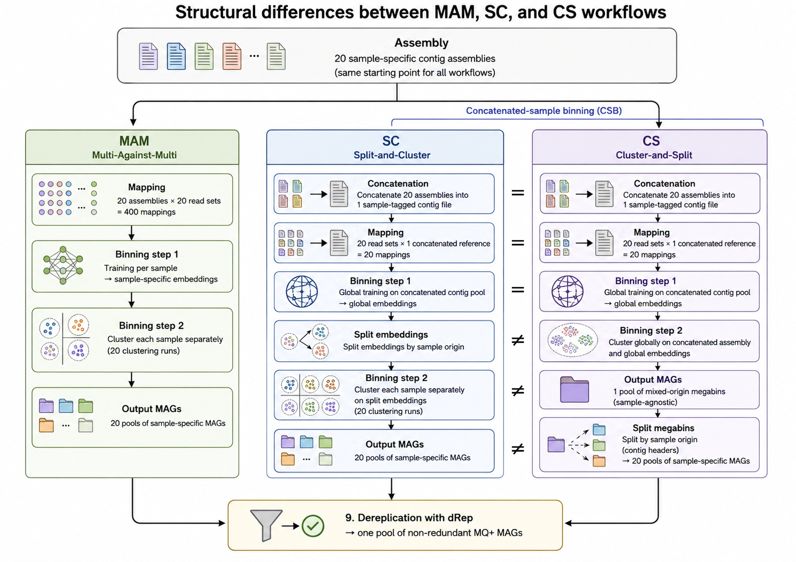

Figure 0A: **Structural differences between the MAM, SC, and CS multi-sample binning workflows**. All workflows start from the same 20 independently assembled sample-specific contig sets, but differ in how contigs and read mappings are organised before binning. In the multi-against-multi workflow (MAM), each sample assembly is kept separate, and reads from all 20 samples are mapped against each of the 20 assemblies, producing 400 mappings. Binning is then performed independently for each sample, so feature learning, embedding generation, and clustering occur within sample-specific contig spaces. In the split-and-cluster workflow (SC), the 20 assemblies are first concatenated into one sample-tagged reference and the 20 read sets are mapped once to this concatenated reference. Feature learning is performed globally on the concatenated contig pool, but the resulting embeddings are split by sample origin before clustering, producing 20 sample-specific MAG pools. In the cluster-and-split workflow (CS), the same concatenated reference and global embeddings are used, but clustering is performed on the full mixed-origin contig pool before bins are split by sample-origin headers. CS therefore produces an intermediate pool of sample-agnostic megabins, whereas MAM and SC maintain sample-specific clustering boundaries. In all workflows, the resulting sample-specific MAGs are pooled and dereplicated with dRep to produce one non-redundant MQ+ MAG set. Note: Image partly generated with ChatGPT Images 2.0.

## 2.5 Evaluation Pipeline

All bin sets produced by the 11 tools across all three workflows were evaluated through an identical post-binning pipeline. This pipeline was applied uniformly to ensure that any observed differences in MAG quality or yield are attributable to binning performance rather than evaluation methodology. See Figure 0B for the evaluation pipeline.

### Quality Assessment: CheckM2

Genome completeness and contamination were estimated using CheckM2 (v1.1.0) against the uniref100.KO.1 database with default parameters. CheckM2 was run on each per-sample bin set prior to dereplication (to supply genome quality estimates to dRep's selection algorithm) and on the per-tool dereplicated MAG set following dRep.

### Dereplication: dRep

Within each tool-workflow combination, MAGs from all 20 samples were pooled and dereplicated using dRep (v3.6.2) (Olm et al., 2017) to remove redundant genome reconstructions of the same species recovered from different depth layers.

### 95% ANI Dereplication (Species-Level)

The primary dereplication round uses a 95% ANI threshold, corresponding to the standard prokaryotic species boundary (Jain et al., 2018). The dRep completeness threshold was set to 50% (below the default of 75%) to ensure that MQ-tier MAGs (Completeness ≥ 50%, Contamination < 10%) were included as dereplication candidates. Within each genome cluster, the representative MAG was selected as the highest-scoring genome according to dRep's composite quality score (Completeness - 5 x Contamination + log(N50) + centrality). Secondary clustering used FastANI (v1.34; --S_algorithm fastANI, --sa 0.95).

The use of FastANI at the 95% threshold is a limitation. FastANI uses fixed 3 kb fragment mapping and was designed for genomes with N50 ≥ 10 kb (Jain et al., 2018). The median N50 across our MAG collection falls well below this threshold. For fragmented MAGs near the species boundary, FastANI may underestimate ANI and retain MAG pairs that should have been dereplicated. This artefact is partially corrected by the post-hoc genome clustering step (Section 2.8), but only for the per-genome analyses. All other analyses (yield, quality, taxonomy) are therefore based on the 95% FastANI-dereplicated pool.

### 99% ANI Dereplication (Strain-Level)

For the strain-resolution analysis (Section 3.8), a second dereplication round was performed at 99% ANI to retain intra-species strain variants. This run used skani v0.3.1 (--S_algorithm skani, --sa 0.99) rather than FastANI. skani uses sparse chaining over variable-length k-mer matches and was validated specifically for incomplete and fragmented metagenomic genomes (Shaw & Yu, 2023), making it substantially more reliable than FastANI for ANI estimation on the fragmented MAGs characteristic of this dataset. The ideal approach would have been to use skani for both the 95% and 99% dereplication thresholds, ensuring methodological consistency and improved accuracy throughout.

### Taxonomic Classification: GTDB-Tk

Taxonomic classification of all dereplicated MAGs was performed with GTDB-Tk (v2.4.0) (Chaumeil et al., 2022) using the classify_wf workflow and GTDB release 220 as the reference database with default parameters. GTDB-Tk first attempts to classify MAGs by screening against GTDB genomes via ANI (ani_screen). MAGs failing the ANI screen are phylogenetically placed on the reference tree using pplacer. The following output fields are used in downstream analyses: the full taxonomic classification string (domain through species; format d\_\_;p\_\_;c\_\_;o\_\_;f\_\_;g\_\_;s\_\_), the RED (Relative Evolutionary Divergence) value, the classification_method field (distinguishing ani_screen from pplacer placements), and the warnings column.

MAGs carrying the warning "Genome not assigned to closest species as it falls outside its pre-defined ANI radius" are retained as valid, as this warning indicates genuine taxonomic novelty rather than classification failure. MAGs carrying destructive warnings ("multiple hits to same target", "incongruent", "questionable", "Insufficient number of amino acids in MSA", "No bacterial or archaeal marker") are excluded from competition and novelty analyses, as these warnings indicate placement uncertainty that would compromise the reliability of taxonomic or quality-based conclusions.

### RNA Gene Detection: Barrnap and Anvi'o

Detecting ribosomal RNA (rRNA) and transfer RNA (tRNA) genes in MAGs is required for classification of genomes into the Near-Complete (NC) quality tier (Section 2.6). The detection approach uses two different tools for the two gene classes, selected based on their respective strengths.

Ribosomal RNA genes (16S, 23S, and 5S) were detected using Barrnap v1.10.6 (Seemann, 2013), which uses Infernal with Rfam covariance models (Nawrocki & Eddy, 2013). Barrnap was run with default parameters across all MAG FASTA files in parallel. Barrnap was chosen over Anvi'o for rRNA detection because empirical testing revealed that certain HMM models for the 23S and 5S subunits within the Anvi'o database version in use failed to produce reliable detections, causing systematic under-counting of these rRNA types. Barrnap's Rfam-based approach does not suffer from this limitation and provides consistent detection of all three rRNA types.

Transfer RNA (tRNA) isotype diversity was estimated using Anvi'o (dev) (Eren et al., 2021) via the anvi-scan-trnas command, which internally runs tRNAScan-SE (v2.0.12) (Lowe & Chan, 2016). tRNAScan-SE uses covariance models for sensitive and accurate tRNA detection and is considered the standard reference method for tRNA identification in published MAG analyses. Anvi'o was chosen over Barrnap for tRNA detection because Barrnap internally uses ARAGORN (Laslett & Canback, 2004), which employs heuristic algorithms and can detect non-canonical tRNA isotypes (including selenocysteine, pyrrolysine, and suppressor tRNAs). These non-canonical isotypes are excluded from the MIMAG Near-Complete tier definition, which specifies ≥ 18 unique tRNA isotypes among the 20 canonical amino acid isotypes. Without filtering, ARAGORN-based tRNA counts can exceed 20 unique isotypes, inflating apparent tRNA diversity beyond the biologically defined maximum and creating non-comparability with tRNAScan-SE-based counts. tRNAScan-SE in Anvi'o strictly counts only canonical isotypes, ensuring consistent and comparable tRNA quantification.

### Chimerism Detection: GUNC

Genome chimerism was assessed using GUNC (v1.1.0) (Orakov et al., 2021) with the proGenomes 2.1 diamond database. GUNC detects taxonomic chimerism through a mechanism complementary to CheckM2. Where CheckM2 relies on single-copy marker gene counts and a gradient-boost model trained on known genome properties, GUNC maps all predicted genes (via Prodigal in -p meta mode) against a reference database using Diamond BLASTP, then measures how those genes distribute across taxonomic clades at each taxonomic level. A genome whose genes scatter across multiple clades on separate contigs receives a high Clade Separation Score (CSS), indicating chimerism. This approach detects a class of contamination that CheckM2 misses entirely: non-redundant contamination from functionally similar organisms, where the contaminant's genes encode many of the same KEGG orthologs and share similar amino acid composition with the primary genome, making the feature vector look like a slightly larger version of a genuine genome rather than a chimeric assembly (Orakov et al., 2021).

The default CSS threshold of > 0.45 was used to classify MAGs as chimeric. A reference representation score (RRS) guardrail of ≥ 0.3 was applied. RRS is computed as the product of the fraction of genes with reference hits and the mean identity of those hits, measuring how well the genome is represented in the reference database. MAGs with RRS < 0.3 lack sufficient reference coverage in proGenomes 2.1 to generate reliable CSS estimates and are therefore treated as unevaluable rather than as passing or failing GUNC. Species-level taxonomic novelty (which approximately 85% of our MAGs exhibit) does not imply low reference representation: a novel species can still have high RRS if its genes match reference homologs at the family or order level.

### Database Selection and Run Parameters

The proGenomes 2.1 database (approximately 4.2 GB) was selected over the larger GTDB r214 database (approximately 37.9 GB). The GUNC authors validated equivalent classification accuracy between the two databases (Orakov et al., 2021), and the CSS = 0.45 threshold was originally calibrated on proGenomes 2.1. Empirical testing confirmed that the GTDB r214 database caused prohibitively long Diamond BLASTP runtimes (12+ hours per tool due to forced double-indexed mode), whereas proGenomes 2.1 completes in 10 - 30 minutes per tool. Two non-default flags were enabled: --detailed_output, which produces per-genome scores at all taxonomic levels (not just maxCSS), and --contig_taxonomy_output, which writes per-contig clade assignments for downstream chimera validation.

### Targeted Application to HQ and NC MAGs

GUNC was applied exclusively to MAGs at or above the HQ tier (Completeness ≥ 90%, Contamination < 5%), covering approximately 20% of the total MAG pool (3,449 MAGs). This targeted application follows the approach of Kim et al., (2026) and is justified on two grounds. First, GUNC's statistical power depends on the number of mapped genes per MAG. MQ-tier MAGs (50 - 89% complete) carry fewer genes overall, reducing the number of reference hits and the reliability of the CSS estimate. Second, the primary scientific concern is the integrity of high-quality MAGs, which are the genomes used for downstream biological interpretation. Identifying chimerism in MQ MAGs, which do not meet the HQ threshold required for most functional or phylogenetic conclusions, provides limited additional value relative to the computational cost.

### Caveats

GUNC is robust to horizontal gene transfer (HGT), with the authors reporting ≤ 10% false-positive chimerism calls among HGT genes because transferred genes typically intermix with the recipient's own genes on the same contigs and keep CSS low (Orakov et al., 2021); the main residual risk is large contiguous HGT islands such as genomic islands or prophages that span entire contigs and can mimic true contamination.

## 2.6 Quality Tier Definitions

MAGs were classified into four primary quality tiers following the Minimum Information about a Metagenome-Assembled Genome (MIMAG) standards (Bowers et al., 2017), with two additional GUNC-verified tiers that account for taxonomic chimerism. The tier definitions used throughout this thesis are given in Table 3.

| Tier | Definition |
|----|----|
| MQ (Medium-Quality) | Completeness ≥ 50%, Contamination < 10% |
| HQ (High-Quality) | Completeness ≥ 90%, Contamination < 5% |
| NC (Near-Complete) | HQ + at least one 16S rRNA gene + at least one 23S rRNA gene + at least one 5S rRNA gene + ≥ 18 unique canonical tRNA isotypes |
| HQ_GUNC | HQ and (pass.GUNC = True or RRS < 0.3) |
| NC_GUNC | NC and (pass.GUNC = True or RRS < 0.3) |

Table 3: Quality tier definitions used throughout this thesis. Thresholds follow MIMAG standards (Bowers et al,. 2017). NC additionally requires structural RNA completeness: at least one each of 16S, 23S, and 5S rRNA genes plus ≥ 18 unique canonical tRNA isotypes (Section 2.5). The GUNC-verified tiers require that a MAG is either not flagged as chimeric (pass.GUNC = True) or lacks sufficient reference coverage for GUNC to render a verdict (reference representation score RRS < 0.3); the RRS condition prevents penalising novel lineages with sparse reference databases.

The GUNC-verified tiers require clarification. A MAG is considered chimeric only when GUNC reports pass.GUNC = False and the RRS ≥ 0.3, indicating that the CSS calculation is supported by adequate reference genome coverage. MAGs with RRS < 0.3 cannot be reliably evaluated by GUNC regardless of their CSS value, because the reference database does not contain enough closely related genomes to generate trustworthy clade separation statistics. Excluding these low-RRS MAGs from the chimera-positive group is essential because deep-sea sediment communities contain a high proportion of novel lineages poorly represented in proGenomes 2.1. Treating unevaluable MAGs as chimeric would incorrectly penalise tools that recover the most taxonomically novel genomes. HQ_GUNC therefore equals the count of HQ MAGs minus those explicitly flagged as chimeric with sufficient statistical confidence. NC_GUNC follows the same logic for the NC tier.

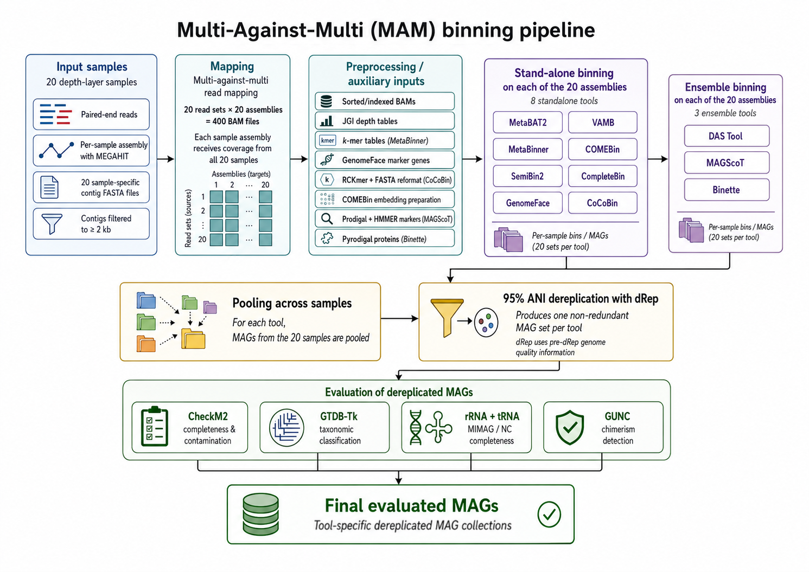

Figure 0B: **Multi-against-multi (MAM) binning pipeline from raw reads to final evaluated MAGs.** The MAM workflow starts from 20 depth-layer samples, each represented by paired-end reads and an independently assembled, ≥2 kb-filtered contig FASTA file. Reads from all 20 samples are mapped against each of the 20 sample-specific assemblies, producing a 20 × 20 mapping matrix and 400 BAM files. This gives each binning run access to cross-sample abundance information while keeping the contigs of each sample assembly in a separate binning space. Tool-specific preprocessing generates the auxiliary inputs required by individual binners, including sorted and indexed BAMs, JGI depth tables, k-mer tables, marker-gene files, reformatted FASTA files, embeddings, HMMER marker profiles, and predicted proteins. Eight standalone binners are then run on each of the 20 assemblies, producing per-sample bin sets that are also used as input to three ensemble binners. For each tool, MAGs from the 20 samples are pooled and dereplicated at 95% ANI with dRep to produce one non-redundant MAG collection per tool. Dereplicated MAGs are then evaluated with CheckM2 for completeness and contamination, GTDB-Tk for taxonomic classification, rRNA and tRNA detection for MIMAG/near-complete tier assignment, and GUNC for chimerism detection. Note: Image partly generated with ChatGPT Images 2.0.

## 2.7 Benchmark Summaries and Workflow Comparisons

The opening benchmark analysis quantifies total MAG yield, quality-tier composition, aggregate quality statistics, and assembly data utilization across all 24 tool-workflow combinations. Yield and quality summaries were computed from the 95% ANI dereplicated master table after applying the MQ+ quality filter (Completeness ≥ 50%, Contamination < 10%), retaining 12,549 of 12,551 MAGs. Unlike the per-genome competition (Section 2.8), this analysis does not apply the destructive GTDB-Tk warning filter, because the yield overview should reflect the full set of MAGs that pass standard MIMAG thresholds.

Because the three workflows include different numbers of tools (11 in MAM, 9 in CS, 4 in SC; Section 2.4), any unrestricted workflow aggregate conflates the workflow effect with tool availability. Therefore, all causal workflow conclusions are drawn from matched-tool strata. Two strata are used throughout: common-9 (the 9 tools shared between MAM and CS, excluding CompleteBin and MetaBinner) for MAM-versus-CS comparisons, and common-4 (COMEBin, GenomeFace, SemiBin2, VAMB) when SC enters the comparison. For aggregate quality statistics such as mean completeness, mean contamination, and mean QS_5x, same-tool cross-workflow comparison is valid because the tool and assemblies are held constant, and the compositional confound that affects cross-tool quality comparisons (Section 2.8) does not apply.

Data utilization, the fraction of total assembly base pairs captured in raw pre-dereplication bins, was computed per tool and workflow following the approach of Kim et al., (2026). Per-sample assembly sizes served as the denominator, and the total base pairs across all raw bins reported in the pre-dereplication CheckM2 quality reports served as the numerator. This metric captures how aggressively each tool assigns contigs to bins, independent of quality filtering and dereplication. Ensemble tools (Binette, DAS Tool, MAGScoT) are excluded from data utilization interpretation because their bins are derived from standalone tool outputs rather than generated de novo from contigs.

## 2.8 Genome Clustering and Per-Genome Competition Framework

To compare binning tools on the same biological substrate, all MAGs representing the same underlying species were grouped into genome clusters before competition. Each genome cluster defines one competition unit: tools that recovered that genome entered one representative MAG, and the highest-quality representative won. This avoids comparing tools only through aggregate yield or mean quality, which are confounded by differences in how many difficult genomes each tool recovers.

### ANI Tool Selection and Filtering

Genome clustering used the complete 95% ANI-dereplicated master table (12,551 MAGs). Competition statistics were calculated after applying the MQ+ reliability filter: CheckM2 completeness > 50%, contamination < 10%, and removal of MAGs carrying destructive GTDB-Tk warnings (Section 2.5). This retained 11,842 MAGs (5.6% removed). ANI was computed with skani rather than FastANI because skani is validated for fragmented MAG comparisons and handles low-N50 assemblies more reliably (Section 2.5). The clustering threshold was 95% ANI, matching the species-level dereplication threshold and preventing strain variants from being counted as separate competition units.

### Clustering Algorithm

The clustering algorithm followed five ordered stages. First, MAGs were grouped by their full GTDB-Tk classification string. MAGs assigned to different taxonomic lineages cannot represent the same species, so this pre-grouping restricted pairwise ANI computation to taxonomically compatible groups and reduced the comparison space from all-vs-all across 12,551 MAGs to within-group comparisons.

Second, every classification group containing at least two MAGs was processed with skani triangle -E, which outputs sparse pairwise ANI estimates. Third, the skani output was converted into a symmetric distance matrix using distance = 1 - ANI/100. Pairs too divergent for skani to report, approximately below 82% ANI, were assigned distance 1.0. When skani produced asymmetric values for a pair because of differences in genome completeness or aligned fraction, the minimum distance, equivalent to the maximum ANI, was retained. This conservative rule favours merging over over-splitting, which is preferable here because over-splitting the same species would inflate singleton counts and prevent valid head-to-head comparisons.

Fourth, complete-linkage hierarchical clustering was applied at distance 0.05, corresponding to 95% ANI. Complete linkage requires every pair of MAGs within a cluster to share ANI ≥ 95%, preventing chain-merging artefacts where A-B and B-C are similar but A-C are not. Finally, classification groups containing a single MAG were assigned unique genome identifiers without ANI computation.

### Same-Tool Duplicates Within Clusters

Same-tool duplicates were possible because each tool was run independently across the 20 depth-layer samples. dRep used FastANI at 95% ANI for primary dereplication, while the post-hoc genome clustering used skani. Of the 834 MAM genome clusters, 96 (11.5%) contained more than one MAG from the same tool: 86 clusters contained exactly two same-tool MAGs, eight contained three, one contained four, and one contained five. These cases represent boundary genomes where FastANI and skani disagree around the 95% ANI species cutoff.

Two properties explain this discordance. FastANI uses fixed 3 kb fragment mapping via MashMap, while skani uses sparse chaining over variable-length k-mer matches. For fragmented MAG pairs near 94.5 to 95.5% ANI, the two algorithms can place the pair on opposite sides of the threshold. These boundary MAGs also had lower completeness than non-boundary MAGs (median 62.6% versus 82.3%), so partial genomes from different depth layers may overlap on different genome segments, making ANI estimation less stable. Post-hoc skani clustering can correct only FastANI false negatives, where dRep retained both MAGs and skani later merged them. It cannot recover FastANI false positives, where dRep already discarded one representative. Same-tool duplicates do not affect the competition because only the highest-QS representative per tool and genome cluster is retained.

### Per-Genome Competition Framework

The genome cluster IDs produced by the clustering step were used as competition arenas within each workflow and as shared identifiers for cross-workflow comparisons. The cluster counts and competition landscape are reported with the Results (Section 3.2).

### Quality Score as the Competition Metric

The primary competition metric was QS_5x = Completeness - 5 x Contamination. A secondary competition used QS_2x = Completeness - 2 x Contamination, matching Binette's native contamination penalty, to test whether rankings depended on the penalty weight.

### Per-Tool Best Representative Selection

For each (tool, workflow, genome cluster) combination, the MAG with the highest QS_5x was selected as that tool's representative. This step reduced 11,842 filtered MAGs to 11,351 representatives (4.1% reduction) and ensured that each tool entered each genome competition once.

### Head-to-Head Competition

Within each workflow and genome cluster, all tool representatives were ranked by QS_5x. Clusters represented by one tool were counted as uncontested wins. Contested wins were assigned to the highest-QS representative, with ties broken by highest completeness, lowest contamination, highest total rRNA count, highest number of unique tRNA isotypes, and then fractional splitting if all criteria remained tied. The margin of victory was the QS difference between the winner and runner-up, and each losing tool's margin of loss was the QS difference to the winner.

### Completeness and Contamination Sub-Competitions

Completeness and contamination sub-competitions were run on the same genome clusters to separate the two quality dimensions. The completeness competition awarded each genome to the highest-completeness representative, and the contamination competition awarded it to the lowest-contamination representative. Both used the same tie-breaking hierarchy, substituting the relevant primary metric before QS, rRNA count, tRNA isotypes, and fractional splitting.

### Pairwise Win Matrix

For each unordered pair of tools sharing at least one genome cluster, representatives were compared directly by QS_5x within the shared clusters. The fraction of shared clusters won by each tool was written to an asymmetric pairwise matrix, with ties retained in the denominator. This matrix tests whether competitive advantages follow a consistent hierarchy or contain tool-pair-specific inversions, where Tool A beats Tool B, Tool B beats Tool C, but Tool C beats Tool A. Such inversions indicate complementary tool strengths and support the rationale for ensemble binning.

### Singleton Characterisation

Singleton genome clusters, defined as genomes recovered by exactly one tool at MQ quality or higher, were compared against multi-tool clusters using two-sided Mann-Whitney U tests. The tested properties were completeness, contamination, QS_5x, contig N50, total contigs, genome size, GC content, and coding density.

### Serendipity and Exclusive Genome Analysis

Serendipity, adapted from recommendation systems and previously applied to binning benchmarks by Xue et al., (2025), quantified the fraction of one tool's genome set that another tool failed to recover. For each ordered pair (A, B):

``` math
Serendipity(A,B) = \frac{|\Omega_{A}\backslash\Omega_{B}|}{\left| \Omega_{A} \right|}
```

where Omega_A is the set of genome clusters in which Tool A had at least one MQ+ representative. Exclusive genome counts were the subset of clusters recovered by exactly one tool and missed by all others.

### Cross-Workflow Genome Recovery

Because genome clusters were computed across all workflows, the same genome IDs were used for workflow comparisons without re-clustering. Workflow-level exclusive counts and serendipity were computed within the matched strata from Section 2.7: common-9 for MAM versus CS and common-4 when SC was included. For per-genome cross-workflow competition, each (tool, genome_id) pair with MQ+ representatives in at least two workflows was compared using the same QS_5x hierarchy. Exact ties across all criteria were recorded separately and excluded from win-rate denominators. Three workflow pairs were evaluated: MAM versus CS in common-9 (3,514 total competitions, 18 ties, 3,496 decided), MAM versus SC in common-4 (1,826 total, 19 ties, 1,807 decided), and CS versus SC in common-4 (1,492 total, 92 ties, 1,400 decided). Completeness and contamination sub-competitions were computed for each pair, and per-tool win rates were pooled within strata with 95% bootstrap confidence intervals from 2,000 resamples using fixed seed 42.

## 2.9 Coverage Dilution in Concatenated-Sample Binning

To test whether read-competition in the concatenated CSB reference is the primary driver of CS's lower per-genome quality relative to MAM, two measurements were made, both restricted to the four common-4 tools (COMEBin, GenomeFace, SemiBin2, VAMB) and using the same MQ+ quality filter and GTDB-Tk warning exclusion as Section 2.8.

### Direct Coverage Measurement

Per-sample JGI depth files produced by jgi_summarize_bam_contig_depths (MetaBat2 package) contain one depth value per contig per input BAM file, representing the mean coverage depth from that BAM's reads over that contig. For each of the 20 depth-layer samples, a same-sample depth ratio was computed for every contig using: (1) the coverage of that sample's reads on the contig when mapped to the per-sample MAM assembly, where the contig has no competing copies from other samples, and (2) the coverage of the same sample's reads on the same contig when mapped to the concatenated assembly, where near-identical copies from all other samples compete for those reads. The ratio (2)/(1) quantifies the fraction of own-sample coverage retained after concatenation. Contigs from genomes unique to a single sample have no competitors and are expected to yield a ratio of exactly 1.0; contigs from genomes shared across N samples are expected to yield lower ratios, decreasing with N. In the concatenated CSB depth file, contig names carry a (Quince et al.): prefix that was used to identify and match each contig to its per-sample MAM counterpart. This was computed across all 1,517,440 contigs in the 20 assemblies.

### Completeness vs Sample Presence

To test whether the completeness gap between MAM and CS grows with the degree of expected coverage competition, per-genome completeness under both workflows was plotted against N_samples (the number of distinct depth-layer samples in which a genome was detected before dereplication). N_samples was estimated using the Cdb.csv files written by dRep for each of the 11 MAM tools' 95% ANI dereplication runs. Each Cdb.csv records the secondary cluster assignment for every pre-dereplication MAG; secondary clusters with a known genome cluster assignment (from the cross-workflow genome cluster table described in Section 2.8) were used to propagate genome identities to all pre-dereplication MAGs within that cluster. The originating depth-layer sample was read directly from each MAG name, which encodes the sample identifier by construction, and unique sample names were pooled across all 11 MAM tools per genome cluster to give the most complete estimate of sample presence. N_sample ranged from 1 to 19 (mean 2.4, median 1.0) across 834 genome clusters.

Spearman rank correlations between N_samples and completeness were computed separately for MAM and CS under each common-4 tool, using the best-QS_5x representative per (tool, workflow, genome_id) from Section 2.8. Both workflows were plotted on the same axes to show their simultaneous trends. Coverage dilution predicts that CS completeness declines (or at least fails to rise) relative to MAM as N_samples increases, because genomes present in more samples have more competing copies in the concatenated reference, progressively diluting their per-contig coverage signal. If both workflows showed the same trend, an alternative explanation, that ubiquitous genomes are intrinsically harder/easier to bin regardless of workflow, would be equally plausible, and the CS signal could not be attributed to coverage dilution alone.

## 2.10 CheckM2 Trustworthiness Calibration

Most analyses of the real deep-sea dataset rely on CheckM2-derived completeness and contamination estimates because the true genome composition of environmental MAGs is unknown. If CheckM2 overestimates or underestimates quality in a tool-specific manner, then yield counts, quality scores, and per-genome competition results may be biased. To evaluate this dependency, CheckM2 predictions were calibrated against AMBER ground truth using the CAMISIM strain simulation described in Section 2.2.

AMBER computes true completeness and purity from the known contig-to-genome assignments produced by CAMISIM. Contamination was defined as 100 minus purity so that AMBER and CheckM2 could be compared on the same completeness-contamination scale. The same MQ and HQ thresholds used in the real benchmark (Section 2.6) were applied to both AMBER and CheckM2 values. For each (tool, workflow, sample, genome) combination, only the best bin was retained under the QS_5x AMBER quality score, matching the selection logic of the real-data benchmark. The MAM workflow and the background genome pool (50 genomes at uniform 10x coverage) served as the primary calibration setting; all-genome and cross-workflow analyses were used as robustness checks.

Continuous prediction bias was computed as the signed difference between CheckM2 and AMBER for completeness, contamination, and quality score. These continuous metrics quantify the direction and magnitude of CheckM2 error per tool, but they do not by themselves show whether the error changes quality-tier assignments. Tier misclassification was therefore summarized using false discovery and false negative metrics. HQ-FDR was defined as the fraction of CheckM2-predicted HQ bins that were MQ or LQ by AMBER. MQ-FDR was defined as the fraction of CheckM2-predicted MQ bins that were LQ by AMBER. The All-FDR (all-tier false discovery rate) summarized overall tier inflation as the fraction of CheckM2-passing bins assigned a higher quality tier than their true AMBER tier, counting every upward error (HQ-to-MQ, HQ-to-LQ, and MQ-to-LQ). False negative rates were computed in the opposite direction: HQ-FNR was the fraction of AMBER-HQ bins classified as MQ or LQ by CheckM2, and combined FNR was the fraction of AMBER MQ/HQ bins classified as LQ. FDR and FNR represent different risks: a tool with high FDR may appear better than it truly is in the real benchmark, while a tool with high FNR may be penalised by CheckM2-based filtering despite producing biologically valid bins.

Several safeguards were applied when interpreting the calibration. FDR was accompanied by false positive rates (FPR) and ground-truth tier distributions, because FDR depends on how many bins each tool produces near tier boundaries. False discoveries were stratified by severity to distinguish mild borderline promotions from severe cases where a CheckM2-passing bin was truly LQ. Results were stratified by CheckM2-estimated completeness buckets (50-60%, 60-70%, 70-80%, 80-90%, 90-100%) to assess transferability across the domain gap. The simulated dataset has higher median completeness (~94%) than the real dataset (~80%) due to its use of clean reference fragments rather than de novo assembled contigs (Section 2.2). Findings from the 90-100% bucket are therefore most transferable, while the 50-70% range is underrepresented in the simulated data. Absolute FDR values are therefore treated as optimistic lower bounds for the real dataset; relative tool rankings and directional findings are the primary actionable output.

## 2.11 Genome Observational Limits and MAG Assembly Properties

This analysis examines whether binning tools differ in their ability to recover genomes at the extremes of biological complexity, specifically large genomes, highly fragmented MAGs, and MAGs with many contigs. Because raw MAG size is jointly confounded by completeness (incomplete recovery yields a smaller MAG) and contamination (spurious sequence inflates it), direct comparison of MAG sizes across tools is misleading. For example, the same underlying genome recovered by different tools can yield estimated sizes ranging from 3.4 MB to 10.9 MB, depending on the quality assessment of the individual MAGs. To enable fair comparison, the estimated true genome size was computed using the formula:

``` math
Estimated\ True\ Size = MAG\ Size*\frac{1 - Contamination/100}{Completeness/100}*1.024
```

The multiplicative correction factor of 1.024 compensates for CheckM2's systematic overestimation of completeness by a mean of +3.21 percentage points (std = 6.39 pp), which causes the uncorrected formula to underestimate true genome size by a median of -2.69%. This correction was derived by validating the formula against AMBER ground-truth genome sizes in the simulated strain dataset (Section 2.2): with CheckM2 predictions, the global scalar of 1.024 reduced the MAPE from 5.81% to 5.26% and shifted all estimates uniformly upward by 2.4% without altering relative tool rankings. The scalar was adopted over per-completeness-bucket corrections and a Gradient Boosting model, both of which were rejected due to overfitting risk given the structural differences between simulated and real data (Supplementary Methods S2). Analysis of extreme estimation errors revealed an asymmetric structure: overestimates exceeding 20% are driven by CheckM2 underestimation of contamination (mean true contamination 26.9% vs. predicted 5.2%), while underestimates below -20% are driven by completeness overestimation (Supplementary Methods S2).

To obtain reliable per-species genome size estimates, the individual per-MAG estimates were aggregated within the skani-based genome clusters from Section 2.8. For each genome cluster, the consensus true genome size was computed as the median of all per-MAG estimates across tools. Using the median rather than the mean dampens the effect of CheckM2 outliers from any single tool. Genome clusters containing a single MAG (singletons) receive their individual estimate as the consensus; these are inherently less reliable due to the absence of cross-tool averaging. Tool-level differences in genome size distributions, contig N50, and total contigs per MAG were then compared across the 920 genome clusters to identify recovery biases.

## 2.12 Taxonomic Composition and Novelty

This analysis quantifies how much taxonomic novelty each tool and workflow recovers from the Atacama Trench metagenomes, and whether the taxonomic depth of that novelty differs across tools or mainly reflects the underlying microbial community. This is important because several evaluated tools use reference-derived or taxonomy-informed information, while the dataset is deliberately novelty-rich, with 88.5% of recovered genome clusters lacking a species-level GTDB match.

Novelty was defined by parsing the 7-rank GTDB-Tk classification string (Section 2.5) to identify the highest taxonomically unassigned rank. A MAG classified to a known order but lacking family, genus, and species assignments (e.g., o\_\_Dehalococcoidales;f\_\_;g\_\_;s\_\_) was categorized as a Novel Family. MAGs with a complete classification string matching an existing GTDB r220 reference species were categorized as Not Novel. This parsing approach captures all forms of novelty, including novel species and genera whose parent clades were defined entirely by tree topology, which would be missed by restricting to MAGs flagged with "taxonomic novelty determined using RED" in the classification_method field. To protect against chimeric MAGs that generate artificially deep phylogenetic placements, the analysis applied the MQ quality filter and the destructive GTDB-Tk warning filter (Section 2.5), retaining only MAGs with valid RED values. All results were faceted by domain (Bacteria and Archaea) because RED rank medians differ between the two domains.

The categorical novelty ranks were cross-validated against the continuous RED values reported by GTDB-Tk. If the parsed novelty assignments are correct, each rank should occupy a predictable RED interval: novel species should cluster above the genus RED median, novel genera should fall between the family and genus medians, and novel families should bridge the order-to-family interval. The domain-specific GTDB r220 rank medians used as reference anchors (Parks et al., 2018) were: for Bacteria, Phylum (0.328), Class (0.450), Order (0.608), Family (0.758), Genus (0.922); for Archaea, Phylum (0.213), Class (0.359), Order (0.532), Family (0.725), Genus (0.907). This dual evaluation of discrete parsed ranks against continuous RED distributions verified whether the recovered novelty represents genuine phylogenetic depth rather than shallow misclassification or chimeric artifact.

Compositional invariance was tested by computing the relative proportion of each novelty rank (novel species, genus, family, order, class, phylum) within each tool's total novel MAG pool, separately per workflow and domain. If the proportional distribution of novelty ranks is stable across tools despite large differences in absolute yield, this indicates that the taxonomic structure of the recoverable novelty is determined by the microbial community rather than by algorithmic properties of individual binning tools.

## 2.13 Real-Data Strain Resolution

The preceding analyses use the 95% ANI dereplicated MAG set (Section 2.5), which collapses within-species variants into one representative per tool. Strain-level recovery was quantified by comparing the 95% and 99% ANI dRep outputs. The MQ+ species-level count (N_95) came from the 95% run, and the MQ+ strain-level count (N_99) came from the 99% run. Strain gain was defined as delta_N = N_99 - N_95, representing the additional within-species variants retained when the dereplication threshold was raised. The strain resolution index was defined as SRI = delta_N / N_95, normalizing strain gain by species-level yield.

Interpretation of delta_N required distinguishing cross-sample strain recovery from within-sample strain separation. Same-sample MAG pairs were therefore screened for ANI ≥ 95% both among the final dereplicated representatives and in the full pre-representative dRep Ndb, using all MQ+ MAGs supplied to dRep. Sample origin was parsed from the identifier encoded in each MAG name. This validation tested whether the observed pattern could be caused by representative selection, with the empirical outcome reported in Section 3.8.

Cross-workflow comparisons used the matched-tool strata from Section 2.7 with Wilcoxon signed-rank tests on delta_N. Within MAM, all 11 tools were ranked by delta_N and SRI. Yield dependence was assessed across all 24 tool-workflow combinations by regressing delta_N on N_95 using OLS regression and Spearman correlation.

New strain MAGs, defined as MQ+ representatives retained at 99% ANI but collapsed at 95% ANI, were compared with existing 95% representatives using CheckM2 completeness and contamination. An HQ sensitivity analysis repeated the N_95, N_99, delta_N, and SRI calculations after restricting the input to HQ MAGs. For CS tools, bin numbers distinguished genuine binner separation from merge-and-split. Same bin numbers indicated one pre-split bin separated only by post-hoc sample-origin splitting, whereas different bin numbers indicated separate binner-assigned clusters.

## 2.14 Simulated Strain Stress Test

The simulated strain stress test used the CAMISIM dataset described in Section 2.2 to measure genuine within-sample strain separation under known ANI and abundance conditions across four mapping modes: SSM, MAM, CS, and SC. AMBER ground-truth completeness and purity were computed for each target strain from the CAMISIM contig-to-genome mapping and used to classify recovery outcomes.

Each target strain was assigned to one of six outcome classes from its AMBER completeness-purity topology: success (completeness ≥ 50%, purity ≥ 90%), conservative fragmentation (completeness < 50%, purity ≥ 90%), mildly contaminated recovery (intermediate between the success and chimera thresholds), complete chimera (completeness ≥ 50%, purity ≤ 75%), incomplete chimera (completeness < 50%, purity ≤ 75%), or unbinned (zero completeness). These thresholds separate successful MQ-or-better recovery, pure but incomplete recovery, and contamination-dominated strain merging without embedding the result-specific failure archetypes in the Methods.

Chimera severity was quantified with a size ratio, defined as total bin length divided by the known ground-truth genome length. A ratio near 1.0 indicates correct genome sizing, while a ratio approaching 2.0 indicates near-complete merger of both strains into one bin. This continuous metric supplements the categorical classes because bins with the same chimera label may incorporate different amounts of foreign sequence.

## 2.15 Computational Efficiency

This analysis quantifies the computational cost of every standalone binning tool and workflow (MAM, CS, SC) evaluated in this thesis, addressing five questions: (1) What is the end-to-end wall-clock runtime and peak physical-memory footprint for each tool in each workflow? (2) How does runtime and peak memory scale with assembly size across the 20 MAM samples, whose filtered assemblies span approximately 25 to 528 MB? (3) How do CS and SC compare to MAM in computational cost relative to their MAG yield? (4) Do tools effectively utilise the CPU cores they are allocated? (5) How large is the preprocessing surcharge (Section 2.3) relative to the binning step itself?

### Computing Environment

All jobs were submitted through Snakemake v9.13.3 using its SLURM executor plugin (v8+) on UCloud, the Danish federated research cloud operated by the SDU eScience Center. Two machine families were used. CPU-bound rules ran on u1-standard-h nodes (Dell PowerEdge C6420, 2x Intel Xeon Gold 6130 at 2.10 GHz, 64 vCPU total, 384 GB DDR4-2400). GPU-accelerated rules ran on u1-gpu nodes (HPE ProLiant XL675d Gen10+, 2x AMD EPYC 7F72 at 3.20 GHz, 96 vCPU total, 2048 GB DDR4-2933, 8x NVIDIA A100-PCIe 40 GB). All tools were installed from pre-built Conda environments referenced in the workflow configuration; no tool was recompiled between runs. The operating system was Ubuntu 22.04 inside each container.

### Benchmarking Resource Caps and Thread Allocation

Rule-specific thread counts and resource limits were enforced through the Snakemake profile's set-threads and set-resources blocks. CPU binning rules received 32 threads with RAM caps ranging from 64 GB to 750 GB depending on the rule. GPU binning rules received 12 threads, 1 GPU, and 240 GB RAM. Default scalar rules received 1 thread and 6 GB RAM. RAM caps were deliberately over-provisioned so that the benchmark could record actual peak demand without the operating system killing the process prematurely.

### Math-Library Thread Limiting

Within the shell block of each rule, the following environment variables were exported: OMP_NUM_THREADS=1, OPENBLAS_NUM_THREADS=1, MKL_NUM_THREADS=1, NUMEXPR_MAX_THREADS=1, and BLIS_NUM_THREADS=1. Without this cap, NumPy, SciPy, and PyTorch routines inside Python-wrapped tools (VAMB, SemiBin2, CoCoBin, Binette, CompleteBin) each silently spawn a number of worker threads equal to the total available cores per tool-level worker process. When the tool also uses multiprocessing, the SLURM-allocated cores (e.g. 32) are oversubscribed many-fold, as 32 worker processes each spawning 32 BLAS threads yield 1,024 threads on a 64-vCPU host. This oversubscription causes cache thrashing, context-switch storms, and memory spikes, making runtime measurements unstable and less reproducible. Because two rules often ran concurrently on the same CPU host (32 + 32 = 64 threads by design), a rule without BLAS limits would steal cores from its sibling, confounding the benchmark. Capping math libraries to one thread and letting each tool manage parallelism via its own internal thread pool produces more deterministic benchmarks and ensures that concurrent rules do not starve each other.

This cap may modestly penalise tools that rely on vectorised BLAS for internal computations. However, this is an unavoidable trade-off of fair multi-tool benchmarking: permitting uncapped BLAS would improve certain tools while destabilising measurements for all tools on the same node.

### Benchmark Metrics and Memory Choice

All rules of interest included the benchmark: directive, and the workflow was executed with benchmark-extended: true. For every completed job, Snakemake wrote a TSV file containing wall-clock runtime in seconds, peak memory (RSS, VMS, USS, PSS) in megabytes sampled at approximately 0.5-second intervals, cumulative disk I/O in megabytes, average CPU load as a percentage, cumulative CPU time in seconds, and other less relevant metrics.

Peak memory is reported as max_pss (Proportional Set Size) throughout this analysis rather than the more commonly reported max_rss (Resident Set Size). The distinction is important for tools that spawn child processes sharing memory-mapped regions. max_rss counts shared memory pages once per child process, producing inflated values for tools such as CompleteBin, GenomeFace, SemiBin2, COMEBin, and Binette, all of which fork multiple workers that share model weights or reference matrices. In the MAM workflow, CompleteBin's max_rss exceeded 1 TB while its max_pss was approximately 178 GB, a divergence of nearly 10x attributable to shared-page double-counting (Supplementary Figure S1). max_pss divides every shared page evenly across the processes that map it and sums the unique pages on top, reconstructing the true physical-memory footprint. This makes PSS the appropriate metric for capacity planning.

In the MAM workflow, each binning rule fires 20 times, once per sample assembly. The reported runtime per tool is the sum of the 20 individual runtimes (total wall-clock time consumed across all samples), while the reported peak memory is the mean of the 20 per-sample peak PSS values. Summation for runtime captures the total computational investment; averaging for memory reflects the typical footprint a practitioner should provision for, since MAM samples are processed independently. For the CS workflow, a single observation per tool is available (one run on the concatenated assembly), so the runtime and peak memory are reported directly. For the SC workflow, the reported runtime is the sum of the shared training step with the CS workflow plus all per-sample clustering steps, and the peak memory is the maximum PSS across those steps.

### Preprocessing Surcharge Attribution

Each tool was evaluated in two configurations: binning-only (runtime and memory from the binner rules alone) and total (binning plus tool-specific preprocessing). The preprocessing requirements for each tool are described in Section 2.3. Shared preprocessing rules (principally JGI abundance computation, consumed by MetaBAT2, CoCoBin, GenomeFace, and MetaBinner) were attributed to each consuming tool by duplicating the benchmark rows. This ensures that each tool's total runtime honestly reflects the preprocessing it requires. Bin-extraction helper rules (for MAGScoT, CoCoBin, and MetaBinner) were similarly attributed because they are mandatory parts of those tools' pipelines, as these tools write a non-standard output format that must be converted to FASTA bins. Runtime is additive across preprocessing and binning because preprocessing must complete before binning can start. Peak memory is the maximum across constituent rules because they do not run concurrently.

### Scaling Analysis

For each tool in the MAM workflow, 20 observations of runtime and peak PSS were available. The predictor variable was the filtered-assembly FASTA file size in megabytes, containing only contigs ≥ 2,000 bp. The filtered assemblies ranged from 24.7 MB to 528.0 MB across the 20 samples, with a median of 338.7 MB and a total (CSB concatenation) of 6,208.9 MB.

A power-law model $`\log 10(y) = \log 10(a) + b*\log 10(x)`$ was fitted separately for runtime and peak PSS, where the slope b is the scaling exponent: b ~ 1 indicates linear scaling, b > 1 super-linear (disproportionate growth with input size), and b < 1 sub-linear (favourable amortisation of fixed overhead). A linear model was fitted alongside for R<sup>2</sup> comparison. Confidence intervals on the power-law slope were obtained by bootstrapping (2,000 resamples with replacement, fixed random seed 42), with the 2.5th and 97.5th percentiles reported as the 95% CI. The qualitative descriptor assigned to each slope followed: b < 0.8 = sub-linear, 0.8 ≤ b < 1.2 = approximately linear, 1.2 ≤ b < 1.8 = moderately super-linear, and b ≥ 1.8 = strongly super-linear.

The CSB assembly (~6.2 GB) provides a single out-of-range observation per tool, plotted as a reference star in the scaling figure. Both MAM and CS runs receive 20 BAM files and differ primarily in FASTA size, so the CS observation is in principle comparable and could be included in the regression. However, since it is a single unreplicated observation at 12x the largest MAM assembly, it is plotted as a visual reference rather than included in the fitted model.

### Derived Efficiency Metrics

Beyond raw runtime and peak memory, several derived metrics were computed for every tool-workflow pair. Parallel efficiency was defined as (mean_load / 100) / threads \* 100, representing the fraction of allocated CPU cores actively utilised, computed only for binner rules (not preprocessing) to isolate the tool's own parallelism behaviour. GB-hours, defined as peak_pss_gb \* runtime_hours, served as a proxy for resource cost, capturing both the memory footprint and the duration over which it is sustained. Three cost-per-bin metrics (seconds per bin, bins per hour, bins per GB-hour) were computed for each quality tier (≥MQ, ≥HQ, NC) using the 95% ANI dereplicated bin counts. Bin counts used cumulative thresholds: the ≥MQ count includes all bins at MQ quality or higher (MQ + HQ + NC), the ≥HQ count includes HQ and NC bins, and the NC count includes only near-complete bins.

## 2.16 Integrated Summary Score and Ranking

To synthesize all the preceding analyses into a single tool ranking, a weighted composite score was computed from a curated set of non-redundant performance metrics, visualized as a ranked bubble-heatmap inspired by Kim et al., (2026).

### Metric Selection

Sixteen metrics were selected for the heatmap, organized into six categories (Table 4). Each metric was included only if it provides information not already captured by another included metric. The choice between count-based and rate-based forms followed a consistent principle: counts were used when absolute magnitude matters biologically (e.g., total novel MAGs, exclusive genomes, strain gain), while rates were used when the metric characterizes a tool-intrinsic property that should be independent of yield (e.g., GUNC pass rate, All-FDR). The inclusion rationale and non-redundancy justification for each of the 16 metrics is detailed in Supplementary Table S3.

Total_Wins and the two efficiency metrics (Runtime_Hours, Peak_Memory_GB) are displayed in the heatmap as informational columns but excluded from the composite score. Total_Wins was excluded for two reasons: Binette dominates the per-genome competition (~73% win rate), compressing the range so severely that the metric barely discriminates among the remaining 10 tools; and the quality dimension it captures is better represented by Mean_QS_5x and GUNC_Pass_Rate, which measure quality robustly across all tools without the same compression problem. Efficiency was excluded because runtime and memory are deployment-relevant constraints, not indicators of biological output quality.

| Category | Weight | Metrics | Justification |
|----|----|----|----|
| Yield | 0.40 | MQ_Count, HQ_Count, NC_Count | Core purpose of binning: how many genomes are recovered at each quality tier |
| Quality | 0.30 | Mean_Comp, Mean_Cont, GUNC_Pass_Rate, Total_Wins, All-FDR, QS_Error_mean | Core quality axes, chimerism detection, CheckM2 reliability, per-genome competition |
| Taxonomic Reach | 0.20 | Exclusive_Genomes, Total_Novel_MAGs, delta_N_MQ | Biological value: unique genome recovery, novel lineage discovery, strain resolution |
| Assembly Quality | 0.10 | Median_Contig_N50_KB, Data_Utilization | Assembly contiguity and fraction of assembly captured in bins |
| Efficiency | -- | Runtime_Hours, Peak_Memory_GB | Deployment-relevant constraints; informational only, not in score |

Table 4: Heatmap categories, their scoring weights, constituent metrics, and justification for the assigned weight. Efficiency metrics are displayed in the heatmap but excluded from the composite score.

### Scoring System

The composite score was computed from 12 metrics across four scoring categories, with category weights reflecting scientific importance (Table 4). Mean_Completeness and Mean_Contamination are shown as separate heatmap columns for visual interpretability, but in the score they are combined into Mean_QS_5x (Completeness minus 5 times Contamination), which naturally weights contamination five times more heavily than incompleteness without requiring ad hoc asymmetric sub-weights. Both All-FDR and absolute QS_Error_mean were included because they capture complementary aspects of CheckM2 reliability: All-FDR measures the frequency of tier inflation, while QS_Error_mean measures the magnitude of quality score bias. These two metrics are only weakly correlated across tools.

| Category (weight) | Metric | Sub-weight | Normalization |
|:---|:---|:---|:---|
| Yield (0.40) | NC_Count | 0.40 | Min-max |
|  | HQ_Count | 0.35 | Min-max |
|  | MQ_Count | 0.25 | Min-max |
| Quality (0.30) | Mean_QS_5x | 0.40 | value / 100 |
|  | GUNC_Pass_Rate | 0.20 | Direct (bounded 0-1) |
|  | All-FDR | 0.20 | 1 - value |
|  | |QS_Error_mean| | 0.20 | Min-max, inverted |
| Taxonomic Reach (0.20) | Exclusive_Genomes | 0.33 | Min-max |
|  | Total_Novel_MAGs | 0.33 | Min-max |
|  | delta_N_MQ | 0.33 | Min-max |
| Assembly Quality (0.10) | Median_Contig_N50_KB | 0.50 | Min-max |
|  | Data_Utilization | 0.50 | min(value, 1.0) |

Table 5:  The 12 scoring metrics with their category weights, intra-category sub-weights, and normalization method. Yield sub-weights are tiered by quality stringency (NC most stringent, MQ least). All metrics are oriented so that higher normalized values indicate better performance.

### Normalization

Normalization followed the approach of Kim et al., (2026). Count-based metrics with no natural upper bound (NC_Count, HQ_Count, MQ_Count, Exclusive_Genomes, Total_Novel_MAGs, delta_N_MQ, Median_Contig_N50_KB) were min-max scaled across tools (Table 5):

``` math
norm(m,t) = \frac{value(m,t) - min(m)}{\max(m) - min(m)}
```

Rate and proportion metrics with natural bounds were normalized as specified in Table 5: Mean_QS_5x was divided by 100 (its theoretical maximum for MQ+ MAGs); GUNC_Pass_Rate was used directly (already bounded 0 to 1); All-FDR was inverted (1 minus value); absolute QS_Error_mean was min-max scaled across tools and inverted; Data_Utilization was capped at 1.0 and used directly. All metrics were oriented so that higher normalized values indicate better performance.

### Sensitivity Analysis

To verify that the ranking is robust to the weighting scheme, scores were recomputed under three alternative schemes: equal-weight across all categories (0.25 each), quality-heavy (Yield 0.20, Quality 0.40, Taxonomy 0.20, Assembly 0.20), and yield-heavy (Yield 0.40, Quality 0.25, Taxonomy 0.20, Assembly 0.15). Spearman rank correlations between the primary and alternative rankings were computed; correlations at or above 0.90 indicate a robust ranking.

## 2.17 Ensemble Tool Analysis

### Experimental Design

This analysis evaluates how the three ensemble tools (DAS Tool, MAGScoT, Binette; Section 2.3) behave under ground-truth conditions as input complexity increases, testing whether accumulating more standalone tool inputs monotonically improves ensemble output. All experiments used Sample 1 of the CAMISIM strain simulation dataset (Section 2.2), enabling AMBER ground-truth evaluation of every bin. The input pool consisted of bin sets from the eight standalone tools run in SSM mode on the simulated assemblies. The eight tools were added cumulatively in three strategy-defined orders. The Quality strategy ordered tools by descending AMBER HQ yield. The Speed strategy ordered tools by ascending runtime. The Efficiency strategy ordered tools by ascending Euclidean distance to a Utopia point in normalized runtime-yield space:​​

``` math
d = \sqrt{\left( 1 - Y_{norm} \right)^{2} + T_{norm}^{2}}
```

where Ynorm*Y*norm​ and Tnorm*T*norm​ are min-max normalized HQ yield and runtime, respectively. Each strategy was executed cumulatively from Step 1 (one tool) through Step 8 (all tools), producing 3 ensemble tools x 3 strategies x 8 steps = 72 experimental scenarios. CheckM2 was run on all input and output bins to compare proxy quality estimates against ground truth.

### Yield Metrics

For each scenario, yield was assessed at the HQ quality tier using three primary metrics. Union Yield is the theoretical maximum: the count of unique genomes represented by at least one HQ bin in the accumulated input pool. Baseline Yield is the HQ count of the single best-performing standalone tool in the current input set. Realized Yield is the actual HQ output of the ensemble tool. From these, two derived metrics were computed: the Confusion Gap (Union minus Realized), quantifying the number of HQ bins available in the input but lost or downgraded by the ensemble process, and the Synergy Score (Realized minus Baseline), measuring whether the ensemble exceeded the best individual contributor.

### Genome-Level Fate Classification

To diagnose how individual genomes were affected, input bins were matched to ensemble output bins by computing pairwise Jaccard Indices over their contig sets; an input bin was considered preserved if its best-matching output bin exceeded a Jaccard threshold of 0.5, and deleted otherwise. For each genome, the best input candidate was identified using tier-first selection (HQ > MQ > LQ, then highest AMBER quality score within the best tier), and the quality delta between this best input and the corresponding ensemble output was classified into four categories. Synergy (Δ>0.001): the ensemble improved the bin beyond the best input. Neutral (∣Δ∣≤0.001): the ensemble correctly selected the best input without modification. Filtered: the genome was present as an HQ or MQ input but absent from the ensemble output. Degradation (Δ<−0.001): the output was recovered at lower quality than the best available input. The tolerance of 0.001 accounts for floating-point arithmetic noise in the quality score computation.

### Degradation Diagnosis

For Binette specifically, degradation events were further subdivided by comparing AMBER and CheckM2 quality score deltas. This detailed diagnosis was restricted to Binette because it is the only ensemble tool whose internal scoring function (QS = Completeness − 2 × Contamination) was replicated exactly in the post-hoc analysis. Degradation events were classified as Assassin Bins (proxy score improved but ground truth worsened) or Botched Bins (both metrics worsened). The definitions, mechanistic explanations, and contig-level forensic tracing methodology are presented alongside the results (Section 3.11).

## 2.18 Legacy Pipeline Comparison

A direct comparison between my research unit's established binning pipeline (per-sample MetaBAT2, CONCOCT, and MaxBin2 followed by DAS Tool ensemble refinement) and CompleteBin MAM is presented in Supplementary Methods S2.12. The comparison covers yield, quality distributions, per-genome head-to-head competition, genome exclusivity, taxonomic diversity (including rarefied diversity indices and Average Taxonomic Distinctiveness), GUNC chimerism, data utilization, and per-sample recovery.

# 3 Results 

## 3.1 Yield and Quality Overview

The benchmark produced 12,551 dereplicated MQ+ MAGs at 95% ANI across 24 tool-workflow combinations, distributed across 11 binning tools operating under three multi-sample workflows: MAM (all 11 tools), CS (9 tools, excluding CompleteBin and MetaBinner), and SC (4 tools: COMEBin, GenomeFace, SemiBin2, VAMB). This section establishes the yield and quality landscape of the benchmark and justifies the focus on the MAM workflow for subsequent results.

### MAG Yield Across Quality Tiers

Under the MAM workflow, CompleteBin produced the highest total MQ+ yield (758 MAGs), followed by Binette (724) and COMEBin (628), while GenomeFace (466) and CoCoBin (261) occupied the lowest positions (Figure 1A, Figure S1). The yield ranking shifted at the HQ+ tier (HQ and NC combined): Binette led with 217, followed by MAGScoT (187) and CompleteBin (180), while MetaBinner (132) and CoCoBin (60) trailed (Figure 1C). At the most stringent NC tier, which additionally requires all three rRNA subunits and at least 18 unique tRNA isotypes, COMEBin led with 45 MAGs, followed by Binette (41) and CompleteBin (39), while CoCoBin (15) and MetaBinner (11) produced the fewest (Figure 1D).

CompleteBin's rank drop from first in total yield to third at HQ+ reflects the composition of its additional recoveries: these are predominantly MQ-tier MAGs from low-abundance, fragmented genomes that other tools fail to recover entirely. This pattern is not indicative of poor algorithmic performance but rather of expanded genome coverage, a distinction that the per-genome competition in Section 3.2 resolves quantitatively through singleton characterisation.

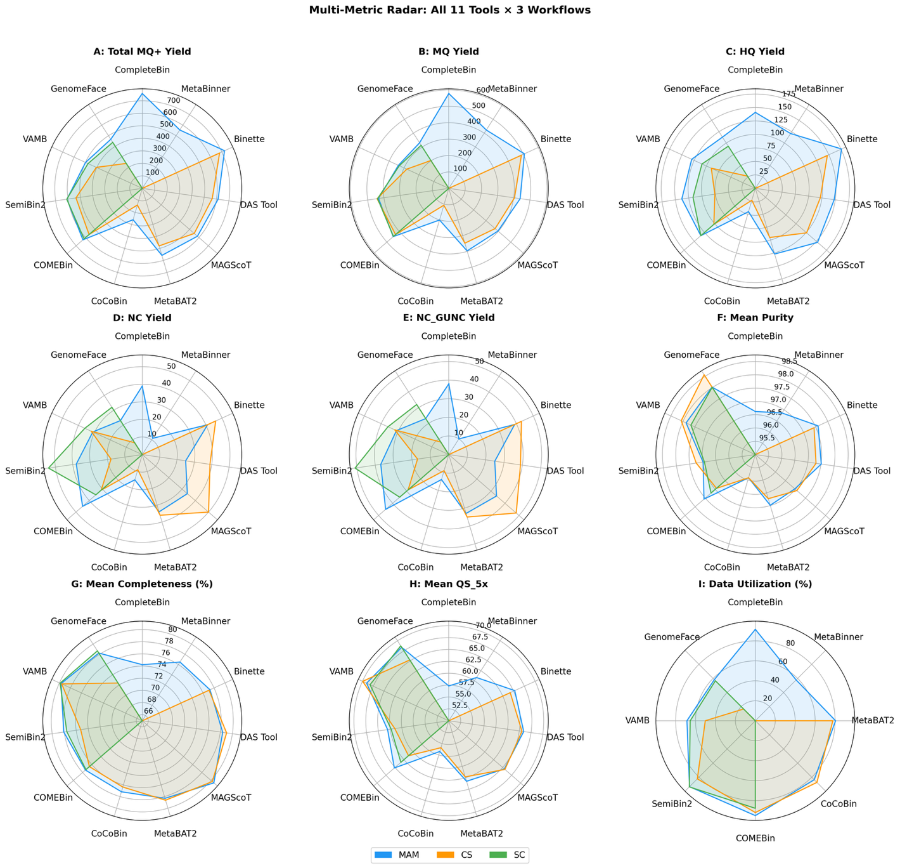

Figure 1: **Multi-metric performance overview of all 11 binning tools across the three multi-sample workflows.** Nine polar (radar) panels summarise per-tool performance on the real benchmark. In every panel the 11 tools occupy the radial axes and the three workflows are overlaid as coloured webs (MAM, CS, SC); a larger radius is better, and a tool absent from a workflow is drawn at the centre (value 0) because it produces no output under that workflow rather than because data are missing. Panels: **(A)** total MQ+ yield; **(B)** MQ-tier yield; **(C)** HQ yield; **(D)** NC yield; **(E)** NC_GUNC yield (NC MAGs that also pass the GUNC chimerism filter); **(F)** mean purity (100 − mean contamination; radial axis starts at 95%); **(G)** mean completeness (axis from 65%); **(H)** mean QS_5x (axis from 50); and **(I)** data utilization, the percentage of assembly base pairs assigned to bins (standalone tools only, as ensemble tools refine existing bins rather than assigning contigs de novo).

### Workflow Comparison

Fair workflow comparison requires restricting to tools shared between workflows, since the three workflows include different numbers of tools. Within the common-9 set (all tools except CompleteBin and MetaBinner), MAM produced 4,942 MQ+ MAGs versus 4,154 for CS, a 19.0% advantage. The HQ+ advantage was larger: 1,450 for MAM versus 1,077 for CS (+34.6%). This differential amplification at higher quality tiers indicates that the MAM workflow does not merely recover more genomes but preferentially recovers them at higher quality (Figure 1, Figure S2).

Within the common-4 set (COMEBin, GenomeFace, SemiBin2, VAMB), all three workflows could be compared directly. MAM led at MQ+ (2,202), followed closely by SC (2,140) and then CS (1,740). At HQ+, the ranking was MAM (652) > SC (610) > CS (384). However, a notable inversion occurred at the NC tier: SC produced 157 NC MAGs compared to 137 for MAM and 89 for CS. This inversion was present in three of four tools - SemiBin2 (SC: 54 NC versus MAM: 38, +42%), GenomeFace (SC: 32 versus MAM: 23, +39%), and VAMB (SC: 36 versus MAM: 31, +16%) - with only COMEBin favouring MAM (45 versus SC: 35).

The NC tier requires near-perfect structural completeness: all three rRNA subunits plus at least 18 tRNA isotypes. The SC workflow's advantage here likely stems from its global feature training, which trains a single neural network model on all samples simultaneously before clustering per-sample. This provides the model with more training examples than MAM's independent per-sample models, producing better-calibrated embeddings for rare and difficult contigs. Because the NC threshold can depend on the correct placement of only a few structural-RNA-carrying contigs, small improvements in the recovery of rRNA- and tRNA-bearing contigs can push HQ MAGs over the NC threshold without meaningfully affecting the broader HQ+ counts.

### Aggregate Quality Profiles

Mean QS_5x under the MAM workflow ranged from 69.04 (VAMB) to 56.74 (CoCoBin), a span of 12.30 quality score units across tools (Figure 1H). VAMB (69.04) and GenomeFace (68.36) occupied the highest-quality positions, followed by DAS Tool (65.94), MAGScoT (65.48), Binette (65.28), and COMEBin (65.18). MetaBAT2 (63.27), SemiBin2 (63.03), and MetaBinner (60.81) formed an intermediate group, while CompleteBin (57.33) and CoCoBin (56.74) occupied the lowest positions (Figure S3).

Mean contamination varied nearly twofold across tools: GenomeFace achieved the lowest contamination (1.98%), followed by VAMB (2.13%), Binette (2.40%), COMEBin (2.44%), and DAS Tool (2.49%), while CoCoBin had the highest (4.09%). Mean completeness ranged from 80.61% (MAGScoT) to 74.23% (CompleteBin). GenomeFace and VAMB achieved the favourable combination of high completeness with low contamination, positioning them in the upper-right region of the completeness-contamination space (Figure 2). The connecting lines in Figure 2 illustrate that most tools shift toward lower completeness or higher contamination when moving from MAM to CS, consistent with the coverage dilution mechanism inherent to concatenated assemblies.

CompleteBin's second-lowest mean QS_5x (57.33) despite producing the highest total yield (758 MAGs) exemplifies the compositional confound inherent in aggregate quality comparisons. Tools that additionally recover difficult genomes near the MQ threshold mechanically depress their mean quality. This confound is not limited to CompleteBin: any tool that extends its recovery toward rarer or more fragmented genomes will incur the same statistical penalty. Notably, CompleteBin still produced 180 HQ+ MAGs (third highest in absolute terms), demonstrating that its lower mean quality reflects a broader difficulty range rather than an inability to produce high-quality reconstructions. The QS_5x violin distributions (Figure S3) confirmed that all tools produced unimodal, left-skewed distributions without secondary peaks. The standard deviation was largest for CompleteBin (24.12) and CoCoBin (22.84), reflecting their broader range of genome difficulties, and smallest for VAMB (17.48) and GenomeFace (18.83), reflecting their more selective recovery.

At the workflow level, the common-4 weighted mean QS_5x was 66.13 for MAM, 65.24 for SC, and 63.89 for CS, confirming that MAM produces not only more MAGs but higher-quality MAGs when the same tools operate on the same assemblies (Figure 1H).

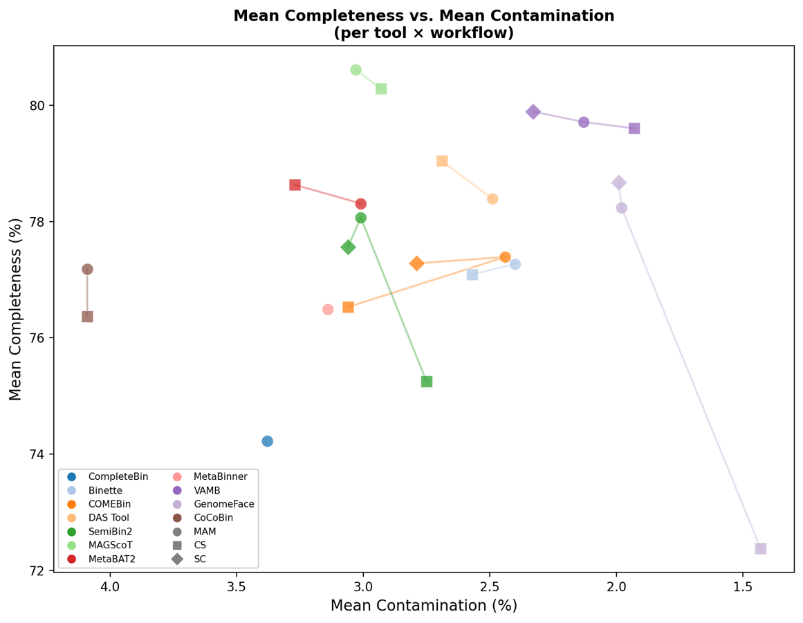

Figure 2: **Mean completeness versus mean contamination for every tool–workflow combination.** Each point is one (tool, workflow) pair; colour encodes tool (11 tools) and marker shape encodes workflow (circle = MAM, square = CS, diamond = SC). Thin lines connect the points of the same tool across workflows to trace its workflow trajectory. The x-axis (mean contamination, %) is inverted so that lower contamination lies to the right; the upper-right region (high completeness, low contamination) is therefore best.

### Per-Tool Workflow Quality Deltas

Comparing MAM and CS for the 9 shared tools, all showed positive MQ+ yield deltas (MAM > CS), ranging from +34 (MAGScoT) to +229 (GenomeFace), with a mean delta of +87.6 MAGs (Figure S4). GenomeFace exhibited the most dramatic CS deficit, losing 49% of its MAM yield (466 to 237 MAGs). This collapse results from GenomeFace's marker-guided clustering algorithm encountering massive single-copy marker gene redundancy in the concatenated assembly, causing it to aggressively shatter otherwise valid genomic structures; the mechanism is discussed in detail in Supplementary Materials S3.2. QS_5x deltas also favoured MAM for most tools: COMEBin (+3.94), GenomeFace (+3.15), SemiBin2 (+1.53), Binette (+1.05), and MetaBAT2 (+0.97). Only VAMB showed a slight CS advantage in QS_5x (-0.92), the sole exception among 9 tools (Figure S4). Mean completeness deltas were more modest: GenomeFace gained +5.86 percentage points (pp) under MAM and SemiBin2 gained +2.82 pp, while most other tools showed deltas below 1 pp.

For the common-4 tools, the MAM-versus-SC deltas were smaller and more varied. COMEBin favoured MAM in both QS_5x (+1.82) and yield (+12 MQ+). GenomeFace showed a slight SC quality advantage (-0.37 QS_5x) despite a MAM yield advantage (+29 MQ+). SemiBin2 was the only tool where SC produced marginally more MQ+ MAGs than MAM (610 versus 609), while VAMB favoured MAM by 22 MQ+ MAGs (499 versus 477). Mean completeness deltas between MAM and SC were modest (all below 0.5 pp), while the NC tier inversions discussed above represent the most notable SC advantage.

### Data Utilization

Data utilization, the fraction of total assembly base pairs captured in raw pre-dereplication bins, ranged from 95.1% (COMEBin) to 57.9% (MetaBinner) among standalone tools in the MAM workflow, a 1.64-fold difference. COMEBin (95.1%), SemiBin2 (93.4%), CompleteBin (91.6%), CoCoBin (83.5%), and MetaBAT2 (80.5%) represent the aggressive end of the binning spectrum, assigning the vast majority of contigs to some bin. VAMB (68.7%), GenomeFace (58.2%), and MetaBinner (57.9%) were more conservative in contig assignment (Figure 1I). The ensemble tools refine bins produced by standalone tools rather than performing de novo contig assignment, so their utilization values (DAS Tool 61.1%, MAGScoT 63.8%, Binette 66.5%) are not directly comparable.

GenomeFace under CS presented an extreme outlier: only 16.7% data utilization, compared to 58.2% under MAM. This 3.5-fold reduction, combined with the 49% yield loss noted above, indicates a near-complete collapse of GenomeFace's binning capacity under the concatenated sample architecture.

## 3.2 Per-Genome Quality Competition

The aggregate yield and quality statistics reported in Section 3.1 are confounded by differences in the number and difficulty of genomes each tool recovers. A tool that additionally recovers difficult genomes near the MQ threshold mechanically depresses its mean quality, creating a misleading impression that it produces worse MAGs. This section resolves this confound using the per-genome competition framework described in Section 2.8, which conducts head-to-head quality comparisons at the individual genome cluster level, holding the biological substrate constant. The skani-based ANI clustering identified 920 unique genome clusters from all 12,551 MAGs, reduced to 767 after applying the MQ and destructive-warning filters, as the remaining 153 clusters lost all their members to the warning filter.

### Competition Landscape

Under the MAM workflow, 717 genome clusters contained at least one MQ+ MAG after filtering, of which 645 were contested (recovered by two or more tools) and 72 were exclusive to a single tool. Competition was dense: the median cluster was contested by 9 tools and 66.2% of clusters were recovered by 8 or more (Figure S5), while 120 clusters (16.7%) was recovered by 3 or fewer tools, representing genomes at the boundary of recoverability. CS (656 clusters, 597 contested) and SC (615 clusters, 540 contested) contained progressively fewer contested clusters, reflecting their smaller participating tool sets. A total of 42 competitions (6.5% of contested) resulted in fractional wins due to perfect ties.

### Primary Competition Results

Binette won 445 of 717 MAM genome competitions (62.1% of total, 73.2% of contested), far exceeding all other tools (Figure 3A). The next most successful tool was CompleteBin with 76 total wins (49 contested, 27 exclusive, 8.2% contested win rate), followed by COMEBin (42 wins, 6.8%), DAS Tool (33, 5.6%), MetaBinner (23, 3.3%), GenomeFace (20, 3.4%), VAMB (19, 3.2%), SemiBin2 (19, 2.8%), MAGScoT (17, 2.4%), MetaBAT2 (17, 2.4%), and CoCoBin (6, 1.9%) (Figure 3A).

Binette's dominance was disproportionate to its yield advantage. In Section 3.1, Binette produced the second-highest total MQ+ yield (724 MAGs), just 4.5% below CompleteBin's 758. Yet its contested win rate (73.2%) was 8.9-fold higher than the next-best tool (CompleteBin, 8.2%). This concentration arises because Binette uses CheckM2 quality scores internally to select the best bin from candidate bin sets generated by multiple standalone tools (Section 2.4), directly optimising the same metric used to judge the competition. This circular optimisation concern is flagged here and evaluated quantitatively in Section 3.4.

### Quality Dimensions: Contamination Penalty Weight and Sub-Competitions

The primary competition was run under QS_5x (k = 5), a strict contamination penalty under which no tool optimises internally. A secondary competition under QS_2x (k = 2, Binette's native scoring weight) tested whether tool rankings shift with the penalty weight (Figure S6). Binette's contested win rate was virtually identical under both weights (73.7% at k = 2 versus 73.2% at k = 5), indicating that its dominance extends beyond its native optimisation criterion. MAGScoT showed the largest shift, dropping from 5.9% to 2.4%, while COMEBin increased from 5.0% to 6.8% and GenomeFace from 2.0% to 3.4%.

These penalty-weight shifts were explained by decomposing the competition into independent completeness and contamination sub-competitions (Figure 3B). Binette achieved near-equal contested win rates for completeness (33.5%) and contamination (32.7%), demonstrating balanced quality optimisation. MAGScoT exhibited the strongest completeness bias, with a 7.1-fold asymmetry (19.9% completeness wins versus 2.8% contamination wins), consistent with its large drop from k = 2 to k = 5. CompleteBin (13.4% versus 9.2%) and SemiBin2 (8.7% versus 3.7%) were also completeness-biased. GenomeFace showed the inverse pattern, winning 24.9% of contamination sub-competitions but only 2.0% of completeness sub-competitions (a 12.5-fold asymmetry), consistent with its increased win rate at k = 5. VAMB (9.8% contamination versus 4.3% completeness), COMEBin (12.7% versus 9.7%), DAS Tool (8.8% versus 5.8%), and MetaBinner (10.1% versus 5.7%) were moderately contamination-biased (Figure 3B).

These archetypes reflect algorithmic design. GenomeFace's marker-guided clustering produces conservative bins with minimal contamination at the cost of missing peripheral contigs, while MAGScoT's marker gene-based merging of standalone tool outputs aggressively incorporates contigs to maximise completeness. The complementarity of all these profiles supports the biological rationale for ensemble approaches.

### Margins of Victory and Loss

The margin distributions show how decisively tools win and lose (Figure 3C,D). Binette had a symmetric profile (mean margin of victory MoV 2.45 QS_5x points, mean margin of loss MoL 2.45), losing only narrowly when it loses, consistent with a tool competitive across the full difficulty spectrum. CompleteBin (mean MoV 3.35) and MetaBinner (3.17) won by large margins but lost by much larger ones (mean MoL 7.20 and 11.58), and CoCoBin had the largest mean MoL of all tools (15.42), reflecting its limited 215-cluster genome set. DAS Tool (mean MoV 0.92) and MAGScoT (1.18) had the narrowest victory margins, indicating their wins are frequently decided by the tie-breaking hierarchy rather than by substantial quality differences.

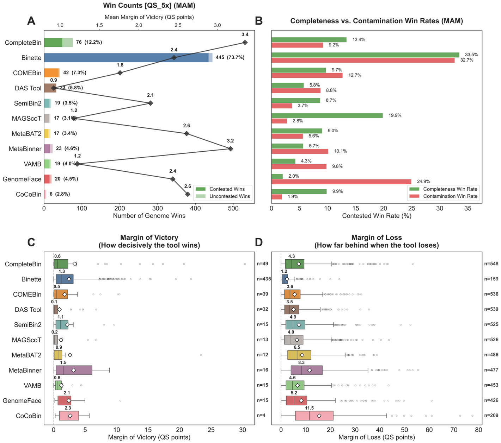

Figure 3: **Per-genome head-to-head quality competition under the MAM workflow.** All panels use the per-genome competition framework, in which tools compete to produce the best reconstruction of each shared genome cluster (the biological substrate is held constant across tools), scored by QS_5x. **(A)** Total genome wins per tool as horizontal stacked bars split into contested wins (clusters recovered by ≥ 2 tools, full colour) and uncontested wins (lighter shade); bars are annotated with the total win count and overall win rate, and the dark diamond line on the upper secondary axis gives each tool's mean margin of victory (QS points). **(B)** Decomposition of the competition into independent completeness (green) and contamination (red) sub-competitions, showing each tool's contested win rate on each quality dimension. **(C, D)** Per-tool distributions (boxplots on a symlog x-axis; white diamond = mean, adjacent value = median, n = number of contests) of the **(C)** margin of victory (QS-point gap to the runner-up when the tool wins) and **(D)** margin of loss (QS-point gap to the winner when the tool loses).

### Pairwise Win Matrix

The full pairwise win matrix confirmed Binette's uniform dominance, winning between 88.1% (versus DAS Tool) and 96.1% (versus CoCoBin) of shared genome competitions under QS_5x (Figure S7). Among non-Binette pairs the landscape was more balanced and pair-specific (COMEBin won 51.9% against CompleteBin, VAMB 57.0% against GenomeFace, MetaBAT2 61.3% against MetaBinner), indicating that no single standalone tool dominates all others and that competitive advantages depend on the specific tool pair and the genomes they share.

### Exclusive Genomes and Serendipity

The 72 MAM exclusive genomes (recovered by exactly one tool) differed sharply from the 5,529 multi-tool representatives (Mann-Whitney U, Figure S8): lower completeness (mean 57.4% versus 79.7%), higher contamination (5.30% versus 2.43%), lower contig N50 (3,836 versus 9,742 bp), and lower QS_5x (30.9 versus 67.5), all at p < 0.001. There was no significant difference in GC content or coding density. Exclusive genomes are therefore hard-to-bin species with fragmented assemblies and low completeness, not easily recoverable genomes that other tools happened to miss.

CompleteBin contributed the most exclusive genomes (27, 4.3% of its 624 eligible clusters), far more than the next tools (Binette 10, MetaBinner 7; all others 5 or fewer) (Figure 4B). These 27 confirm the hypothesis raised in Section 3.1: CompleteBin's high total yield reflects genuine expansion into species that other tools cannot recover, not inflated counts from poor-quality reconstructions of shared genomes.

The pairwise serendipity matrix quantifies the fraction of one tool's genome set not recovered by another (Figure 4A). CompleteBin showed the highest serendipity relative to most tools (32.1% of its genomes missed by GenomeFace, 27.4% by VAMB), whereas other tools had low serendipity relative to Binette (3.0% for VAMB to 9.1% for CompleteBin), meaning Binette's genome set covered 91 - 97% of what each individual tool recovered.

The non-redundancy across standalone tools demonstrates that running multiple tools captures more total biological diversity than any individual tool, providing the rationale for ensemble approaches. However, the three ensemble tools in the benchmark (Binette, DAS Tool, MAGScoT) are not complete supersets of their standalone inputs: CompleteBin has 9.1% serendipity relative to Binette, meaning Binette's selection process discards some genomes that CompleteBin uniquely recovers. The mechanisms behind this incomplete consolidation are examined in Section 3.11.

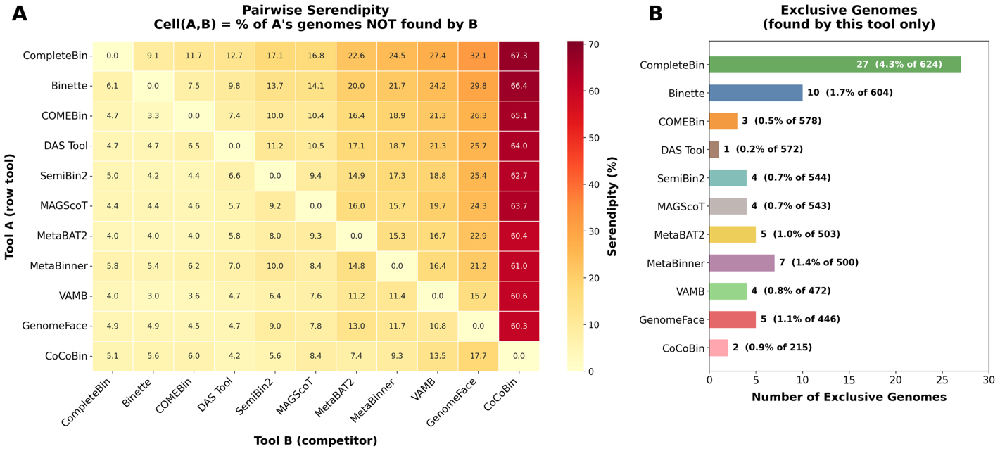

Figure 4: **Complementarity and exclusive genome recovery among tools under MAM.** **(A)** Pairwise serendipity heatmap: cell (row tool A, column tool B) gives the percentage of tool A's recovered genome clusters that tool B does not recover (darker = more unique recovery relative to that competitor). **(B)** Exclusive genome clusters per tool, i.e. clusters recovered by exactly one tool and missed by all other ten, as a horizontal bar chart annotated with the count, the percentage of the tool's eligible clusters, and the tool's total cluster count. Together the panels quantify how much non-redundant biological diversity each tool contributes, which is the rationale for ensemble binning.

### Cross-Workflow Per-Genome Competition

The cross-workflow competition compares workflows by evaluating which produces the better MAG when the same tool processes the same genome under different workflow architectures, isolating the workflow effect from the tool effect.

Pooled across all decided competitions in the common-9 stratum, MAM won 66.0% of QS_5x competitions against CS (2,307 of 3,496 decided, 18 ties = 0.5%) (Figure 5D). This advantage was consistent across all 9 individual tools: per-tool MAM win rates ranged from 61.6% (DAS Tool, MAGScoT) to 71.9% (CoCoBin), with no tool favouring CS (Figure 5A-C). Among the common-4 tools, MAM defeated SC in 58.1% of 1,807 decided competitions (19 ties = 1.0%). SC in turn defeated CS in 65.3% of 1,400 decided competitions (92 ties = 6.2%), establishing a clear transitive quality score ranking: MAM > SC > CS (Figure 5D).

The quality dimension driving each workflow advantage differed (Figure S9). The MAM-versus-CS gap was overwhelmingly completeness-dominated: MAM won 63.7% of completeness sub-competitions versus CS's 35.7%, but only 52.4% of contamination sub-competitions versus CS's 47.0%. This asymmetry is consistent with coverage dilution in the concatenated assembly (Section 3.3), which reduces per-contig coverage and causes binners to lose contigs, reducing completeness without necessarily increasing contamination. The MAM-versus-SC gap was more balanced (53.9% completeness, 53.2% contamination). The CS-versus-SC comparison was again completeness-dominated in SC's favour (SC won 64.0% of completeness sub-competitions), but CS won the contamination dimension (52.5% versus SC's 41.2%). Since CS and SC share identical feature learning and differ only in clustering scope (Section 2.4), the mechanistic basis for SC's slight contamination disadvantage is unclear.

MAM also won by larger margins: the pooled mean MoV against CS was 6.87 QS_5x points versus CS's mean MoV of 4.11 when CS won (Figure S10). Against SC, the margins were more symmetric (MAM mean MoV 4.46 versus SC mean MoV 3.51), consistent with the closer overall win rate.

GenomeFace exhibited the most extreme cross-workflow sensitivity. Under MAM, GenomeFace recovered 446 genome clusters, but under CS only 229 (a 48.7% reduction). Its MAM serendipity relative to CS was 52.0%, meaning more than half of GenomeFace's MAM genomes were absent from its CS output. In the CS-versus-SC comparison, GenomeFace showed the strongest SC advantage (75.8% SC win rate, with 29.6% ties), further confirming that its marker-guided algorithm is particularly incompatible with the concatenated assembly architecture.

At the workflow level, MAM recovered 76 genome clusters not found in CS within the common-9 stratum (serendipity 11.1%), while CS recovered 50 not found in MAM (7.6%) (Figure S11). The union of both workflows captured 732 unique clusters, 50 more than MAM alone (682) and 76 more than CS alone (656). Within the common-4 stratum, 561 genome clusters were shared across all three workflows, with MAM contributing 32 exclusive clusters, CS 19, and SC 18. At the per-tool level, the MAM advantage in exclusive genome recovery was most extreme for MetaBAT2 (104 MAM-exclusive genomes versus 35 for CS) and GenomeFace (53 MAM-exclusive versus 4 for CS and 20 for SC). COMEBin in MAM had a serendipity of 19.0% relative to COMEBin in CS, while the reverse was only 5.5%. VAMB showed a similar asymmetry: 25.0% MAM-to-CS serendipity versus 9.5% CS-to-MAM.

Despite MAM's clear quality superiority, the non-zero exclusive genome counts for CS and SC indicate that each workflow recovers genomes the others miss. CS's 50 exclusive genome clusters in the common-9 stratum and SC's 18 in the common-4 stratum represent species that are inaccessible under MAM's per-sample binning but are successfully recovered when contigs and coverage information are pooled across samples. This complementarity suggests that running multiple workflows captures additional biological diversity beyond what any single workflow achieves.

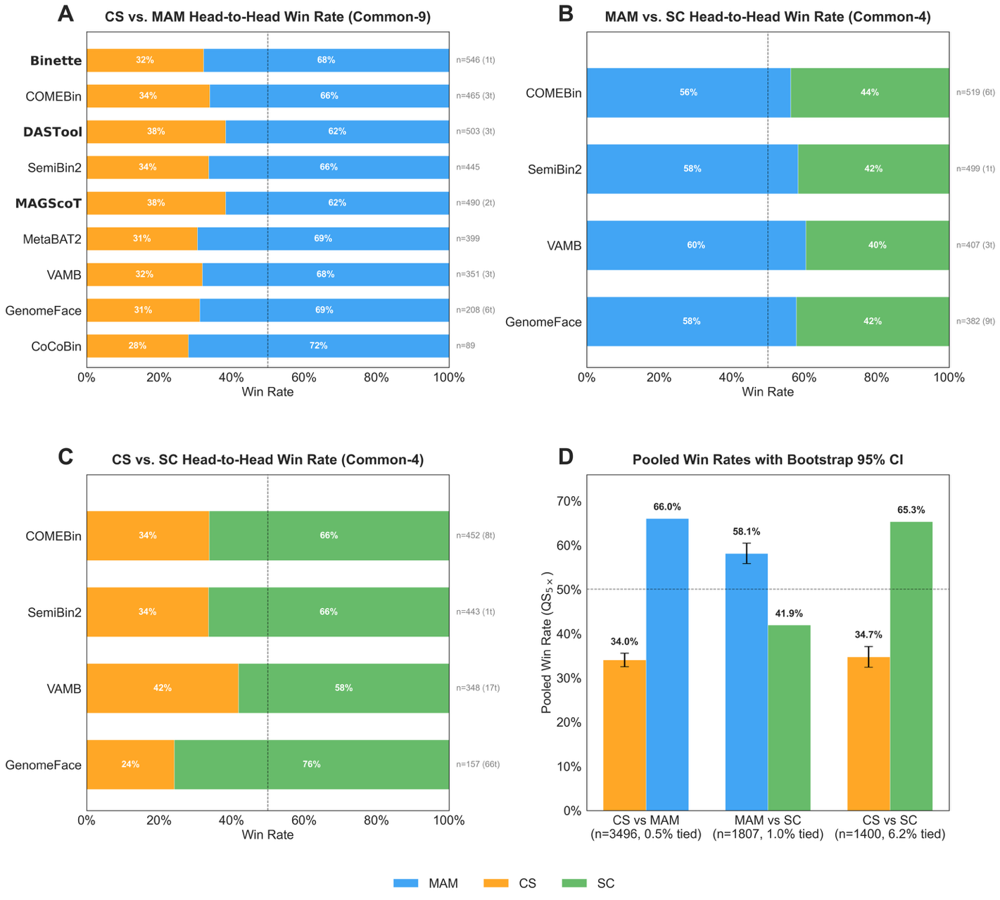

Figure 5: **Cross-workflow per-genome competition: which workflow produces the better MAG when the same tool processes the same genome.** Competitions are decided by QS_5x within matched-tool strata (common-9 for MAM vs CS; common-4 for any comparison involving SC); ties are excluded from win-rate denominators. **(A–C)** Per-tool win rates as 100% stacked horizontal bars for the three workflow pairs: **(A)** MAM vs CS, **(B)** MAM vs SC, **(C)** CS vs SC, coloured by workflow, with the 50% parity line dashed and the number of decided competitions (and ties) annotated; ensemble tools are shown in bold. **(D)** Pooled win rate per workflow pair with bootstrap 95% confidence intervals (error bars on the first-named workflow's bar), establishing the transitive ranking MAM &gt; SC &gt; CS.

## 3.3 Coverage Dilution in Concatenated-Sample Binning

The yield overview (Section 3.1) and the cross-workflow head-to-head competition (Section 3.2) consistently show that MAM produces more MAGs and higher per-genome quality than CS. Pooled across 3,496 decided competitions in the common-9 stratum, MAM won 66.0% versus CS's 34.0% (Figure 5D), with the advantage overwhelmingly driven by completeness: MAM won 63.7% of completeness sub-competitions but only 52.4% of contamination sub-competitions (Figure S9). These results establish the direction and magnitude of the MAM advantage but do not explain the mechanism. This section tests whether coverage dilution in the concatenated assembly is the cause, first by measuring the physical coverage loss directly, then by showing that the per-genome completeness gap between MAM and CS grows with the degree of expected competition in the concatenated assembly.

### Direct Coverage Measurement

When reads from a single sample are mapped to the concatenated assembly, near-identical contigs from other samples' assemblies compete for those reads. To quantify this, the per-contig depth ratio was computed for each contig: the depth from a sample's own reads when mapped to the concatenated assembly, divided by the depth from the same reads when mapped to only that sample's assembly. Across all 1,517,440 contigs in the 20 assemblies, the overall median depth ratio was 0.616 and the mean was 0.627, meaning that the average contig lost approximately 38% of its coverage from its own sample's reads in the concatenated assembly (Figure 6).

The ratio distribution was bimodal (Figure 6, right panel). Approximately 16% of contigs produced a ratio of exactly 1.0, forming a discrete spike. These belong to genomes present in only a single sample, where no competing copies exist in the concatenated assembly and all reads map identically under both workflows. The remaining 81.7% of contigs (n = 1,239,054), representing genomes shared across multiple samples, formed a broad distribution below 1.0 with a median of 0.525 and mean of 0.541, corresponding to approximately 47% coverage loss.

Dilution severity varied across the 20 samples (Figure 6, left panel). The shallowest layers retained the most coverage (1 - 2 cm: median ratio 0.795, 2 - 3 cm: 0.737, 3 - 4 cm: 0.722), consistent with these surface communities harbouring more ecologically distinct species that share fewer taxa with other layers. The most severely diluted samples were from layers with high community overlap (22.5 - 25 cm: 0.363, 10 - 12.5 cm: 0.418, 30 - 32.5 cm: 0.434), where each genome is represented by near-identical copies from many adjacent layers and the competition for reads is most intense. All 20 samples showed median ratios below 1.0, with the fraction of diluted contigs ranging from 71.7% (1 - 2 cm) to 96.5% (22.5 - 25 cm).

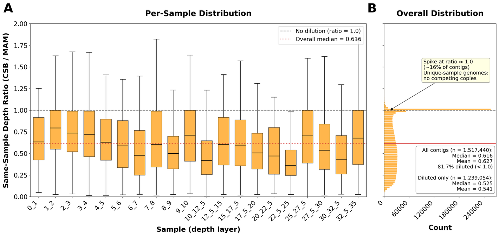

Figure 6: **Direct measurement of coverage dilution in concatenated-sample binning.** The per-contig same-sample depth ratio (depth from a sample's own reads mapped to the concatenated assembly, divided by the depth from the same reads mapped to that sample's own per-sample MAM assembly) is computed for all 1,517,440 contigs across the 20 depth layers; a ratio of 1.0 means no coverage was lost to competing near-identical copies from other samples. **(A)** Per-sample boxplots of the depth ratio across the 20 depth layers (dashed line = no dilution at ratio 1.0; dotted red line = overall median). **(B)** Horizontal histogram of the depth ratio pooled over all contigs, which is bimodal: a spike at ratio ≈ 1.0 from contigs of genomes unique to a single sample (no competing copies, no dilution) and a broad distribution below 1.0 from contigs of genomes shared across samples (reads diverted to competing copies, i.e. genuine coverage dilution).

### Completeness Gap Scales with Sample Presence

The direct coverage measurement confirms that dilution is pervasive and substantial, but it operates at the contig level. To test whether this translates into a per-genome quality difference between workflows, per-genome completeness under both MAM and CS was plotted against N_samples, the number of distinct samples in which each genome was detected before dereplication (Section 2.9). If coverage dilution drives CS's inferior completeness, the completeness gap between MAM and CS should grow with N_samples, because genomes present in more samples have more competing copies in the concatenated assembly and therefore experience progressively stronger dilution. Separately, MAM completeness is expected to increase with N_samples, since genomes present in more samples tend to be abundant and produce stronger coverage signals for the binner.

Both expectations were confirmed across all four common-4 tools (Figure 7). Under MAM, completeness correlated positively with N_samples for COMEBin (Spearman ρ = +0.428, p = 3.2 × 10⁻²², n = 468), SemiBin2 (+0.398, p = 2.6 × 10⁻¹⁸, n = 445), VAMB (+0.371, p = 5.5 × 10⁻¹³, n = 354), and GenomeFace (+0.357, p = 8.0 × 10⁻⁸, n = 214), confirming that genomes present in more samples are easier to bin when per-sample assemblies are used. Under CS, these correlations were consistently suppressed: COMEBin dropped to +0.257, VAMB to +0.211, and SemiBin2 to +0.114 (barely significant, p = 1.6 × 10⁻²). GenomeFace showed the most extreme result, with its CS correlation completely reversing to -0.251 (p = 2.1 × 10⁻⁴), meaning that genomes expected to be easiest to bin actually achieved the lowest completeness under CS.

The growing gap between the MAM and CS trend lines in Figure 7 is the central result: as N_samples increases, the completeness difference between workflows widens progressively. For genomes present in five or more samples, the mean MAM completeness ranged from 89.8% (COMEBin) to 93.7% (GenomeFace), while the corresponding mean CS completeness ranged from 68.9% (GenomeFace) to 86.7% (VAMB). GenomeFace's gap at high sample presence was 24.8 pp, meaning that MAM recovered nearly a quarter more of the genome than CS for the most ubiquitous species.

This gap was quantified directly as DeltaCompleteness (Completeness_MAM minus Completeness_CS) per genome cluster and correlated with N_samples (Figure S12). All four tools showed significant positive correlations: GenomeFace (ρ = 0.659, p = 5.3 × 10⁻²⁸), SemiBin2 (0.488, p = 5.4 × 10⁻²⁸), COMEBin (0.368, p = 1.8 × 10⁻¹⁶), and VAMB (0.255, p = 1.1 × 10⁻⁶). The mean DeltaCompleteness was positive for all tools (GenomeFace +9.57 pp, SemiBin2 +5.07 pp, VAMB +3.31 pp, COMEBin +1.02 pp), confirming MAM's per-genome completeness advantage on average. For genomes in five or more samples, the mean DeltaCompleteness reached +24.78 pp (GenomeFace), +10.48 pp (SemiBin2), +4.76 pp (COMEBin), and +4.07 pp (VAMB). For single-sample genomes, where no dilution is expected, the differences were much smaller (+3.10, +0.82, -1.35, and +0.47 pp respectively), consistent with coverage dilution being the dominant driver of the gap at high sample presence.

Together, the direct coverage measurement and the completeness-versus-N_samples analysis identify coverage dilution as a primary mechanism behind CS's inferior performance: the concatenated assembly forces reads from shared genomes to compete across near-identical copies from multiple samples, reducing per-contig coverage and causing binners to lose contigs. The completeness-dominated nature of the MAM-CS quality gap, confirmed by the cross-workflow sub-competition win rates in Section 3.2, is consistent with this mechanism.

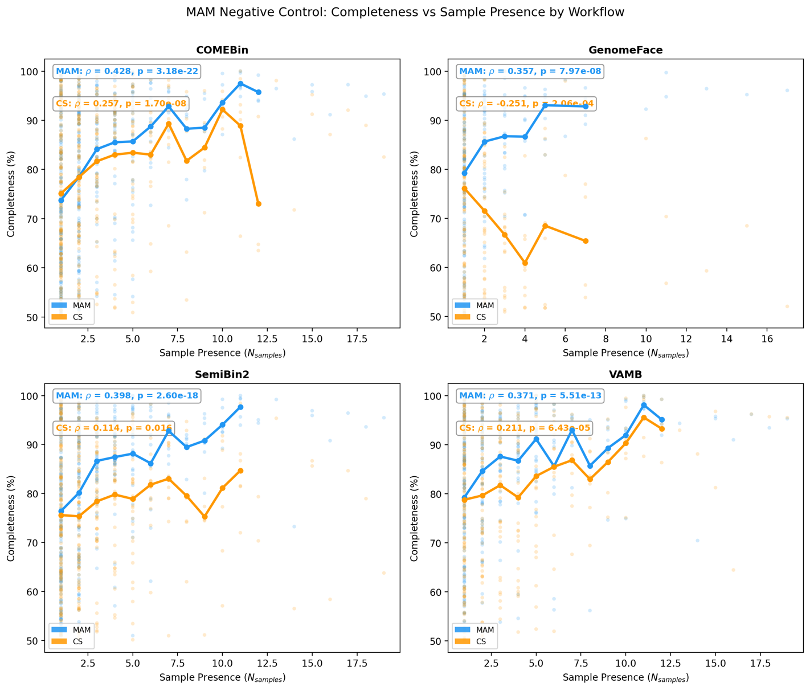

Figure 7: **The per-genome completeness gap between MAM and CS widens with sample presence, confirming coverage dilution as a mechanism.** Four panels, one per common-4 deep-learning tool (COMEBin, GenomeFace, SemiBin2, VAMB). Each panel plots per-genome completeness (%) against N_samples (the number of depth-layer samples in which a genome was detected before dereplication), overlaid for MAM (blue) and CS (orange); faint points are individual genome-cluster observations and the bold marked lines are binned means per workflow, with the per-workflow Spearman correlation (ρ, p) annotated. If coverage dilution drives CS's inferior completeness, the gap between the two trend lines should grow with N_samples, because genomes present in more samples have more competing near-identical copies in the concatenated assembly and therefore experience progressively stronger read competition. The figure confirms this: MAM completeness correlates positively with N_samples across all four tools (ρ = 0.36–0.43), while CS correlations are consistently suppressed or reversed (GenomeFace ρ = −0.25), and the MAM–CS mean completeness gap widens from near-zero for single-sample genomes to up to 24.8 percentage points for genomes present in five or more samples.

## 3.4 CheckM2 Trustworthiness Calibration

The per-genome competition (Section 3.2) and all yield counts and quality statistics throughout this thesis depend on CheckM2's accuracy. If CheckM2 overestimates or underestimates quality in a tool-specific manner, competition results and yield rankings are biased. This section calibrates CheckM2 predictions against AMBER ground truth from the CAMISIM strain simulation (Section 2.2), quantifying per-tool false discovery rates, bias severity, false positive rates, and the circular optimisation effect. All results use the MAM workflow and all-genomes pool (64 reference genomes, 5 samples) unless stated otherwise.

The error landscape of each tool reveals that CheckM2 accuracy depends on the structural properties of a tool's output bins (Figure S13). Aggressive mergers (MetaBAT2, VAMB, CoCoBin) fail predominantly by co-binning related genomes (often strains), producing bins with high completeness but elevated contamination. These chimeric mergers display strong negative QS errors, as CheckM2 detects cross-genome marker signals and assigns harsher contamination penalties than the AMBER purity metric. Conservative fragmenters (CompleteBin, SemiBin2) instead fail by splitting genomes into many small, incomplete fragments with variable contamination. For these fragments, CheckM2 lacks sufficient gene content to detect contamination and overestimates completeness from partial pathway signatures, producing strong positive QS errors. This coupling between algorithmic failure mode and CheckM2 error direction means that All-FDR is systematically higher for aggressive mergers (e.g. MetaBAT2 30.6%, CoCoBin 27.1%) than for conservative fragmenters (e.g. GenomeFace 12.6%, CompleteBin 14.2%).

### Trustworthiness Classification

The All-FDR measures the overall fraction of CheckM2-passing bins assigned to a higher quality tier than their true AMBER tier. Across the 11 tools (2,861 bins total), All-FDR ranged from 12.6% (GenomeFace) to 32.6% (MetaBinner), a 2.6-fold spread (Figure 8B). Three trustworthiness groups emerged. GenomeFace (12.6%), CompleteBin (14.2%), MAGScoT (15.4%), and COMEBin (18.0%) formed a trustworthy tier with All-FDR below 20%. SemiBin2 (19.3%), VAMB (20.5%), DAS Tool (20.5%), and Binette (22.9%) fell into an intermediate tier. CoCoBin (27.1%), MetaBAT2 (30.6%), and MetaBinner (32.6%) were classified as unreliable, with roughly one in three passing bins assigned to an inflated tier (Figure 8A, Figure 8B).

Pool comparison was stable: the three-tier grouping was preserved between the Background (50 genomes) and All (64 genomes, including strain pairs) pools, with most tools shifting upward by 1-4 pp in the All pool (Figure S14A). Cross-workflow robustness was assessed using the SSM workflow, where all 11 tools are available. The broad trustworthy (GenomeFace 11.5%, CompleteBin 15.8%, MAGScoT 14.5%, COMEBin 16.0%) and unreliable (MetaBAT2 33.3%, MetaBinner 32.8%, CoCoBin 28.4%) groupings were preserved, though individual rankings shifted within groups (e.g. VAMB dropped from 20.5% in MAM to 12.8% in SSM). The CS workflow was unsuitable for robustness testing because five standalone tools (CompleteBin, COMEBin, GenomeFace, MetaBinner, and SemiBin2) collapsed on the simulated concatenated assembly due to artificial sequence redundancy (Section 3.8), producing zero or near-zero CheckM2-passing bins (Figure S14B).

### False Discovery Rates

HQ-FDR (fraction of CheckM2-predicted HQ bins truly lower quality by AMBER) was highest for MetaBAT2 (38.6%), VAMB (34.5%), MetaBinner (34.4%), and CoCoBin (32.3%), meaning roughly one in three CheckM2-called HQ bins from these tools was actually MQ or LQ. CompleteBin (13.7%), MAGScoT (15.7%), and GenomeFace (16.2%) had the lowest HQ-FDR (Figure 8B).

MQ-FDR revealed a different ranking: Binette (39.4%), MetaBinner (31.5%), and DAS Tool (27.3%) were highest, while VAMB (2.3%), GenomeFace (7.6%), and COMEBin (7.7%) were lowest. Among HQ false discoveries, the majority were borderline MQ rather than severe LQ, though the fraction varied: SemiBin2 and VAMB had 100% MQ among their HQ false positives, while CoCoBin had only 72.5% MQ (11 of 40 truly LQ), MetaBAT2 87.5% (7 of 56 truly LQ), and MetaBinner 81.3% (6 of 32 truly LQ) (Figure S15).

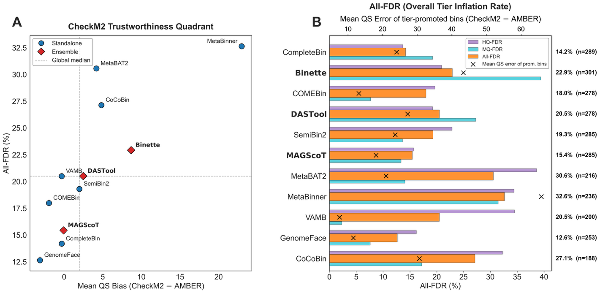

Figure 8: **CheckM2 trustworthiness calibrated against AMBER ground truth.** CheckM2 completeness and contamination predictions are compared with AMBER true values on the CAMISIM simulation (MAM workflow, all-genome pool); All-FDR is the fraction of CheckM2-passing bins assigned to a higher quality tier than their true AMBER tier. **(A)** Trustworthiness quadrant: each tool is plotted by its mean QS bias (CheckM2 − AMBER over the CheckM2-passing pool; x-axis) against its All-FDR (%, y-axis), with standalone tools as circles and ensemble tools as diamonds; dashed crosshairs at the global medians partition tools into reliable (low bias, low All-FDR) and unreliable regions. **(B)** Per-tool All-FDR (orange bars), with thinner HQ-FDR (fraction of CheckM2-HQ bins that are truly lower quality: purple) and MQ-FDR (fraction of CheckM2-MQ bins that are truly LQ: blue) sub-bars; black "x" markers on the secondary x-axis give the mean QS error of tier-promoted bins as a severity measure, and n is the number of CheckM2-passing bins.

### FDR Severity

All-FDR captures how often CheckM2 inflates a tool's bins, but not how severely. The mean QS_5x overestimation among tier-promoted bins (Inflated QS delta) quantifies this (Figure 8B, secondary axis). VAMB's false discoveries were the mildest (mean delta +7.6), consistent with borderline promotions near tier boundaries. GenomeFace (+11.6) and COMEBin (+13.2) were also mild to moderate. At the extreme end, MetaBinner's tier-promoted bins had a mean QS delta of +65.8, driven by catastrophic chimeras with true contamination of 50-57% where CheckM2 estimated only 5-8%, producing individual QS errors exceeding +250 points. Binette (+43.3) was notably severe given its moderate All-FDR (22.9%), indicating its false discoveries are not solely borderline promotions but bins that strongly exploit CheckM2's dual tendency to overestimate completeness and underestimate contamination - especially for lower quality bins (Figure S16). DAS Tool (+27.2), CoCoBin (+30.6), and CompleteBin (+24.0) occupied the moderate-to-severe range.

### False Positive Rate as Base-Rate Control

A tool that produces predominantly high-quality bins has few truly non-HQ bins in its output. Even if CheckM2 inflates most of those non-HQ bins, they are diluted by the large pool of correctly classified bins, keeping All-FDR low. The All-FPR (fraction of truly non-HQ bins that receive an inflated CheckM2 tier) isolates this effect: a tool with low All-FDR but disproportionately high All-FPR indicates that its low All-FDR is partly an artifact of having few truly non-HQ bins, rather than evidence of superior CheckM2 calibration (Figure S17).

Binette showed the most extreme FPR (82.1%), far exceeding its All-FDR (22.9%): of its 84 truly non-HQ bins, 69 received inflated tiers. This extreme gap between All-FPR and All-FDR reveals that Binette's moderate All-FDR is largely a base-rate artifact: truly HQ bins cannot be inflated by definition, so tools producing many truly HQ bins (Binette: 217 of 301 passing) dilute their All-FDR denominator regardless of how aggressively CheckM2 inflates their non-HQ output. CompleteBin (FPR 53.9%, All-FDR 14.2%) and MAGScoT (FPR 58.7%, All-FDR 15.4%) also showed disproportionately high FPR, indicating their low All-FDR partly reflects a favorable base rate. GenomeFace (FPR 21.6%, All-FDR 12.6%) and VAMB (FPR 23.0%, All-FDR 20.5%) had consistently low rates on both metrics, confirming genuine calibration accuracy. MetaBinner (FPR 39.7%, All-FDR 32.6%) and MetaBAT2 (FPR 39.5%, All-FDR 30.6%) showed proportionally matched rates, confirming their high All-FDR reflects genuine CheckM2 exploitation of the contamination blind spot rather than base-rate amplification.

### Continuous Bias

CheckM2 overestimated completeness for all 11 tools, with mean error ranging from +0.89 pp (CoCoBin) to +5.94 pp (MetaBinner) and +5.44 pp (Binette), yielding a global mean completeness overestimation of approximately +3.2 pp (Figure S18). Contamination bias was more heterogeneous: MetaBinner showed severe underestimation (-3.41 pp), CoCoBin (-0.79 pp) and Binette (-0.65 pp) mild underestimation, while GenomeFace (+1.08 pp) and COMEBin (+0.96 pp) showed overestimation, making these tools appear worse than ground truth (Figure S18).

The combined QS_5x error was most extreme for MetaBinner (+22.98), driven by dual inflation of severe completeness overestimation and contamination underestimation. Binette (+8.68), CoCoBin (+4.82), and MetaBAT2 (+4.18) also showed substantial positive QS bias. Five tools had negative QS errors: GenomeFace (-3.13), COMEBin (-1.96), CompleteBin (-0.32), VAMB (-0.32), and MAGScoT (-0.08), meaning CheckM2 systematically underestimates their quality relative to ground truth (Figure 8A, Figure S18).

### Circular Optimisation

Binette uses CheckM2 internally for bin selection (QS_2x scoring, Section 2.4), creating circularity where the evaluation metric is the same model that drives selection. Binette's MQ-FDR (39.4%) was the highest of any tool, while its HQ-FDR (20.9%) was comparable to other intermediate tools. This asymmetry is consistent with CheckM2's regime-dependent bias (Figure S16): CheckM2 overestimates completeness and underestimates contamination to an increasing extent as true bin quality decreases, making fragmented truly-LQ bins more likely to be pushed above the 50% MQ threshold than moderate-quality bins to cross the 90% HQ boundary. Binette's internal optimisation preferentially retains these falsely promoted fragments, amplifying the effect at the MQ level. Binette's 73.2% contested win rate (Section 3.2) is therefore more reliable at the HQ level than for MQ-tier contests, though even substantial correction is unlikely to eliminate its overall dominance given its 8.9-fold advantage over the next-best tool.

### Completeness Stratification and Transferability

Within the well-populated 90-100% completeness bucket the trustworthy/unreliable distinction held (CompleteBin 13.1%, GenomeFace 14.9%, MAGScoT 15.4% versus MetaBAT2 38.8%, VAMB 32.5%, MetaBinner 32.4%; Figure S19). Because the simulation oversamples high completeness relative to the real data (median ~94% versus ~80%), the absolute All-FDR values are optimistic lower bounds for the real benchmark while the relative tool ranking is the transferable finding; the full per-bucket stratification is given in Supplementary Materials S2.4.

CheckM2 has a structural blind spot for same-genus and same-species chimeras, whose feature vectors are largely shared between host and contaminant (Section 2.5). GUNC provides an orthogonal, taxonomy-based filter that detects chimeras CheckM2 misses entirely, evaluated next in Section 3.5.

## 3.5 GUNC Chimerism Detection

Section 3.4 established that CheckM2's contamination estimates are tool-specific in their accuracy. A key vulnerability is non-redundant contamination from phylogenetically related organisms, where the contaminant shares similar feature signatures with the host genome across CheckM2's input space (KEGG orthologs, amino acid composition, genome size, coding density), making the chimeric bin appear as a slightly larger genuine genome rather than a contaminated assembly (Section 2.5). GUNC detects this class of chimerism through taxonomic clade analysis of all predicted genes, providing an orthogonal quality filter. This section applies GUNC to all HQ+NC MAGs (1,762 in MAM, 3,449 across all workflows) and quantifies tool-specific chimerism rates, the taxonomic depth of chimerism, and the impact on yield rankings.

### Overall Chimerism Rates

Among the 1,762 HQ+NC MAGs in the MAM workflow, 1,332 (75.6%) had sufficient reference representation (RRS ≥ 0.3) for reliable GUNC scoring. The remaining 430 (24.4%) fell below the RRS guardrail and were classified as unevaluable (Figure S20). Of the 1,332 scored MAGs, 46 were flagged as chimeric (CSS > 0.45), corresponding to an overall chimerism rate of 3.5% among evaluable MAGs, or 2.6% of the total HQ+NC pool (Figure 9A). Across all 24 tool-workflow combinations, 99 chimeric MAGs were detected out of 2,590 scored (3.8%), with 859 unevaluable (24.9% of the 3,449 total HQ+NC pool).

Chimerism rates were marginally lower at the NC tier than at HQ. Among scored MAM MAGs, 3.7% of HQ MAGs (39/1,056) were chimeric compared to 2.5% of NC MAGs (7/276) (Figure S21). This difference is consistent with the additional structural completeness requirements for NC (rRNA and tRNA), which are less likely to be satisfied by chimeric assemblies composed of fragments from multiple organisms.

### Per-Tool Chimerism Profiles

Tool-specific chimerism rates under the MAM workflow spanned a 15-fold range across the 11 tools (Figure 9A). CoCoBin exhibited the highest rate at 15.2% (7 of 46 scored MAGs chimeric), followed by MetaBAT2 (6.7%, 8/120), Binette (6.1%, 10/165), CompleteBin (5.2%, 7/135), and SemiBin2 (4.7%, 6/127). COMEBin (2.2%, 3/134), VAMB (1.6%, 2/122), MAGScoT (1.4%, 2/143), and MetaBinner (1.0%, 1/99) showed low chimerism. DAS Tool and GenomeFace achieved 0.0% chimerism (0/139 and 0/102 scored MAGs, respectively).

These rates align with algorithmic expectations. CoCoBin uses k-mer composition and coverage covariance without internal quality control, making it susceptible to merging contigs from coverage-covarying genomes. MetaBAT2's abundance-correlation-based contig merging has a similar vulnerability. GenomeFace's marker-guided HDBSCAN clustering produces conservative bins, and DAS Tool's single-copy gene scoring explicitly penalises bins containing duplicated markers, providing direct protection against chimeric mergers.

Mean CSS values across all HQ+NC MAGs (not just chimeric ones) corroborated this ordering: GenomeFace had the lowest mean CSS (0.189), followed by DAS Tool (0.197), VAMB (0.201), COMEBin (0.205), and MAGScoT (0.209), while CoCoBin had the highest (0.276). This gradient indicates that the tool-specific chimerism rates reflect a continuous spectrum of genomic purity rather than discrete chimera/non-chimera categories.

### Chimerism Taxonomic Depth

Among the 46 chimeric MAGs in the MAM workflow, chimerism manifested across all taxonomic levels: phylum (14 MAGs), genus (10), order (8), family (8), kingdom (3), and class (3) (Figure S22). The dominance of phylum-level chimerism (30.4%) indicates that a substantial fraction of chimeric MAGs contain contaminant contigs from distantly related organisms, a contamination type that CheckM2's marker gene-based approach should in principle detect but evidently does not for these specific bins. Genus-level chimerism (21.7%) represents the expected CheckM2 blind spot: contamination from closely related organisms whose feature profiles overlap with the host genome.

The taxonomic composition of chimeric MAGs was dominated by Pseudomonadota (14 MAGs), Marinisomatota (11), Patescibacteria (8), and Bacteroidota (7). Patescibacteria, which are characterised by reduced genomes and limited metabolic capacity (Brown et al., 2015), were disproportionately represented: 8 of 142 Patescibacteria HQ+NC MAGs were chimeric (5.6%), compared to 14 of 543 Pseudomonadota (2.6%). Marinisomatota was the most overrepresented relative to its pool size: 11 chimeric of 57 HQ+NC MAGs (19.3%), suggesting that this phylum's genomic properties make it particularly susceptible to chimeric binning or to spurious GUNC calls.

### CSS Versus CheckM2 Contamination

The scatter plot of CSS against CheckM2-estimated contamination (Figure 9B) visualises the orthogonality of the two metrics. All 46 MAM chimeric MAGs passed CheckM2's < 5% contamination threshold (inherent to HQ status), and their contamination distribution (mean 1.84%, median 1.44%, 65% below 2.0%) closely matched that of the overall HQ+NC pool (mean 1.68%, 64.6% below 2.0%). The chimeric MAGs are scattered throughout the full contamination range rather than concentrating near the 5% boundary, meaning no tighter CheckM2 contamination cutoff within the HQ range would help separate them from clean MAGs.

### Reference Representation and Taxonomic Novelty

The reference representation score (RRS) distribution across all MAM HQ+NC MAGs had a mean of 0.401 and median of 0.420, with a prominent left tail below the 0.3 guardrail (Figure S20). RRS correlated strongly with taxonomic novelty depth (Figure S23): species-level MAGs (those with a GTDB-Tk species assignment) had 20% below the RRS threshold (n = 301), genus-novel MAGs 23% (n = 835), family-novel 25% (n = 536), order-novel 31% (n = 71), and class-novel 79% (n = 19). This gradient confirms that the unevaluable fraction is concentrated among the most taxonomically novel lineages, where the proGenomes 2.1 database lacks close references.

Phylum-level RRS variation was substantial (Figure 9D). Zixibacteria (83% below 0.3, n = 166) and Actinomycetota (98% below 0.3, n = 55) were nearly entirely unevaluable, reflecting their deep-branching phylogenetic positions and sparse representation in proGenomes 2.1. Planctomycetota (57% below 0.3, n = 76) and Marinisomatota (42%, n = 57) also had large unevaluable fractions. In contrast, Pseudomonadota (2%, n = 543), Patescibacteria (3%, n = 142), Bacteroidota (1%, n = 108), and Chloroflexota (6%, n = 89) were well-represented.

### Cross-Workflow Chimerism Patterns

For the 9 tools present in both MAM and CS workflows, CS produced higher chimerism rates in 6 of 9 tools (Figure 9C). The largest CS elevations occurred in CoCoBin (20.0% CS versus 15.2% MAM, +4.8 pp), DAS Tool (3.3% versus 0.0%), MAGScoT (4.4% versus 1.4%), and COMEBin (5.3% versus 2.2%). Only Binette (4.8% CS versus 6.1% MAM) and MetaBAT2 (4.8% versus 6.7%) had lower chimerism under CS. The general trend toward higher CS chimerism is consistent with the properties of concatenated-sample binning: coverage dilution (Section 3.3) reduces per-contig signal strength, while global feature learning and global clustering across all samples likely increase the probability that contigs from related organisms in different samples are merged into the same bin.

Among the 4 common tools present in all three workflows, SC showed mixed results. SemiBin2 had the highest chimerism under SC (6.3%) compared to MAM (4.7%) and CS (4.9%). VAMB showed a similar pattern (SC 3.7%, CS 2.3%, MAM 1.6%). COMEBin was roughly equal across SC (2.4%) and MAM (2.2%), while GenomeFace showed its only chimerism under SC (1.1%, 1/95), with perfect scores under both MAM and CS.

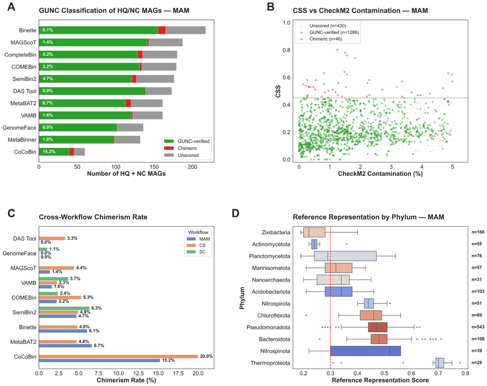

Figure 9: **GUNC taxonomic-chimerism analysis of HQ and NC MAGs.** A 2×2 composite based on the real benchmark. **(A)** Per-tool GUNC classification of HQ+NC MAGs as stacked horizontal bars: GUNC-verified, chimeric (Clade Separation Score CSS &gt; 0.45 with adequate reference representation), and unscored (reference representation score RRS &lt; 0.3, too few references for a reliable call); the attrition rate is annotated per tool. **(B)** CSS versus CheckM2 contamination for every HQ+NC MAG, coloured by GUNC status, with the CSS = 0.45 chimerism threshold as a dashed line; the absence of any relationship shows the two metrics are orthogonal, i.e. GUNC flags chimeras that pass CheckM2's contamination filter. **(C)** Cross-workflow GUNC chimerism rate per tool (MAM vs CS, and SC where available) as grouped bars. **(D)** Reference representation score (RRS) distribution per phylum (boxplots), identifying the deep-branching phyla whose sparse reference coverage (RRS &lt; 0.3) leaves them unevaluable by GUNC. Panels A, B and D use the MAM workflow.

## 3.6 Genome Observational Limits

The preceding sections compared tools on yield, quality, and chimerism. This section instead tests whether the MAM tools differ at the margins of genome recovery: large consensus genome size, low contig N50, and high contig count. Genome size is reported as the consensus true size per unique genome cluster (Section 2.11), whereas contig N50 and total contig count use individual filtered MAGs. Across 767 genome clusters, consensus size ranged from 0.43 to 7.97 MB with a median of 2.94 MB, so the analysis focuses on upper-tail recovery rather than community-wide size structure.

### Large Genome Recovery

Median consensus genome size was nearly identical across tools, ranging from 2.88 MB for VAMB and CoCoBin to 3.04 MB for SemiBin2 (Figure 10E), indicating no central genome-size bias. Differences appeared only in the upper tail: the fraction of unique genomes at or above 5 MB ranged from 5.1% for VAMB (24 of 472) to 8.2% for CompleteBin (51 of 624), a 1.6-fold difference (Figure 10A). CompleteBin also had the highest Q95 value (5.34 MB versus 5.01 MB for VAMB) and reached furthest into the extreme tail, recovering 14 genomes at or above 6 MB and 7 at or above 7 MB, compared with 4 and 1 for VAMB and 5 and 1 for GenomeFace.

### Assembly Fragmentation Tolerance

Fragmentation showed stronger tool separation than genome size. Median contig N50 ranged from 4.64 KB for CompleteBin to 7.27 KB for GenomeFace, compared with a global MAM median of 5.45 KB (Figure 10D). The low-N50 tail showed the largest divergence: 9.7% of CompleteBin MAGs had N50 at or below 3 KB (66 of 681), compared with 0.9% for GenomeFace (4 of 455), a 10.8-fold difference (Figure 10B). Total contig count followed the same pattern, with median counts of 479 for CompleteBin and 279 for GenomeFace (Figure S24), and at least 1,000 contigs in 5.6% versus 0.7% of MAGs, respectively (Figure 10C). CompleteBin therefore extends recovery into fragmented assemblies that other tools leave unbinned, whereas GenomeFace preferentially retains cleaner, more contiguous MAGs at the cost of lower yield (446 versus 624 genomes). GC content and coding density were nearly identical across tools (median GC 0.51 to 0.52; median coding density 0.895 to 0.899), indicating no systematic compositional recovery bias.

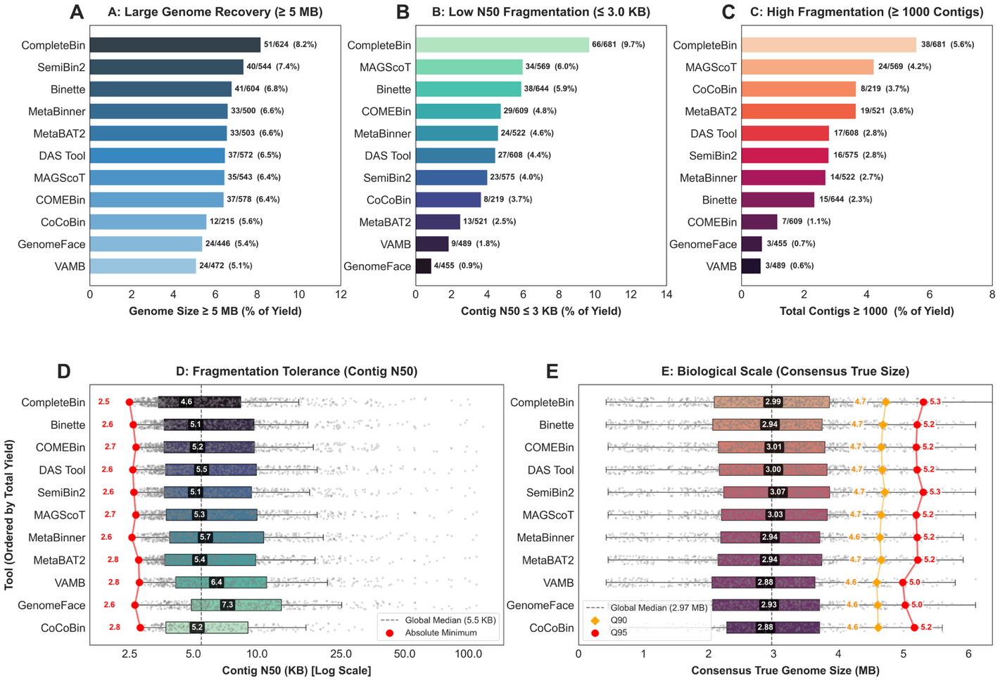

Figure 10: **Genome observational limits: recovery at the extremes of genome size and assembly fragmentation (MAM workflow).** **(A–C)** Proportion of each tool's MAGs that are **(A)** large genomes (consensus true genome size ≥ 5 MB, computed on genome-deduplicated clusters), **(B)** fragmented by low N50 (contig N50 ≤ 3.0 KB), and **(C)** fragmented by high contig count (≥ 1000 contigs), as horizontal bars per tool. **(D)** Per-tool distribution of contig N50 (KB, log-scale boxplots with jittered points; the global median is a dashed line, each tool's absolute-minimum N50 a red marker joined across tools, and medians annotated). **(E)** Per-tool distribution of consensus true genome size (MB) as boxplots with jittered points; the global median (2.97 MB) is a dashed vertical line, and per-tool Q50 (yellow circle) and Q90 (red circle) percentile markers are annotated with their values to show both the typical and the upper tail of each tool's size distribution. Tools are ordered by total yield. The figure tests whether tools differ at the margins of recoverability rather than on average.

## 3.7 Taxonomic Composition and Novelty

This section quantifies how much of the recovered diversity represents previously uncharacterised lineages and whether the depth of that novelty differs across tools.

### Volume of Taxonomic Novelty

After applying the MQ quality filter, destructive GTDB-Tk warning filter (Section 2.5), and retaining only MAGs with valid RED values, the MAM workflow yielded 5,893 evaluable MAGs across all 11 tools. Of these, 5,214 (88.5%) lacked a species-level match in the GTDB r220 database and were classified as taxonomically novel (Figure 11A,B, Figure 11C,D). The per-tool novelty fraction was stable: GenomeFace had the highest rate (89.2%, 406 of 455), CoCoBin the lowest (86.3%, 189 of 219), and the remaining nine tools fell within 87.5 to 89.1%. This narrow 2.9 percentage point range across tools with 2.9-fold yield differences (CompleteBin 604 novel versus CoCoBin 189) confirms that the novelty rate is governed by the environment, not the algorithm.

In absolute terms, CompleteBin recovered the most novel lineages (604), followed by Binette (574), DAS Tool (542), COMEBin (540), and SemiBin2 (508). The absolute ranking mirrored the overall MQ+ yield ranking from Section 3.1, confirming that higher-yielding tools simply recover proportionally more novelty. Cross-workflow totals showed the same pattern: CS produced 3,452 novel MAGs from 3,902 total (88.5%), and SC produced 1,817 from 2,050 (88.6%), nearly identical to the MAM rate (88.5%) (Figures S39 - S42).

### Novelty Depth and Compositional Invariance

The vast majority of novel MAGs represent shallow divergences from known species. Within the MAM bacterial pool, novel species accounted for a mean of 60.5% (SD 1.75%) of all novel MAGs across tools, novel genera for 31.7% (SD 2.28%), novel families 6.3% (SD 0.82%), novel orders 1.3% (SD 0.19%), and novel classes 0.2% (SD 0.13%). No validated novel phyla were recovered by any tool in any workflow (Figure 11C,D). Archaeal novelty was shallower, reaching only the family level: each of the 11 tools recovered exactly 1 novel archaeal family, with the remainder resolving as novel species (mean 71.5%, SD 3.66%) and novel genera (mean 25.3%, SD 3.87%).

In absolute terms, CompleteBin recovered 347 novel bacterial species, 164 novel genera, 37 novel families, 7 novel orders, and 1 novel class. CoCoBin, despite its low yield, recovered 100 novel species, 64 novel genera, 7 novel families, 2 novel orders, and 1 novel class. The deepest bacterial MAG in the dataset was a novel class within the Elusimicrobiota phylum, recovered by 10 of 11 tools (all except Binette) in the MAM workflow with RED values between 0.394 and 0.397, aligning with the expected class-level divergence interval (GTDB bacterial class median = 0.450).

The low standard deviations in the proportional breakdown reveal a second layer of invariance beyond the overall novelty rate. Despite CompleteBin recovering 3.2 times more novel bacterial MAGs than CoCoBin (556 versus 174), their proportional rank distributions were nearly identical: novel species constituted 62.4% versus 57.5%, novel genera 29.5% versus 36.8%, and novel families 6.7% versus 4.0%. A chi-squared test on the tool-by-rank contingency table confirmed this invariance for both bacteria (chi-squared = 12.6, df = 40, p = 1.00) and archaea (chi-squared = 3.6, df = 20, p = 1.00). The standard deviation across all 11 tools was below 2.3 percentage points for every bacterial novelty rank, and an identical invariance pattern held in the archaeal domain and across both the CS and SC workflows.

This compositional invariance establishes that the taxonomic depth distribution of recoverable novelty is an intrinsic property of the microbial community. No single algorithm possesses a mathematical advantage for targeting deeply rooted ancestral lineages over shallow divergences.

### RED Validation of Novelty Depth

The continuous RED distributions confirmed that parsed novelty ranks correspond to genuine phylogenetic depth (Figure 11A,B). For CompleteBin, bacterial novel species registered RED values from 0.843 to 0.997 (median 0.952), clustering above the GTDB genus median (0.922). Novel genera spanned 0.697 to 0.909 (median 0.815), novel families 0.533 to 0.868 (median 0.701), and novel orders 0.439 to 0.669 (median 0.518), each occupying the expected interval between adjacent rank medians. This cascading pattern was consistent across all tools and both domains.

Some individual MAGs registered RED values outside their expected interval (e.g. a novel family at RED 0.868), which reflects GTDB-Tk's design: topology takes precedence over RED when assigning ranks, and the ±0.1 RED tolerance window accommodates the biological reality that evolutionary rates vary across lineages (Parks et al., 2018).

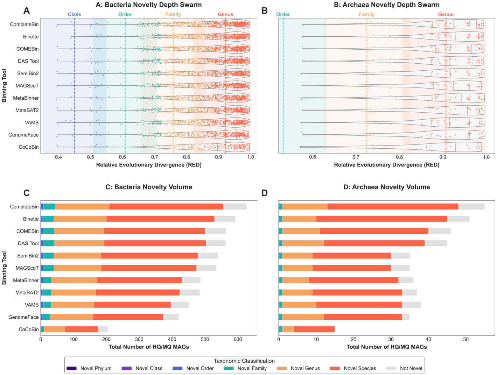

Figure 11: **Taxonomic novelty: phylogenetic depth and volume of recovered lineages (MAM workflow), faceted by domain.** Novelty rank is parsed from the highest unassigned level of each MAG's GTDB-Tk classification string. **(A, B)** Novelty depth: per-tool distribution of Relative Evolutionary Divergence (RED) shown as violin density with jittered points coloured by novelty rank, for **(A)** Bacteria and **(B)** Archaea; dashed vertical lines and shaded bands mark the GTDB rank-median RED intervals (genus, family, order, …), against which the continuous RED values of each parsed novelty rank are validated. **(C, D)** Novelty volume: per-tool stacked horizontal bars of total HQ/MQ MAG counts, segmented by classification from Not Novel through Novel Species, Genus, Family, Order, Class and Phylum, for **(C)** Bacteria and **(D)** Archaea.

## 3.8 Strain Resolution

The preceding analyses evaluated genome recovery at the 95% ANI species boundary (Section 2.5), which collapses all within-species variants into a single representative. This section quantifies strain-level recovery by comparing species-level (95% ANI) and strain-level (99% ANI) dereplication outputs (Section 2.13), revealing how much additional within-species diversity each tool and workflow preserves.

### Strain Gain and the Cross-Sample Recovery Mechanism

Raising the dereplication threshold from 95% to 99% ANI increased the total MQ+ MAG count from 12,549 to 21,838 across all 24 tool-workflow combinations, a gain of 9,288 strain-level MAGs (74.0% increase) (Figure 12).

As established in Section 2.13, this entire strain gain originates from cross-sample recovery: across all 24 tool-workflow combinations, zero same-sample MAG pairs share ANI at or above 95%, a finding confirmed in both the final dereplicated output and the full dRep Ndb prior to dereplication (625,013 possible same-sample pairwise comparisons across all MAM tools yielded zero within-species hits) (Figure S25A-B, Figure S26A). ΔN therefore measures how many of a tool's species have recoverable strain variants in other depth-layer samples, not whether a tool can separate co-existing strains within the same sample. The absence of within-sample strain separation most likely reflects chimeric assembly by MEGAHIT, which produces consensus contigs when two highly similar genomes co-exist at comparable abundance (Li et al., 2015), making separation impossible at the binning stage regardless of the algorithm used. Competitive exclusion within individual depth layers and binner merging of co-existing strains with similar compositional and abundance signals are likely contributing factors. The simulated strain stress test (Section 3.8) provides the controlled complement for testing genuine within-sample strain separation.

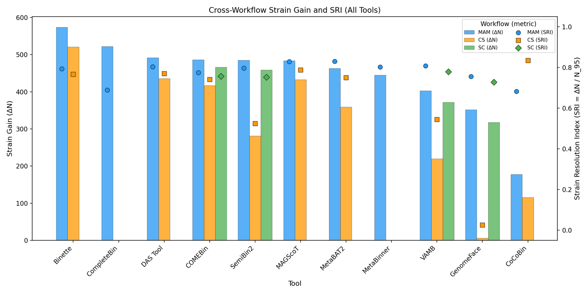

Figure 12: **Cross-workflow strain recovery per tool (real benchmark, 95% versus 99% ANI dereplication).** Grouped bar chart of strain gain ΔN (= N_99 − N_95, the number of additional MQ+ MAGs retained when the dereplication threshold is raised from the 95% ANI species boundary to 99% ANI) for each tool under MAM, CS and SC (bars coloured by workflow), with the yield-normalised strain resolution index SRI (= ΔN / N_95) overlaid as dots on the secondary y-axis (marker shape per workflow). Tools are ordered by MAM ΔN.

### Cross-Workflow Strain Resolution

MAM produced consistently higher strain gain than CS for all nine shared tools without exception (Figure 12). The mean ΔN was 435 for MAM versus 310 for CS (Wilcoxon signed-rank W = 0.0, p = 0.004, n = 9). For the four tools shared across all three workflows, the ranking was MAM (mean ΔN = 432) > SC (404) > CS (231). This ordering extends the binning-scope effect (Section 2.4) to the strain level. MAM's fully independent per-sample binning preserves strain-level variation by design, because strain variants from different samples are processed in separate binning runs and cannot be merged. SC's per-sample clustering (after global training) preserves most of this independence. CS's concatenated binning scope exposes all within-species contigs from all 20 samples to a single clustering call, enabling the algorithm to merge cross-sample strain variants into a single bin. Although the post-hoc splitting step subsequently separates these merged bins by sample-of-origin header, the resulting sub-MAGs are fragments of a merged cluster rather than independently reconstructed genomes.

The yield-normalized strain resolution index (SRI = ΔN / N_95) reveals that the MAM advantage varies substantially across tools. MAM SRI values clustered tightly (0.68 to 0.83, median 0.80), while CS values ranged from 0.025 to 0.84. Binette (SRI: MAM 0.79 versus CS 0.77), MAGScoT (0.83 versus 0.79), and COMEBin (0.77 versus 0.74) lost little proportional strain resolution under CS, indicating algorithmic robustness to the concatenated binning scope. In contrast, SemiBin2 (0.80 versus 0.52), VAMB (0.81 versus 0.54), and GenomeFace (0.76 versus 0.03) showed dramatic SRI drops.

GenomeFace CS was the most extreme outlier, recovering only 6 additional MAGs at 99% ANI (SRI = 0.025) versus 352 under MAM and 318 under SC. In CS mode, GenomeFace embeds all contigs from all 20 concatenated samples through two neural networks and clusters them in a single global HDBSCAN call. Same-species contigs from different samples form a single dense region in the combined embedding space, and HDBSCAN merges them into one cluster rather than resolving per-sample sub-clusters. In MAM and SC mode, per-sample clustering prevents this cross-sample merging entirely. Other CS tools retain more strains because their clustering features incorporate per-sample abundance information that can distinguish contigs from different samples even when compositional profiles converge (e.g. MetaBAT2's coverage covariance score, SemiBin2 and COMEBin's per-sample coverage embeddings).

### Cross-Tool Strain Resolution within MAM

Within the MAM workflow, the absolute strain gain ranking closely mirrored the species-level yield ranking from Section 3.1. Binette led with ΔN = 574, followed by CompleteBin (522), DAS Tool (492), COMEBin (486), and SemiBin2 (485). Regressing ΔN on N_95 across all 24 tool-workflow combinations confirmed this relationship: Spearman ρ = 0.959 (p < 0.0001), OLS slope = 0.88 (R² = 0.880), meaning each additional species-level MAG predicts approximately 0.88 additional strain-level MAGs (Figure S27). Strain resolution is therefore predominantly a byproduct of species-level yield rather than a distinct algorithmic capability, which follows directly from the cross-sample recovery mechanism: tools that recover more species have more raw material for strain-level dereplication to split.

The SRI ranking reveals a different hierarchy. MetaBAT2 (SRI 0.83) and MAGScoT (0.83) led, followed by VAMB (0.81), DAS Tool (0.80), and MetaBinner (0.80). CompleteBin's SRI (0.69) was the second-lowest among MAM tools despite its highest species yield (758 MAGs), and CoCoBin was the lowest (0.68). Since ΔN measures cross-sample recovery, CompleteBin's low SRI means its additional species-level MAGs (the rare, fragmented genomes from Section 3.6) tend to be the single-strain species in the dataset. These single-strain species dilute the SRI denominator without contributing cross-sample variants. This interpretation is confirmed by the per-species strain structure analysis: CompleteBin had the highest species count (751) but the second-lowest multi-strain fraction (26.4%), compared to 30.8 to 33.8% for most other tools (Figure S28). Most multi-strain species harboured 2 to 3 strains, with a strongly right-skewed tail extending to 15 to 19 strains per species depending on the tool.

### Within-Species ANI Landscape

Among the 99% dereplicated MAGs, 52,822 within-species pairwise comparisons between MAGs that both survived dereplication as distinct representatives (i.e. both belong to the same 95% Cdb species cluster but were retained as separate genomes at 99% ANI) had a median ANI of 98.40% (IQR 97.99 to 98.75%) (Figure S29). The distribution was unimodal and concentrated between 97 and 99%, with no secondary peak near 99.5% that would indicate near-clonal assembly duplicates. This confirms that the strain gain reflects genuine within-species biological diversity at the 1 to 3% divergence range, not artifactual near-duplicates from assembly-level variation. The surviving nearest-neighbour ANI (NN-ANI) profiles were consistent across tools and workflows, with median NN-ANI ranging from 98.55 to 98.70% across all MAM tools (Figure S30). GenomeFace CS was again the outlier, with only 16 of its 243 MAGs having any non-self pairwise comparison among dereplicated representatives (versus 551 for GenomeFace MAM), reflecting how thoroughly global HDBSCAN clustering merged within-species representatives.

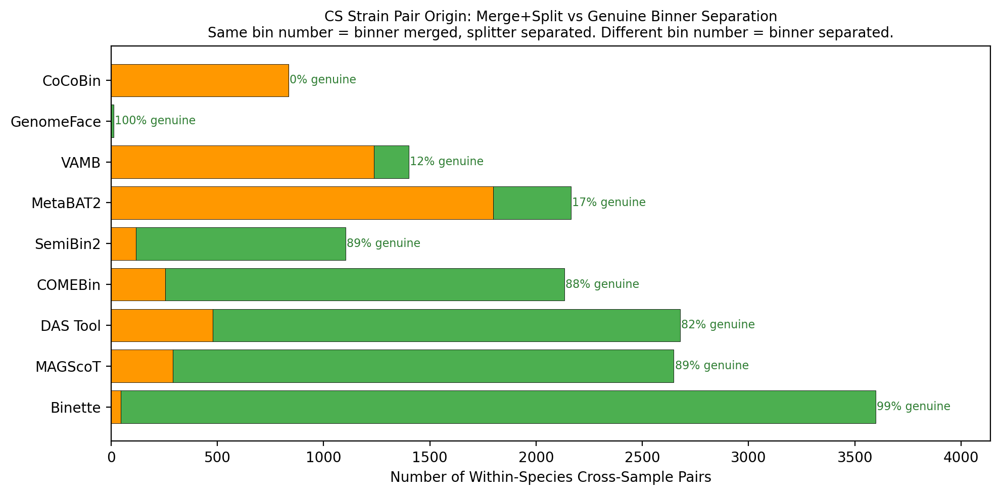

Figure 13: **Origin of CS strain-level MAGs: genuine binner separation versus merge-and-split (real benchmark).** For each CS tool, the within-species cross-sample strain pairs recovered at 99% ANI are classified as genuine separation (green; the binner itself assigned the two samples' contigs to different clusters / bin numbers) or merge-and-split (orange; the binner placed them in a single bin and the post-hoc sample-of-origin splitter separated them), shown as a stacked horizontal bar with the percentage of genuine separations annotated per tool. The classification distinguishes tools that truly resolve cross-sample strains from those whose CS strain gain is an artefact of the splitting step.

### CS Genuine Separation versus Merge-and-Split

For CS tools, the bin-number analysis (Section 2.13) distinguished strain-level MAGs produced by genuine binner separation (different bin numbers, meaning the binner assigned within-species contigs from different samples to distinct clusters) from merge-and-split artifacts (same bin number, meaning the binner grouped all within-species contigs into one bin and the post-hoc splitting script separated them by sample-of-origin header). Across 16,574 within-species cross-sample CS pairs, tools showed dramatically different separation behaviours (Figure 13).

Among the six standalone CS tools, SemiBin2 (89.3% genuine) and COMEBin (88.1%) achieved high genuine separation rates, as their deep learning architectures incorporate explicit per-sample coverage features that learn embeddings which distinguish same-species contigs by their sample-specific abundance profiles. In contrast, MetaBAT2 (16.9% genuine), VAMB (11.6%), and CoCoBin (0.0%) produced strain-level MAGs almost entirely through the merge-and-split mechanism. MetaBAT2's composite distance score and VAMB's VAE latent space map same-species contigs to similar representations regardless of sample origin, causing the clustering algorithm to group them into single bins. CoCoBin's co-abundance approach inherently groups contigs with correlated abundance profiles, making cross-sample same-species merging inevitable. GenomeFace showed 100% genuine separation but on only 12 pairs, too few for meaningful comparison. The ensemble tools (MAGScoT, DAS Tool, Binette) do not perform clustering themselves and therefore cannot genuinely separate or merge contigs. For tools like MetaBAT2 and VAMB, CS strain gain is functionally identical to MAM's cross-sample recovery, as both rely on post-hoc separation rather than binner decisions. For tools like SemiBin2 and COMEBin, CS strain gain partially reflects the binner's ability to resolve same-species contigs from different samples when presented simultaneously.

### New Strain Quality Validation

A key question is whether the new strain MAGs (in the 99% set but not the 95% set) are genuine biological variants or low-quality fragments of the same genome that fail to align above 99% ANI. The 9,318 new strain MAGs had modestly lower completeness (median 77.3% versus 80.3% for existing MAGs) and slightly higher contamination (2.9% versus 2.1%), consistently across all workflows (Figure S31). This gap is a direct consequence of dRep selecting the highest-quality genome as each species representative: the existing MAGs are by definition these top-scoring representatives, and the new strains are the second-best or lower genomes previously collapsed. The modest size of the gap (approximately 3 pp. completeness, 0.8 pp. contamination) confirms the new strains are genuine biological variants rather than fragmentation artifacts. An HQ-only sensitivity analysis reduced absolute ΔN substantially (352 to 574 at MQ+ versus 40 to 87 at HQ for MAM tools), showing strain variants concentrate in the MQ tier, but left the tool ranking stable (MetaBAT2 SRI 0.45, MAGScoT 0.42, Binette 0.40, SemiBin2 0.40; CompleteBin 0.33), confirming that MAG incompleteness does not drive the tool-level differences (Figure S32).

### Simulated Strain Stress Test

The real-data analysis established that all observed strain gain comes from cross-sample recovery, with no within-sample strain separations detected. The simulated strain stress test addresses this gap directly by evaluating within-sample strain resolution under controlled ground-truth conditions: seven empirically derived strain pairs spanning 95.0 to 99.9% ANI, five abundance ratios (1:1 to 1:20), and four mapping modes (SSM, MAM, CS, SC), evaluated against AMBER ground-truth assignments (Sections 2.2, 2.14).

### Resolution Horizon

The most prominent result was a universal resolution wall at 99.5% ANI: across all 11 tools, all four mapping modes, and all five abundance ratios, zero strains were successfully resolved at 99.5% or 99.9% ANI (0 of 500 possible successes) (Figure 14A). This wall defines the absolute compositional resolution limit of current short-read binning algorithms on clean, digitally shredded contigs where assembly artifacts are excluded by design.

Below this wall, resolution depended strongly on whether tools had access to multi-sample coverage information. In SSM mode, where each sample is binned using only its own reads (Section 2.2), the equal-abundance (1:1) condition produced complete failure: zero strains resolved across all 11 tools and all seven ANI levels (Figure 14A, Figure 14B). Without any coverage differential, the k-mer composition overlap between same-species strains prevented separation even at 95% ANI. At abundance ratios of 1:2 and above, a within-sample coverage differential became available, and SSM success jumped to 54 to 58%, but only for strains at 99.0% ANI or below. Aggregated across all 35 conditions (7 ANI levels x 5 ratios), tool performance in SSM separated into three tiers: Binette, COMEBin, and SemiBin2 led at 57.1% (40 of 70 strain targets each), followed by CompleteBin, DAS Tool, and MAGScoT at 55.7%. MetaBinner (32.9%) and CoCoBin (31.4%) occupied a lower tier, while GenomeFace was a drastic outlier at 4.3% (3 of 70), reflecting its marker-gene-based clustering approach that cannot leverage within-sample coverage signals.

MAM mode, which provides all five BAM files to each per-sample binning run (Section 2.2), rescued resolution at the 1:1 condition: even though the sample being clustered has equal-abundance strains, the binner observes the full 1:1-to-1:20 coverage gradient embedded across the five BAM files. MAM resolution was stable across all abundance ratios (57 to 62%) because the cross-sample coverage matrix was always available (Figure 14A, Figure S33). Aggregated across all conditions, the tool ranking shifted relative to SSM: Binette, COMEBin, and MAGScoT led at 70.0%, while CoCoBin (45.7%), MetaBinner (48.6%), and VAMB (52.9%) formed the bottom tier. At the hardest 1:1 condition, Binette, COMEBin, CompleteBin, and MAGScoT each resolved 10 of 14 strains (71.4%), resolving pairs up to 99.0% ANI, while CoCoBin resolved only 6 of 14 (42.9%). GenomeFace and SemiBin2 could only resolve pairs up to 98.0% ANI in MAM. Resolution did not decrease monotonically with ANI similarity: the 97% pair was resolved more readily (99.1% of tools) than the 96% pair (66.4%), reflecting pair-specific differences in genome architecture rather than a strictly ANI-proportional difficulty gradient. SC performed comparably to MAM for the three tools evaluated (COMEBin 71.4%, GenomeFace 70.0%, VAMB 55.7%) (Figure S34).

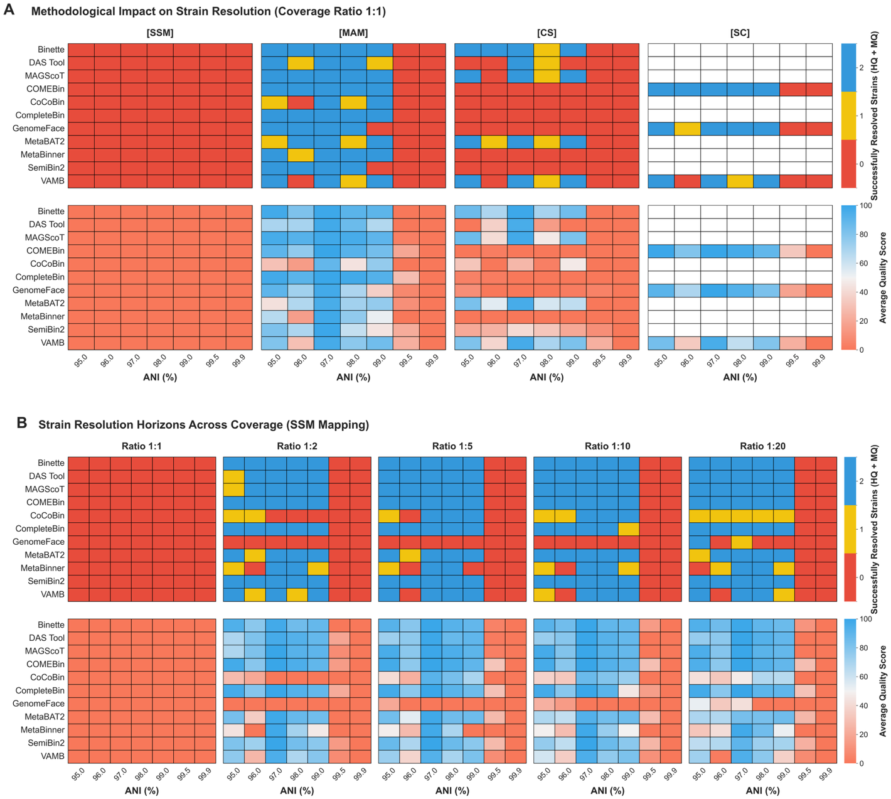

Figure 14: **Strain resolution horizons under controlled coverage and mapping (CAMISIM simulation, AMBER ground truth).** In every heatmap, rows are tools (ensemble-first) and columns are strain-pair ANI levels (95.0–99.9%); cell colour shows either the number of the two simulated strains successfully resolved as HQ/MQ bins (discrete 0/1/2, red/yellow/blue) or the mean AMBER quality score (continuous diverging scale). **(A)** Methodological impact at the hardest 1:1 abundance ratio: resolved-strain (top sub-row) and quality-score (bottom sub-row) heatmaps across the four mapping modes (SSM, MAM, CS, SC), isolating the contribution of cross-sample coverage information. **(B)** Resolution horizons under single-sample mapping (SSM) across the five abundance ratios (1:1 to 1:20): resolved-strain and quality-score heatmaps showing how a within-sample coverage differential rescues resolution as the ratio steepens. The universal failure above 99.5% ANI appears as the right-hand columns turning uniformly unresolved.

### CS Deterministic Clone Trap

CS mode suffered catastrophic failure on the simulated dataset (22.7% overall), but this was driven by a simulation-specific artifact. Because the 50 background genomes were simulated with identical abundance across all five samples (Section 2.2), concatenation produced five mathematically identical sequence clones per background contig (sharing exact TNF and coverage profiles), triggering algorithmic failures in five standalone tools (COMEBin, CompleteBin, SemiBin2, MetaBinner, GenomeFace: 0 to 2.9% strain resolution success), while MetaBAT2 (60.0%) and VAMB (45.7%) survived because their distance-based and medoid-based clustering approaches tolerate identical duplicates within a cluster (Figure S35). These CS results should not be extrapolated to real metagenomic data, where biological variation prevents exact contig duplication across samples.

### Failure Archetypes

Ground-truth AMBER classifications at the SSM 1:1 condition, where every tool failed, revealed two distinct failure archetypes (Figure 15). Aggressive mergers (MetaBAT2, CoCoBin) grouped both strains of a pair into single chimeric bins: both tools produced 7 complete chimeras and 7 unbinned strains out of 14 targets. Conservative fragmenters (CompleteBin, GenomeFace) refused to commit uncertain contigs, instead producing tiny incomplete fragments: CompleteBin classified 12 of 14 strains as incomplete chimeras (high contamination, low completeness), while GenomeFace produced 9 incomplete chimeras and 5 unbinned strains. COMEBin, SemiBin2, and VAMB showed mixed profiles dominated by incomplete chimeras (10 to 11 of 14). GenomeFace was the only tool that failed to recover any of the 14 strains even at the 1:10 ratio in SSM mode (0 of 14), while all other tools recovered 6 to 10 strains at this condition (Figure 15, Figure S36).

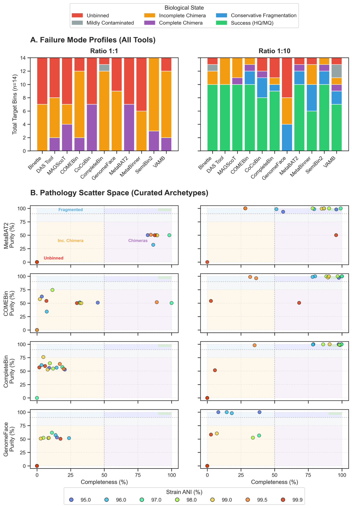

Figure 15: **Ground-truth archetypes of strain binning failure (CAMISIM simulation, AMBER).** **(A)** Failure-mode profiles for all 11 tools at the 1:1 (left) and 1:10 (right) abundance ratios: stacked bars partition each tool's 14 target-strain reconstructions into Success (HQ/MQ), Conservative Fragmentation, Complete Chimera, Incomplete Chimera, Mildly Contaminated, and Unbinned. **(B)** Pathology scatter space for the four archetype tools (rows: MetaBAT2, COMEBin, CompleteBin, GenomeFace) at the 1:1 and 1:10 ratios (columns): each target-strain bin is plotted by AMBER completeness (x) against purity (y), coloured by strain-pair ANI, with the regions of the plane labelled (Unbinned at bottom-left, Chimeras at high-completeness/low-purity, Incomplete Chimera, Fragmented at high-purity/low-completeness). The contrast separates aggressive mergers (chimeras) from conservative fragmenters (low-completeness fragments).

### Chimera Size Bloat

The size ratio (recovered bin length divided by known genome length) quantified merger severity at the 1:1 condition (Figure S37). MetaBAT2 produced a mean size ratio of 1.90, with all 7 non-unbinned bins exceeding 1.5x the expected genome length, confirming near-complete merger of both strains into single bins. CoCoBin reached a mean of 2.05 (maximum 3.08), exceeding the theoretical 2.0x ceiling through incorporation of off-target background contigs. At the opposite extreme, CompleteBin (mean 0.20), GenomeFace (mean 0.22), and VAMB (mean 0.29) produced fragments well below the expected genome size, consistent with their conservative fragmentation phenotype. SemiBin2 (0.65) and COMEBin (0.64) occupied the middle ground with partial mergers. At 1:10, size ratios normalized as resolution improved: MetaBAT2 dropped from 1.90 to 0.82, CoCoBin from 2.05 to 0.73, and most tools converged toward the ideal 1.0, except for GenomeFace.

## 3.9 Computational Efficiency

This section quantifies runtime, peak memory, and scaling behaviour for the eight standalone binning tools across all three workflows (Section 2.15). Ensemble tools (Binette, DAS Tool, MAGScoT) are excluded from direct comparison because their true cost depends on upstream tool selection rather than on the assembly itself.

### Runtime and Peak Memory

CompleteBin was by far the most expensive tool in the MAM workflow, consuming 287.5 hours of total wall-clock time and 177.5 GB peak PSS, 70.1x longer and 93.4x more memory-intensive than MetaBAT2 (4.1 hours, 1.9 GB). No other tool exceeded 50 hours in any workflow, placing CompleteBin in a qualitatively different cost category. At the other extreme, MetaBAT2 was the fastest and second-lightest tool, followed by VAMB (5.5 hours, 2.1 GB) and CoCoBin (6.5 hours, 1.0 GB peak memory, the lowest of any tool) (Figure 16).

Among higher-cost tools, COMEBin was the second-most expensive at 36.7 hours and 37.1 GB. MetaBinner consumed 25.3 hours and 11.0 GB. SemiBin2 occupied a middle position at 12.8 hours and 20.3 GB. GenomeFace required 8.5 hours total, but 94.8% was preprocessing (marker gene annotation and JGI abundance computation); its actual binning took only 0.44 hours, the fastest raw binning time of any tool (Figure 16, Figure S38).

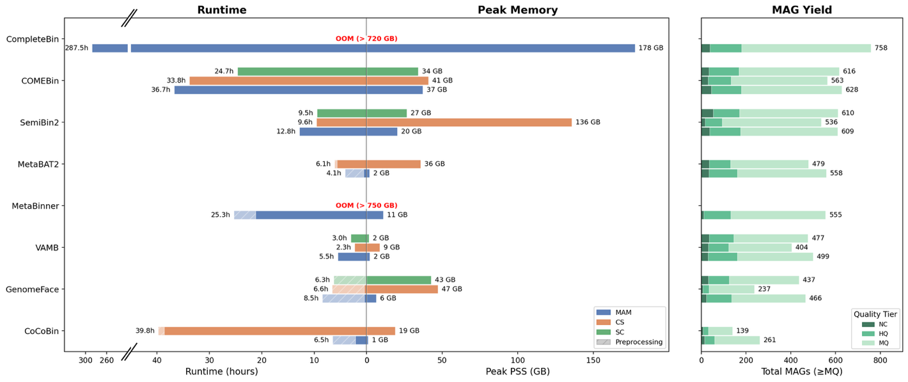

Figure 16: **Computational cost and yield per tool and workflow (standalone tools, real benchmark).** Population-pyramid layout with one row per standalone tool (ranked by maximum MQ yield; ensemble tools excluded) and the three workflows shown as adjacent colour-coded bars. From the centre outward: runtime in hours extends to the left (split into binning and, hatched, preprocessing components, on a broken axis that accommodates the extreme runtimes), peak memory (peak PSS, GB) extends to the right, and a separate right-hand panel gives MAG yield (total MAGs ≥ MQ).

### Workflow Comparison

The four tools present in all three workflows (COMEBin, SemiBin2, VAMB, GenomeFace) enabled direct workflow comparison. For runtime, MAM was the slowest workflow for most tools. COMEBin required 36.7 hours (MAM), 33.8 hours (CS), and 24.7 hours (SC). SemiBin2 required 12.8, 9.6, and 9.5 hours. VAMB was fastest in CS (2.3 hours) and SC (3.0 hours) compared to MAM (5.5 hours). The exceptions were MetaBAT2 and CoCoBin, where CS was slower than MAM. MetaBAT2 took 4.1 hours in MAM versus 6.1 hours in CS, and CoCoBin took 6.5 hours in MAM versus 39.8 hours in CS (Figure 16).

For peak memory, CS always demanded more memory than MAM, but the magnitude varied by tool. SemiBin2's peak PSS rose from 20.3 GB (MAM) to 135.7 GB (CS), a 6.7x increase. MetaBAT2 showed an even larger relative jump from 1.9 GB to 35.7 GB (18.5x). COMEBin was a notable exception: its CS peak memory (40.8 GB) was only 1.1x higher than MAM (37.1 GB), suggesting that its memory footprint is less sensitive to assembly size than other tools. In the SC workflow, COMEBin SC (34.0 GB) and VAMB SC (1.6 GB) were comparable to or slightly below their MAM values. SemiBin2 SC (26.6 GB) was modestly higher than MAM (20.3 GB). GenomeFace SC (42.7 GB) was 6.8x higher than its MAM memory (6.3 GB), approaching its CS level (47.2 GB), because the SC mode still processes the full concatenated assembly rather than individual sample assemblies.

MetaBinner and CompleteBin both failed with out-of-memory errors on the CS workflow, despite being allocated 750 GB and 720 GB of RAM respectively. The scaling analysis below provides a mechanistic explanation for these failures.

### Quality Versus Cost

Combining the yield data from Section 3.1 with the cost data above reveals a clear Pareto structure. Figure 17 presents three quality-versus-cost scatter panels (MQ+, HQ+, NC), where each point represents a tool-workflow combination and point size encodes peak memory. Figure S39 ranks the eight standalone MAM tools on three axes (quality, runtime, peak memory), showing that no tool simultaneously ranked in the top three on all three axes.

CompleteBin occupied an extreme position in every panel of Figure 17, with the highest runtime, largest memory footprint, and highest MQ+ yield (758). However, at the NC tier (39 bins), it was surpassed by SemiBin2 SC (54 NC bins at 9.5 hours and 26.6 GB) and COMEBin MAM (45 NC bins at 36.7 hours), demonstrating that CompleteBin's quality advantage narrows at the highest quality thresholds and the cost premium becomes harder to justify. MetaBAT2 was the cheapest tool per MQ+ bin at 0.4 minutes (71.1 MQ+ bins per GB-hour), achieving the highest resource efficiency despite ranking 4th in quality (558 MQ+ MAGs). SemiBin2 offered a compelling middle ground at 1.3 minutes per MQ+ bin (2.3 MQ+ bins per GB-hour), with 609 MQ+ MAGs (a 9.1% yield increase over MetaBAT2 for 3.1x the runtime). SemiBin2 ranked 3rd in quality, 4th in runtime, and 5th in memory, the best balance among tools recovering more than 600 MQ+ MAGs (Figure S39). At the HQ+ tier, MetaBAT2 remained cheapest at 1.5 minutes per bin, followed by VAMB (2.1 minutes) and SemiBin2 (4.4 minutes), while CompleteBin was most expensive at 95.8 minutes per HQ+ bin (Figure S40).

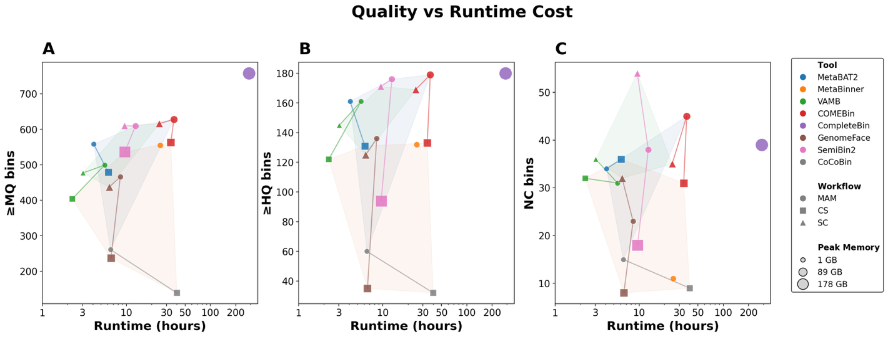

Figure 17: **Quality versus runtime cost (standalone tools, real benchmark).** Three Pareto panels for **(A)** ≥ MQ, **(B)** ≥ HQ, and **(C)** NC quality tiers. In each, bin count (y) is plotted against total runtime (x, log scale, hours); each point is one tool–workflow combination coloured by tool, with marker shape encoding workflow and point area proportional to peak memory (PSS, GB). Thin lines connect the same tool across workflows, and shaded convex hulls (one per workflow, over tools present in ≥ 2 workflows) bound each workflow's cost–yield region. The upper-left region (high yield, low runtime) is most efficient.

### Scaling with Assembly Size

Runtime scaling exponents (b) from power-law fits across 20 MAM assemblies (24.7 to 528.0 MB), with 95% bootstrap confidence intervals, fell into three groups (Figure S41). Sub-linear scaling (b < 0.8) was observed for CompleteBin (b = 0.05), GenomeFace (b = 0.48), SemiBin2 (b = 0.59), and VAMB (b = 0.72). CompleteBin's near-zero slope means its total runtime is essentially independent of assembly size, a consequence of its dynamic epoch auto-scaling, which assigns more training epochs to smaller assemblies and fewer to larger ones (capped at 200) and so largely cancels the per-epoch cost increase from larger assemblies. Approximately linear scaling was observed for COMEBin (b = 0.82) and MetaBinner (b = 1.12), and moderately super-linear scaling for MetaBAT2 (b = 1.52) and CoCoBin (b = 1.67). MetaBAT2's super-linear runtime, despite its fast absolute speed (4.1 hours across 20 samples), follows from its pairwise contig-distance computation over tetranucleotide frequency, abundance distance, and Pearson correlation (Kang et al., 2019), whose cost grows quadratically with contig count.

Memory scaling was substantially flatter than runtime scaling for most tools. SemiBin2 (b = 0.39), VAMB (b = 0.41), MetaBAT2 (b = 0.66), CoCoBin (b = 0.67), and GenomeFace (b = 0.67) all showed sub-linear memory scaling. COMEBin (b = 0.83) showed approximately linear memory scaling. CompleteBin (b = 1.11, R^2 = 0.89, CI [0.90, 1.37]) and MetaBinner (b = 1.19, R^2 = 0.74, CI [0.37, 1.60]) exhibited the steepest memory slopes. Both tools failed with OOM on the CSB assembly, consistent with their elevated scaling exponents. When extrapolated from the median MAM assembly (~339 MB) to the CSB concatenation (~6,209 MB), a factor of approximately 18.3x, CompleteBin's projected memory requirement is approximately 177.5 x 18.3^1.11 = 4,476 GB, far exceeding its 720 GB allocation. MetaBinner's projected requirement is approximately 11 x 18.3^1.19 = 350 GB, below its 750 GB allocation on paper, but the discrepancy between the 350 GB projection and the actual OOM failure reflects the limited extrapolation range of the power-law model fitted on 25 to 528 MB assemblies (Figure S41).

## 3.10 Summary Score and Integrated Ranking

Figure 18 integrates the preceding nine analyses into a ranked bubble-heatmap (Methods 1.16), with the composite score weighting the four scoring categories 40% Yield, 30% Quality, 20% Taxonomic Reach, and 10% Assembly Quality. Total_Wins, the two efficiency metrics, and the raw completeness and contamination columns are displayed for reference but excluded from the score.

CompleteBin ranked first overall (0.863), followed by Binette (0.828), COMEBin (0.779), SemiBin2 (0.739), MAGScoT (0.712), DAS Tool (0.659), MetaBAT2 (0.655), VAMB (0.617), GenomeFace (0.512), MetaBinner (0.459), and CoCoBin (0.310) (Figure 18, Figure S42). CompleteBin's lead was built across all four scoring categories. Its Yield score (0.847) reflected the highest MQ+ count (758, rank 1), with rank 3 in both HQ+ (180) and NC (39). Its Taxonomy score (0.956, highest) was driven by 27 exclusive genomes (rank 1), 604 novel MAGs (rank 1), and 522 strain-level gains (rank 2). Its Assembly score (0.954, highest) reflected the lowest median contig N50 (4.64 KB, rank 1), indicating recovery of the most fragmented genomes (Section 3.6). Despite the lowest mean completeness (74.2%) and second-highest contamination (3.38%), its Quality score (0.791) remained competitive because its All-FDR (0.116, rank 2) and |QS_Error| (1.09, rank 5) indicate high CheckM2 trustworthiness (Section 3.4). Binette ranked second with the highest Yield score (0.936), with 724 MQ+ (rank 2), 217 HQ+ (rank 1), and 41 NC (rank 2). Its Taxonomy score (0.758) was lower than CompleteBin's due to fewer exclusive genomes (10 versus 27) and fewer novel MAGs (574 versus 604).

COMEBin and SemiBin2 occupied positions 3 and 4 with balanced profiles across all scoring categories. COMEBin had the highest NC count (45, rank 1), the second-highest GUNC pass rate (0.978), and the second-highest Quality category score (0.804). SemiBin2 achieved the highest Assembly category score (0.867) and strong Yield (0.751). GenomeFace had the most polarized profile. It achieved the highest Quality score (0.809), ranking first in contamination (1.98%), GUNC pass rate (1.0), and All-FDR (0.112), but its Yield was the lowest (0.414), reflecting its conservative binning strategy (Section 3.1). CoCoBin ranked last (0.310) with the weakest Yield (0.047) and Taxonomy (0.013) scores.

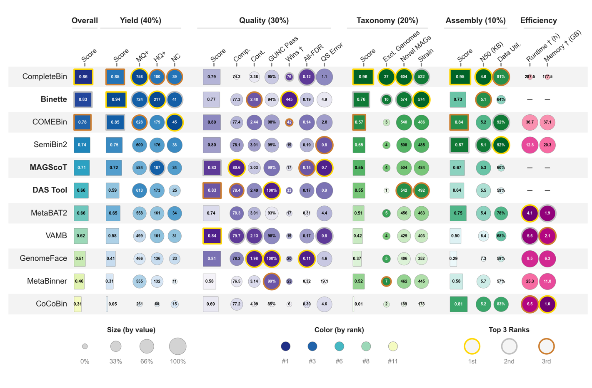

Figure 18: **Integrated multi-metric ranking of the 11 tools (MAM workflow).** Ranked bubble-heatmap integrating the preceding nine analyses: rows are tools ordered by the weighted composite score, columns are the 16 evaluation metrics grouped into the scoring categories Yield (40% weight), Quality (30%), Taxonomic Reach (20%), Assembly Quality (10%), and Efficiency (informational only). Within each column, bubble size encodes the normalised metric value and fill colour encodes the tool's rank on that metric (lighter = better; light-to-dark per-category gradient), with the metric value annotated inside each bubble; per-category sub-score bars and the final composite score accompany the rows. Three columns are displayed but excluded from the composite score: Total_Wins (Binette's ~73% win rate compresses the discriminating range for the other ten tools), Runtime_Hours, and Peak_Memory_GB. Mean_Completeness and Mean_Contamination are shown as separate columns for interpretability but enter the score combined as Mean_QS_5x. Data_Utilization measures a different quantity for ensemble tools (non-redundancy filtering of pre-binned input) than for standalone tools (de novo assembly coverage); it is retained in the score because its effective weight is small (0.05) and removing it does not change the ranking. Metric definitions and category weights are given in Methods 1.16.

### Ranking Sensitivity

The ranking was highly robust to alternative weighting schemes (Figure S43). Under all three alternatives (equal-weight, quality-heavy, yield-heavy), the top five tools (CompleteBin, Binette, COMEBin, SemiBin2, MAGScoT) maintained identical positions. The only rank changes occurred at positions 6 and 7, where DAS Tool and MetaBAT2 swapped under the equal-weight and yield-heavy schemes, and at positions 9 and 10, where GenomeFace and MetaBinner swapped under equal-weight. Spearman rank correlations between the primary and all alternative rankings ranged from 0.982 to 1.000, indicating near-perfect agreement in tool ordering regardless of how the four scoring categories are weighted.

### Cross-Workflow Ranking

The supplementary heatmap extends the ranking to all 24 tool-workflow combinations (Figure S44). CompleteBin MAM, Binette MAM, and Binette CS occupied the top three positions. SemiBin2 SC placed fourth, ahead of COMEBin MAM (fifth), despite lower MQ+ (610 versus 628) and HQ counts (171 versus 179). SemiBin2 SC achieved the highest NC count across all 24 entries (54, rank 1) and the second-highest Assembly score (N50 rank 3, data utilization rank 1), demonstrating that the SC workflow can match or exceed the generally dominant MAM workflow for tools with compatible architecture.

## 3.11 Ensemble Tool Analysis: The Input Paradox and Metric Bias

This analysis tests whether accumulating more standalone tool inputs monotonically improves ensemble output. Because Binette uses CheckM2 internally to score and select bins, any systematic bias in CheckM2 (Section 3.4) will propagate directly into its selection decisions. All experiments used Sample 1 of the CAMISIM simulated dataset with AMBER ground-truth evaluation (Section 2.17), bypassing the proxy metric entirely. The eight standalone tools were added cumulatively in three strategy-defined orders across eight steps, producing 72 scenarios (3 ensemble tools x 3 strategies x 8 steps). The primary analysis focuses on the Quality strategy, which adds tools in descending AMBER HQ yield starting with CompleteBin. For each step, HQ yield was evaluated against the Union Yield (unique HQ genomes in the accumulated input pool), the Baseline Yield (HQ count of the single best standalone tool), and the Realized Yield (actual ensemble output).

### The Input Paradox: More Tools, Worse Output

The central finding is counter-intuitive: adding more input tools reduces HQ yield for Binette, MAGScoT, and partially DAS Tool, and the gap between theoretical potential (Union) and realized output widens with input complexity (Figure 19A).

In the Quality strategy, the Union Yield grew from 47 at Step 1 to 52 at Step 8 as progressively weaker tools contributed unique HQ genomes. However, Binette's realized yield moved in the opposite direction, declining from 47 at Step 1 (matching the Union perfectly) to 42 at Step 8, a net loss of 5 HQ bins (10.6%) despite a pool that expanded by 5 unique genomes. MAGScoT showed a parallel decline, peaking at 47 at Step 2 and falling to 43 at Step 8. The Confusion Gap (Union minus Realized) widened from 0 to 10 for Binette and from 1 to 9 for MAGScoT. DAS Tool was more resistant to input noise, starting at only 43 HQ bins at step 1, peaking and maintaining 47 between Steps 4 and 6 before declining to 44 at Step 8 (Figure 19A). The Speed strategy, which starts with the weakest tools, confirmed that this degradation is not an artefact of starting with the strongest tool: the Confusion Gap still widened as input complexity grew, reaching 9 at Step 7 for Binette (Union 49, Realized 40). At Step 8, all three strategies converge to identical yields (Binette 42, DAS Tool 44, MAGScoT 43), as the full input pool is identical regardless of addition order.

### Genome-Level Fate: Downgrades Dominate Upgrades

To understand what happens to individual genomes as input complexity grows, each genome's fate was classified into categorical transitions across the quality tiers (Figure S45A, Figure S45D). In the Quality strategy, Binette maintained 47 HQ bins at Step 1, but by Step 8 only 42 remained at HQ while 10 were downgraded (Figure S45A). MAGScoT followed a similar trajectory, with downgrades increasing from 2 at Step 2 to 9 at Step 8. DAS Tool showed the same increasing trend in downgrades (2 at Step 2 to 8 at Step 8), but additionally exhibited a distinct failure mode: it filtered HQ bins entirely, losing 4 at Step 1 and 1 at Step 8. Aggregated across all steps and strategies, Binette downgraded 132 of 976 HQ inputs (13.5%), split into 124 to MQ and 8 to LQ, while never filtering out any HQ bins. DAS Tool downgraded 121 of 976 HQ inputs (12.4%), split into 90 to MQ and 31 to LQ, and additionally lost 41 HQ bins entirely. MAGScoT downgraded 117 of 867 HQ inputs (13.5%), split into 97 to MQ and 20 to LQ, with no lost bins (Figure S45D). Upgrades from lower tiers to HQ were rare: MAGScoT achieved 11, Binette 9, DAS Tool 1.

The continuous quality score analysis (Figure 19B-D) reveals the same pattern. Synergy events were both infrequent and mild, while degradation events were frequent and increasingly severe. In the Quality strategy, Binette's output at Step 2 consisted of 26.1% Neutral (unmodified), 26.1% Synergy, and 47.8% Degraded bins. By Step 8, this shifted to 2.4% Neutral, 16.7% Synergy, and 81.0% Degraded. Degradation severity worsened from a mean quality loss of -0.84 QS per degraded bin at Step 2 to -2.30 at Step 8, while synergy severity remained flat (+0.74 to +1.03 per event). DAS Tool and MAGScoT exhibited the same trajectory: degradation frequency increased and severity worsened (DAS Tool from -1.16 to -2.32, MAGScoT from -1.12 to -2.35 per degraded bin), while synergy events remained rare and low-magnitude. The mean quality score change across all processed bins was therefore consistently negative, declining from -1.21 at Step 2 to -3.56 at Step 8 for Binette, from -0.83 to -5.36 for DAS Tool, and from -0.40 to -4.71 for MAGScoT (Figure 19D).

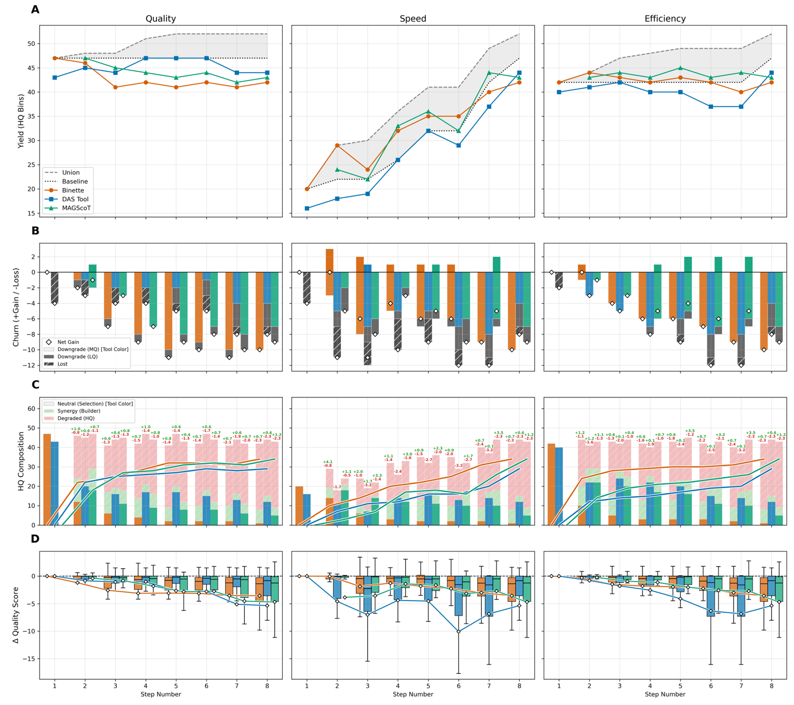

Figure 19: **Ensemble yield and quality dynamics as the number of input tools grows (ensemble analysis; CAMISIM Sample 1, AMBER ground truth).** Columns are the input-addition strategies (the primary Quality strategy adds standalone tools in descending AMBER HQ yield); the x-axis of every panel is the cumulative input step (1–8). **(A)** HQ-yield trajectory: each ensemble tool's realised yield against the Union yield (dashed; the unique HQ genomes available in the accumulated input pool) and the Baseline yield (dotted; the single best standalone input), with the Union−Baseline region shaded; the widening gap between Union and realised yield is the input paradox. **(B)** Genome churn per step: stacked counts of HQ-input fates (upgrade, downgrade to MQ, downgrade to LQ, lost). **(C)** Synergy composition per step: the proportion of processed bins that are Neutral, Synergy (improved), or Degraded. **(D)** Quality shift per step: boxplot of the per-bin change in AMBER quality score.

### CheckM2 Precision Blindness

Ground-truth evaluation of CheckM2 on all input and output bins exposed a systematic, regime-dependent bias that explains these destructive selections (Figure S16). CheckM2 completeness predictions tracked the diagonal closely (R^2 ~ 0.98), though with a consistent tendency toward overestimation (Figure S16D). Precision predictions, however, diverged sharply from ground truth in two pathological zones (Figure S16B, S16C, S16E).

In the "Hallucination Zone," small, fragmented bins with low completeness (<25%) and low real precision (<60%) received inflated CheckM2 precision predictions, often exceeding 95%. These bins contain too few marker genes for CheckM2 to detect contamination, so the model defaults to an optimistic estimate. In the "Panic Zone," large chimeric bins with high completeness (>80%) but low real precision (<60%) received extreme underestimation, with CheckM2 predicting near-zero precision (these are likely strain merges). The quality error exhibited a negative slope against real quality score (Figure S16A): bins with real quality below 70 were systematically overestimated (mean error +9.9 to +53.0 depending on tier), while bins with real quality above 90 were systematically underestimated (mean error -2.3). This compression of the predicted quality range created a false-positive trap for ensemble selection algorithms: a lower quality bin inflated to appear HQ can defeat a genuinely high-quality bin that is slightly penalized. Of 241 bins classified as HQ by CheckM2, 56 were false positives by AMBER ground truth, a false HQ rate of 23.2% (Figure S16F).

### Metric Bias Drives Destructive Selection in Binette

Because Binette uses CheckM2 internally to score and select bins, the precision blindness identified above propagates directly into its greedy selection algorithm. Ground-truth tracking of every genome processed by Binette across the Quality strategy classified each transition into four categories. An "Assassin Bin" is a degraded output where CheckM2 scored the selected bin equal to or higher than the best input, meaning Binette optimized its proxy objective correctly, but the proxy was discordant with ground truth. A "Botched Bin" is a degraded output where both AMBER and CheckM2 scores decreased. Botched events arise from competitive exclusion: when the best input bin for a given genome (the "Victim") shares contigs with a bin assigned to a different genome (the "Rival") that carries a higher CheckM2 score, Binette's greedy non-redundancy constraint selects the Rival and discards the Victim, leaving only a residual "Difference Bin" (the Victim stripped of overlapping contigs). If CheckM2 then scores this degraded Difference Bin lower than a third-rate alternative, the algorithm selects the inferior candidate.

Across the Quality strategy, 254 of 472 total transitions were classified as Assassin events (Figure 20A). In these cases, Binette selected a bin that appeared to improve quality (mean CheckM2 gain of +0.53 QS per event) but actually degraded it (mean AMBER loss of -3.60 QS). An additional 38 Botched events were identified (mean AMBER loss of -7.17 QS). The prevalence of these errors scaled with input complexity (Figure 20B). At Step 2, only 4.2% of HQ inputs were lost to metric bias errors. By Step 5, this rate reached 15.4% and remained there through Step 8. Cumulatively (Figure 20C), metric bias errors accounted for a quality loss of -155.5 AMBER QS points by Step 8, while synergy events contributed only +9.3, a ratio of 16.7:1. The mean severity per Assassin event (-3.6 AMBER points) was modest individually, but Botched events were more extreme (mean -10.5 points per event).

This degradation was invisible to Binette's internal diagnostics. When the gap between Union and Realized yield was measured by CheckM2 (Figure 20D, dashed line), only 1 HQ bin appeared missing at Step 8. The same gap measured by AMBER ground truth (solid line) widened to 10 missing bins. This "Metric Illusion" confirms that Binette successfully maximized a flawed proxy while systematically degrading biological quality. The mechanistic details of competitive exclusion, including contig-level forensic tracing of stolen core versus contamination sequences, are presented in Supplementary Materials S2.11.

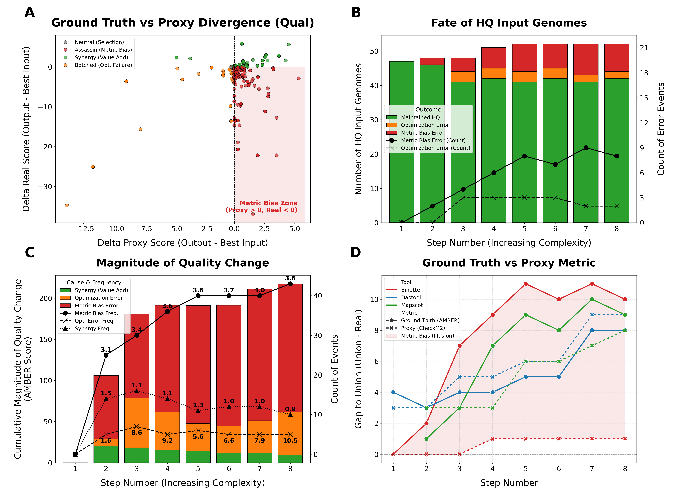

Figure 20: **Mechanism of ensemble degradation: proxy-metric bias in greedy selection (ensemble analysis, Quality strategy; CAMISIM Sample 1, AMBER ground truth).** **(A)** Forensic scatter of every genome transition: change in real AMBER quality (output − best input; y) versus change in the CheckM2 proxy (x); the shaded region contains "Assassin" events, where CheckM2 records an improvement but AMBER records a loss. **(B)** Categorical cost per input step: the number of HQ input genomes lost to metric-bias (Assassin) and optimisation (Botched) errors, with error-event counts on the secondary axis. **(C)** Continuous impact per step: cumulative magnitude of AMBER quality change across all processed inputs, separating synergy gains from degradation losses. **(D)** Gap analysis per step: the Union−realised yield gap measured by AMBER ground truth (solid) versus by the CheckM2 proxy (dashed); the divergence (shaded "metric illusion") shows the proxy reporting almost no loss while ground truth reveals a large one.

# 4 Discussion

## 4.1 Main Findings and Why a Hadal-Sediment Benchmark Matters

Metagenome-assembled genomes (MAGs) underpin nearly every culture-independent statement made about microbial diversity, metabolism, and ecology in modern microbiome research. They support comparative genomics, ARG and BGC cataloguing, ecological inference, GTDB-scale taxonomic reconstruction, and increasingly the construction of training datasets for genomic foundation models trained on nucleotide and protein sequences (Bowers et al., 2017; Almeida et al., 2021; Dalla-Torre et al., 2025; Nguyen et al., 2024; Lin et al., 2023). Every conclusion that flows from a MAG inherits the assumptions of the binning algorithm and workflow that produced it, so the choice of tool and workflow carries scientific weight that aggregate yield numbers alone cannot capture. This benchmark addresses that gap by evaluating 11 binning tools across three multi-sample workflows (MAM, CS, SC), giving 24 tool-workflow combinations, on 20 Atacama Trench hadal-sediment samples (1,517,440 filtered contigs totalling 6.21 Gb of assembly, 12,551 dereplicated MAGs at 95% ANI). The evaluation combines three orthogonal quality-control layers (CheckM2 for completeness and contamination, GUNC for taxonomic chimerism, GTDB-Tk for placement reliability), an AMBER-anchored simulated strain stress test with seven empirically derived strain pairs spanning 95.0 to 99.9% ANI, and a per-genome head-to-head competition framework that holds the biological substrate constant across tools and isolates the algorithmic contribution from the difficulty of the genomes each tool admits.

The environment is itself a deliberate stress test. The Atacama hadal sediment community has 88.5% of recovered MAGs lacking a species-level match in GTDB r220, and its sharp vertical redox zonation drives strong shifts in community composition (Schauberger et al., 2024; Glud et al., 2021; Trouche et al., 2023). Cross-species coverage covariation between samples is likely substantially lower than in the gut, ocean, and soil communities that dominate prior binning benchmarks, where related lineages co-occur at correlated abundances across many samples and produce more chimerism-prone bins (Kim et al., (2026) reports a 19.7-32.9% chimerism rate across those environments against 3.5% in this hadal data). These conditions may stress reference-dependent neural-network tools, magnify the cost of any binning error that propagates into a novel-lineage description, and sharpen the relative contrast between the MAM, SC, and CS workflows. On this substrate the present benchmark provides the first per-tool MAM / CS / SC head-to-head decomposition on a real environmental short-read dataset, in an environment where reference dependence and taxonomic novelty are both near-maximal; Section 4.3 positions this contribution against prior work that treats multi-sample binning as a single category.

Four findings carry the remainder of the discussion. First, no single algorithmic class dominates MAG recovery across all dimensions. Deep-learning binners occupy both the high-yield end (CompleteBin 758 MAM MQ+ MAGs, COMEBin 628) and the high-purity end (VAMB mean QS_5x 69.04, GenomeFace 68.36), while the classical MetaBAT2 remains the cost-efficiency leader by a wide margin (Section 4.2). The more informative axis for tool comparison is the completeness-biased versus contamination-biased archetype split documented in the per-genome sub-competitions (Section 3.2), which recurs unchanged in the ground-truth-anchored strain stress test (Section 3.8).

Second, workflow architecture controls outcomes more than tool choice for the dominant quality dimensions. MAM defeats CS in 66.0% of 3,496 decided per-genome competitions and SC in 58.1% of 1,807, with the MAM-versus-CS gap driven overwhelmingly by completeness (MAM wins 63.7% of completeness sub-competitions against only 52.4% of contamination sub-competitions), consistent with direct measurement of coverage dilution in the concatenated assembly (mean per-contig depth ratio 0.627 across all 1.5 M contigs, Section 3.3). CS and SC nonetheless retain narrow niches: cross-sample rare-genome serendipity, where CS recovers 50 genome clusters not found in MAM in the common-9 stratum and an additional 19 in the common-4 stratum, and SC contributes 18 exclusive clusters in the common-4 stratum, alongside NC-tier-rich recovery (SemiBin2 SC produces 54 NC MAGs, the highest of any tool-workflow combination).

Third, CheckM2 is not an equal referee across tools. Tool-specific All-FDR ranges from 12.6% (GenomeFace) to 32.6% (MetaBinner) on simulated data, and the bias is non-random. Tools whose internal scoring function targets CheckM2 inherit this bias: Binette's MQ-FDR (39.4%) is the highest of any tool while its HQ-FDR (20.9%) is comparable to non-circular ensembles, indicating that proxy-driven selection inflates ambiguous MQ-tier counts more than HQ-tier counts. Orthogonal validation through GUNC and ground-truth simulation is therefore required for any defensible single-tool yield claim or benchmark ranking.

Fourth, ensemble refinement is not monotonic in input quantity. Adding more standalone inputs progressively reduces HQ yield for Binette (47 to 42), MAGScoT (47 to 43), and DAS Tool (peak 47 declining to 44). Coleman et al., (2026) supports this, as they showed that DAS Tool can produce worse results than each of its individual inputs. The scaling reported here extends that single-comparison finding to a continuous, input-pool-size effect across three ensemble tools. Kim et al., (2026) reach the opposite recommendation, advising ensembles for overall binning accuracy without testing input-quantity effects. The driving mechanism is selection error from a biased quality estimator: greedy bin selection picks the bin with the highest CheckM2 or marker-gene score, but the estimator can rank a degraded bin above a better one, and these mis-rankings compound as the candidate pool grows.

## 4.2 Algorithmic Personality Is the Useful Axis for Comparing Tools

The completeness and contamination sub-competitions (Section 3.2) split the eleven tools into three mechanistic archetypes, each tied to a specific design choice in the underlying clustering algorithm. This archetype framing is the most useful axis for thinking about tool selection because it predicts the type of MAGs a tool will produce under any workflow and dataset. The same archetype assignment is recoverable from the GUNC chimerism gradient (section 3.5), where the tools that dominate the completeness sub-competition also produce the most GUNC-flagged bins.

### Aggressive Mergers (Completeness-Biased)

Aggressive mergers win substantially more genomes on completeness than on contamination. MAGScoT shows the most extreme asymmetry (19.9% completeness wins versus 2.8% contamination wins, 7.1:1 ratio), followed by CoCoBin (9.9% versus 1.9%, 5.2:1), SemiBin2 (8.7% versus 3.7%, 2.4:1), MetaBAT2 (9.0% versus 5.6%, 1.6:1), and CompleteBin (13.4% versus 9.2%, 1.5:1).

MAGScoT's extreme position comes from two algorithmic features. It merges pairs of input bins that share at least 80% of their single-copy marker genes into hybrid bins built from the union of their contigs (default min_sharing = 0.8), and it scores candidates using Completeness - 0.5\*Contamination - 0.5\*MultiContam, which penalises contamination at only half the rate of completeness (Rühlemann et al., 2022). Both choices push the algorithm toward larger, more complete bins at the cost of purity. CoCoBin and MetaBAT2 cluster contigs on coverage covariance without a marker-gene constraint, which makes them prone to grouping contigs from different genomes whose abundance profiles co-vary across samples. Both produce among the highest GUNC chimerism rates in the benchmark (15.2% and 6.7% respectively, Section 3.5).

### Conservative Fragmenters (Contamination-Biased)

Conservative fragmenters show the inverse profile. GenomeFace has the strongest purity bias (24.9% contamination wins against only 2.0% completeness wins, a 12.5-fold asymmetry), followed by VAMB (9.8% versus 4.3%, 2.3:1), MetaBinner (10.1% versus 5.7%, 1.8:1), DAS Tool (8.8% versus 5.8%, 1.5:1), and COMEBin (12.7% versus 9.7%, 1.3:1).

GenomeFace applies a hard 85% marker-purity floor inside its dynamic-programming reward function. A candidate cluster below the threshold receives zero reward regardless of its completeness, so the algorithm preferentially splits borderline clusters into smaller, cleaner subgroups (Lettich et al., 2024). VAMB shows a milder version of the same tendency through its variational autoencoder, which produces tight latent clusters that the downstream iterative-medoid step splits rather than merges when boundaries are ambiguous (Nissen et al., 2021).

### Balanced (Binette)

Binette is the only tool with near-symmetric completeness and contamination wins (33.5% versus 32.7%, 1.02:1). This balance comes from its candidate-generation step. Binette enumerates union, intersection, and asymmetric-difference combinations across all overlapping input bins. The result is a diverse candidate pool that spans the completeness-contamination trade-off for every shared genome (Mainguy & Hoede 2024). CheckM2 then picks the candidate that best resolves the trade-off for that specific genome, which lets Binette output a union candidate when the genome is completeness-limited and an intersection candidate when it is contamination-limited.

### The Archetypes Hold Under Ground Truth

The simulated strain stress test (Section 3.8) confirms the archetype assignments against AMBER ground truth. At the SSM 1:1 condition, where every tool failed to separate the two within-sample strains, MetaBAT2 and CoCoBin produced complete chimeras (mean size ratios 1.90 and 2.05, near-complete merger of both strains into single bins), while GenomeFace and VAMB produced incomplete fragments (mean size ratios 0.22 and 0.29). SemiBin2 (0.65) and COMEBin (0.64) occupied the predicted intermediate position. Because these classifications use AMBER ground truth rather than CheckM2 estimates, they rule out the alternative interpretation that the real-data archetype assignments are artefacts of CheckM2's tool-specific bias. The merger-versus-fragmentation dichotomy is therefore a genuine algorithmic personality rather than a measurement effect

### Higher Yield Means Higher Compute

Yield in this benchmark tracks compute cost rather than the archetype itself. CompleteBin in MAM consumed 287.5 wall-clock hours and 177.5 GB peak PSS for 758 MQ+ MAGs, against 4.1 hours and 1.9 GB for MetaBAT2's 558 MQ+ MAGs (Section 3.9). MetaBAT2 therefore produces 71.1 MQ+ bins per GB-hour against 0.015 for CompleteBin, a 4,700-fold efficiency gap for a 36% yield gain. SemiBin2 and COMEBin sit between these extremes (12.8 and 36.7 hours respectively, both under 40 GB). CompleteBin and MetaBinner also failed with out-of-memory errors on the CS workflow despite 720 GB and 750 GB allocations, which limits where the high-compute tools can be deployed regardless of their algorithmic merits. Recent work such as QuickBin (Bushnell & Villada 2026) addresses this gap directly by providing a CPU-only binner that runs on commodity hardware, an option for groups that lack routine access to GPU nodes or terabyte-RAM allocations.

### Interpretability and Reference Dependence

Two further concerns apply to the deep-learning binners. First, their latent embeddings are not biologically interpretable, which limits the ability to anticipate when a tool will fail on a new dataset (Kim et al., 2026). Second, CompleteBin and GenomeFace rely on pre-training: CompleteBin's taxonomic embedding is built from 15,780 reference genomes in proGenomes v3.0 (Zou et al., 2025), and GenomeFace's neural network is trained on reference genomes (Lettich et al., 2024). This raises a transferability question for novel communities such as the Atacama dataset, in which 88.5% of MAGs lack a species-level GTDB match. The two tools answer this question differently in the present benchmark: CompleteBin leads MAM yield (758 MQ+) and recovers the most novel lineages (604 MAGs without a species-level match), while GenomeFace produces only 466 MQ+ MAGs. Pre-training is therefore not automatically disqualifying on novel data, but the contribution of reference dependence cannot be isolated from the rest of each tool's design.

## 4.3 Workflow Architecture Often Controls Outcomes More Than Tool Choice

### Separating MAM, SC, and CS Is the Contribution

All three workflows compared here (MAM, CS, SC) are forms of multi-sample binning that differ in mapping scope and clustering scope (Section 2.4). Most prior short-read binning benchmarks treat multi-sample binning as a single category and therefore obscure differences that the present results show to be large. Han et al., (2025) and Coleman et al., (2026) both group MAM, SC, and CS into a single multi-sample category. Kim et al., (2026) run the multi-sample variants of SemiBin2 and VAMB (SemiBin2-multi, VAMB-multi, which correspond to CS or SC depending on the tool's internal default) but do not separate the two modes and do not run a MAM equivalent. Yazhini et al., (2025) explicitly compare the CS and SC modes. This benchmark therefore provides the first per-tool MAM / CS / SC head-to-head decomposition on a real environmental short-read dataset.

### MAM Is the Default

MAM outperforms CS on every aggregate quality dimension and for every individual tool in the common-9 stratum without exception. Per-tool MAM-versus-CS MQ+ yield deltas range from +34 MAGs (MAGScoT) to +229 MAGs (GenomeFace) with a mean of +87.6, and the mean common-4 weighted QS_5x sits at 66.13 for MAM against 63.89 for CS. The per-genome head-to-head competition reproduces the pattern without the residual confound of tools recovering different sets of genomes. Pooled across 3,496 decided competitions in the common-9 stratum, MAM wins 66.0% against CS, with per-tool win rates ranging from 61.6% (DAS Tool, MAGScoT) to 71.9% (CoCoBin) and no tool favouring CS. MAM also wins by larger margins than CS (mean MoV 6.87 versus 4.11 QS_5x points). The advantage is overwhelmingly completeness-driven (63.7% versus 52.4% contamination sub-wins), suggesting a mechanism that reduces the number of contigs a binner can correctly group rather than one that admits more contaminants.

Coverage dilution provides a parsimonious mechanistic explanation. When reads from a single sample are mapped to the concatenated assembly, near-identical contigs from other samples' assemblies compete for those reads, and the inferred per-contig coverage of the originating sample's contig drops. Direct measurement confirms the effect at scale. Across all 1,517,440 filtered contigs, the median shared-genome contig retains only 52.5% of its native-sample coverage in the concatenated reference, and 81.7% of all contigs (those belonging to genomes present in more than one sample) are diluted to some degree (Section 3.3). The MAM negative-control analysis strengthens the causal interpretation: per-genome completeness correlates positively with the number of samples in which a genome is detected under MAM (Spearman ρ between +0.357 and +0.428 across the common-four tools), because cosmopolitan genomes are typically abundant and produce strong coverage signals. Under CS the same correlation collapses or reverses, and the completeness gap (MAM minus CS) widens with sample presence, reaching a mean ΔCompleteness of +24.78 pp for GenomeFace genomes present in five or more samples. This is consistent with the coverage-dilution framing in Pan et al., (2025). Strain-level dereplication at 99% ANI tilts in the same direction: MAM preserves more cross-sample strain variants than CS for every shared tool (mean ΔN 435 versus 310, Wilcoxon W = 0.0, p = 0.004), because per-sample binning processes strain variants from different samples in independent clustering runs and cannot merge them.

### CS Is a Costly Workflow With a Narrow Niche

The CS underperformance described above is consistent across all 9 common-9 tools and is best framed as a general property of the concatenated-sample architecture rather than as a strict tool-specific quirk. Two distinct mechanisms likely operate in parallel. Coverage dilution reduces per-contig signal strength for any genome present in more than one sample, and embedding-space contamination during global clustering merges near-identical contigs from different samples into single cross-sample bins that the post-hoc sample split then carves into sub-MAGs with inherited contamination.

Tool-specific CS failures are concentrated in deep-learning binners whose feature spaces are most disturbed by the cross-sample near-duplicates. GenomeFace under CS loses 49% of its MAM MQ+ yield (466 to 237) and recovers only 6 additional strain MAGs at 99% ANI (Section 3.8), reflecting near-complete collapse of strain-level resolution.

CS nonetheless retains one genuine niche. The cross-workflow exclusive-genome counts (Section 3.2) show that CS recovers 50 genome clusters not found in MAM in the common-9 stratum and 19 in the common-4 stratum. One plausible interpretation is that the global clustering call sees contigs of a low-abundance genome aggregated across many samples and can therefore detect a coherent cluster from a contig count that would be too small to cluster confidently within any single sample under MAM. The post-hoc sample-origin split then yields per-sample sub-bins that each clear the MQ threshold even though no individual sample contained enough contigs to bin the genome on its own. This interpretation is consistent with the observation that CS-exclusive contributions concentrate at low sample presence, where dilution is mild and the cross-sample pooling effect dominates. CS run as a sole workflow is dominated by MAM on every aggregate quality metric. CS run in parallel with MAM is the only configuration in which it adds value.

### SC Is a Genuine Middle Ground

The Split-and-Cluster workflow occupies a strictly transitive middle position in per-genome quality (MAM > SC > CS): it defeats CS in 65.3% of 1,400 decided competitions while losing to MAM in 58.1% of 1,807, and the mean common-4 weighted QS_5x (65.24) sits between MAM (66.13) and CS (63.89). SC's win against CS is entirely completeness-driven (SC wins 64.0% of completeness sub-competitions), and CS slightly outperforms SC on the contamination sub-competition (52.6% versus 41.2%) despite losing the overall comparison. SC's feature learning is identical to CS, so the difference comes entirely from the clustering step: SC clusters per sample after building global embeddings, while CS clusters globally and splits by sample of origin afterwards. A plausible explanation for SC's slight contamination disadvantage is that SC's per-sample clustering must build bin boundaries from each sample's contigs in isolation and may admit borderline contigs that CS's globally-informed boundaries would have rejected. This interpretation is not directly tested in this benchmark, but could be interesting for future work to target.

The most striking SC-specific result is the inversion of the MAM advantage at the most stringent Near-Complete tier. SC produces 157 NC MAGs across the common-four tools against 137 for MAM and 89 for CS (Section 3.1), and the inversion is present in three of the four tools (SemiBin2 SC: 54 NC versus MAM: 38, +42%; GenomeFace SC: 32 versus MAM: 23, +39%; VAMB SC: 36 versus MAM: 31, +16%), with only COMEBin remaining MAM-favoured (45 versus SC: 35). A likely mechanism is that SC computes feature embeddings globally over the concatenated assembly before splitting per sample, so tools receive more training data than they do under MAM's 20 independent per-sample models. Because rRNA operons and tRNA gene arrays often reside on short contigs with atypical coverage profiles due to their multi-copy nature (Lui et al., 2021), small improvements in the correct placement of these structural-RNA-carrying contigs can lift an HQ MAG over the NC threshold without changing the HQ+ count materially. SC therefore captures the upside of the concatenated reference (global feature learning from a much larger contig pool) while avoiding the embedding-space contamination of CS by clustering per sample. This is consistent with the SC > CS finding reported by Yazhini et al., (2025), although the present benchmark adds the further observation that SC can match or exceed MAM at the NC tier specifically.

### Workflow Choice Is Constrained by Tool Choice

The workflow decision cannot be made independently of the tool decision. Native SC is supported only by SemiBin2 (via the multi_easy_bin subcommand) and GenomeFace (via the -s flag). For VAMB and COMEBin, SC was implemented by reusing the global CS embedding and applying custom per-sample clustering scripts (Section 2.4). CompleteBin and MetaBinner cannot run on the CS workflow at all within the 720 GB and 750 GB allocations used in this benchmark, and the seven remaining standalone tools support MAM and CS only. For most users a single workflow is the realistic constraint, and on that basis MAM remains the default because it dominates per-genome quality, preserves the most strain-level variation, and suffers no tool-specific architectural failures. Where compute permits, MAM combined with SC or CS captures additional biological diversity, but the gain (50 to 76 exclusive genome clusters per added workflow within the relevant tool strata) must be weighed against the cost of remapping reads and re-running the full binning stack.

## 4.4 Different MAG Use Cases Weight Yield and Quality Differently

This benchmark reports yield at multiple quality tiers (MQ+, HQ+, NC), per-genome quality (mean QS_5x and per-genome head-to-head competition), taxonomic novelty, chimerism, and strain resolution. None of these axes is sufficient on its own, but they are also not equally important for every downstream use. Which axis carries the most weight depends on what the MAGs will be used for, and the set of downstream uses for MAGs has widened substantially over the past decade (Bowers et al., 2017; Almeida et al., 2021; Coleman et al., 2026.

### Each Use Case Places Different Relative Weight on Yield and Quality

The metrics reported here are common to all use cases. The difference is in their relative weight. For broad ecological inference, where the question is how community composition shifts across the redox gradient in the Atacama core, yield at MQ+ carries high weight because every additional recovered species expands the resolution at which compositional shifts can be quantified. CompleteBin's 758 MAM MQ+ MAGs against MetaBAT2's 558 corresponds to 200 additional MAGs, of which approximately 177 are taxonomically novel given the 88.5% novelty rate. Each of these additional MAGs is a genuine scientific gain rather than a quality cost: the compositional confound documented in Section 3.1 means that CompleteBin's lower mean QS_5x simply reflects the difficulty of the additional genomes it admits, not lower per-genome quality on shared substrate as proved in the per-genome framework (section 3.2).

For antibiotic-resistance and biosynthetic-gene-cluster mining, the relevant metric is tier-stratified yield at HQ and NC, because the genomic context required to call an ARG host or a complete BGC depends on the contiguity that fragmented MQ bins cannot provide. Han et al., (2025) make this concrete by reporting that the larger NC yield of multi-sample binning translates directly into 30 to 54% more potential ARG hosts and 24 to 54% more BGCs identified across short-read, long-read, and hybrid data, which is the kind of downstream gain a binning improvement actually delivers. SemiBin2 SC's 54 NC MAGs (the highest count of any tool-workflow combination in this benchmark) is therefore particularly informative for projects oriented around catalogue building or functional discovery.

For foundation-model training data the priority shifts toward low contamination above all else. Nucleotide and protein foundation models learn from the sequence distributions represented in their training corpora (Dalla-Torre et al., 2025; Nguyen et al., 2024; Lin et al., 2023), and general data-centric machine-learning work identifies training-data quality as a determinant of model behaviour (Whang et al., 2023). Bushnell & Villada (2026) therefore argue, using 15,554 JGI bacterial isolates that average 99.82% completeness and 0.66% contamination as a reference baseline, that the MIMAG high-quality threshold (up to 5% contamination) is too permissive for training data, and that an isolate-quality target of ≥95% completeness and ≤1% contamination is more appropriate. Under this use case the relative weight tilts toward GUNC-verified HQ and NC tiers and away from total MQ+ count, and a tool's CheckM2-tier inflation becomes a serious concern that is less relevant for ecological summaries.

Pangenome and comparative-genomic work sits closer to the foundation-model end of the spectrum: completeness and purity both need to be high because partial genomes create false gene absences, while contaminated genomes create false gene presences and inflate gene-family sizes (Bowers et al., 2017; Li & Yin 2022). Strain resolution adds a third requirement because bacterial pangenomes partition gene content into core, shell, and cloud components across strain-level representatives (Medini et al., 2005; Page et al., 2015). If closely related strains are co-binned, accessory loci are folded into one consensus MAG and the shell/cloud signal is compressed. This matters because strain preservation varied strongly between tools: SemiBin2 and COMEBin showed high genuine CS separation (89.3% and 88.1%), while MetaBAT2, VAMB, and CoCoBin mostly relied on post-hoc merge-and-split. Coleman et al., (2026) report a direct contig-level problem, showing that binners systematically lose shared and variable accessory elements that are important for comparative genomics and population genetics.

Novel-lineage discovery and phylogenetic placement work require GTDB-Tk-compatible quality with a destructive-warning-filter pass and ideally HQ tier, because deep placements in undersampled phyla are most likely to be misled by chimeric contamination.

The implication for benchmark interpretation is that the same set of results supports different tool recommendations depending on the user's downstream goal. CompleteBin is the most informative choice when total yield drives the science, SemiBin2 SC when NC count drives the science, MetaBAT2 when compute cost is the binding constraint, and Binette when per-genome HQ quality drives the science.

### Per-Genome Head-to-Head Competition Is a More Robust Way to Rank Tools

A benchmark's headline ranking depends on the metric used to compare tools, and aggregate mean QS_5x is a common choice. The compositional confound shows that aggregate mean QS_5x can be misleading because the metric is correlated with the difficulty distribution of the genomes each tool admits. Holding the genome constant in a per-genome head-to-head competition removes this confound and is the ranking method used throughout this benchmark. Coleman et al., (2026) reach the same methodological conclusion through a different route, fitting linear mixed-effects models at the per-genome level rather than averaging over bins per sample, and explicitly arguing that the MAG-E framework uses ground-truth per-genome metrics rather than per-sample averages because the latter can be biased by between-pipeline differences in the number of bins produced. Per-genome ranking should be a community standard for any binning benchmark that aims to compare tools rather than only describe their average behaviour.

## 4.5 Quality Estimation Is the Weakest Link in MAG Benchmarking

Every conclusion drawn in this benchmark, and in every recent short-read binning benchmark, depends on the quality estimates produced by CheckM2 and GUNC. If those estimates have systematic, tool-specific biases, the tool rankings inherit those biases and the conclusions are no longer robust.

### Single-Estimator Dependence Is the Structural Weakness of Every Recent Benchmark

Most recent short-read MAG benchmark, including Han et al., (2025), Kim et al., (2026), and Yazhini et al., (2025), reports tool rankings on CheckM2-based completeness and contamination estimates. Han et al., (2025) acknowledge the prokaryote-only scope of CheckM2 as a limitation, and Kim et al., (2026) note that marker-gene-based scoring can partially overlap with tools that themselves use single-copy markers internally. Coleman et al., (2026) go further and demonstrate against ground-truth isolate genomes that CheckM2 systematically overestimates completeness and underestimates contamination across 30 MAG pipelines. Orakov et al., (2021) reaches the same conclusion through a different simulation framework, conservatively estimating that 15 to 30% of pre-filtered HQ MAGs in recent studies are undetected chimeras, although this was based on CheckM.

The contribution of the present benchmark is to extend this critique with per-tool calibration. The simulated All-FDR ranges from 12.6% (GenomeFace) to 32.6% (MetaBinner), and the error is not random but correlates with the algorithmic personality from Section 4.2: aggressive mergers (MetaBAT2, MetaBinner, CoCoBin) sit at the high-FDR end, conservative fragmenters (GenomeFace, CompleteBin) at the low-FDR end. Few prior benchmarks have decomposed CheckM2 error by tool, which means that CheckM2-based rankings published in the field implicitly weight different tools on different effective scales.

The structural cause is asymmetric. CheckM2's completeness predictor switches adaptively between a general gradient-boosted model and a lineage-specific neural network depending on cosine similarity to the training set, while its contamination predictor uses only the general gradient-boosted model regardless of taxonomic novelty (Chklovski et al., 2023). The contamination model was trained on synthetic MAGs whose contamination was generated by randomly sampling proteins from distantly related genomes (Chklovski et al., 2023), which means the model learned to detect foreign KEGG orthologs and disrupted pathway-completeness signatures. Same-genus chimeras, where two closely related organisms share most of their KEGG profile, do not produce these signals and pass unflagged. This explains why aggressive mergers (which preferentially merge contigs from coverage-covarying related genomes) exploit the contamination blind spot more than conservative fragmenters, and the same mechanism is documented independently by Orakov et al., (2021) for the original CheckM. Per-tool FDR calibration on realistic simulated datasets should be a required component of any rigorous benchmark.

### GUNC Closes Part of the Gap, but Has Its Own Limitations

GUNC measures taxonomic chimerism by assigning each predicted gene to a clade using a Diamond search against proGenomes 2.1, then scoring how genes from different clades distribute across contigs (Orakov et al., 2021). The metric targets exactly the contamination class CheckM2 misses, namely non-redundant contamination where contaminant contigs come from different clades than the host genome but share marker-gene profiles. Adding GUNC to a CheckM2 pipeline therefore catches chimeras that CheckM2 cannot detect, although Coleman et al., (2026) show that the gain is concentrated at LQ and MQ tiers rather than the HQ tier where CheckM2 is most accurate.

The MAM chimerism rate across this benchmark is 3.5%, substantially lower than the 19.7-32.9% range Kim et al., (2026) report for ocean, gut, and soil environments. Lower community overlap and coverage covariation between species in deep-sea sediment is one plausible contributor to the difference, but the comparison is also affected by the post-dereplication scope of this analysis, so a direct attribution to environment alone is not justified.

GUNC's main limitation is its dependence on reference representation. Across HQ+NC MAGs in the MAM workflow, 24% have a reference representation score below 0.3 and are therefore unevaluable. The unevaluable fraction is concentrated in the deep novel lineages: 79% of class-novel MAGs have RRS < 0.3, against 20% of species-level MAGs. The chimerism guardrail is therefore weakest exactly where deep novelty claims are made, which is a general structural problem for any reference-database-dependent QC method working in undersampled ecosystems. Deep-novelty claims in environments like the Atacama Trench therefore require additional validation from independent approaches, beyond the scope of this benchmark.

### Ground-Truth Simulation Is the Only Way to Audit Quality Estimators

Coleman et al., (2026) and this benchmark's simulated trustworthiness analysis (Section 3.4) reach the same conclusion from different starting positions: a benchmark without ground truth cannot detect systematic bias in its quality estimator, because the binner and the estimator can be wrong in the same direction. The CAMISIM-based simulation used here estimates the tool-specific All-FDR landscape. Coleman et al., (2026) has a more extensive approach through a mirror-simulation (MAG-E) that matches the strain composition of a specific input metagenome and evaluates per-genome recall and contamination against isolate references. The QuickBin paper (Bushnell & Villada 2026) argues for the same principle explicitly, stating that "benchmarks using synthetic data with a known ground truth are the only way to audit these estimators and expose failures that are otherwise concealed by the inherent resolution limits of current marker-gene heuristics".

The specific simulation used here has its own limitations detailed in Section 4.8, including deterministic digital shredding without assembly artefacts, a fixed-abundance background community, and a 64-genome total community much smaller than a real metagenome. These limitations constrain how broadly the present FDR numbers transfer.

A separate corollary is that benchmark studies in novel environments face an unresolvable tension between realistic simulation and reference availability. Novel environments are precisely those where ground-truth simulation is hardest to build, because no high-quality reference set exists from which to draw the simulated community. The mirror-simulation approach from Coleman et al., (2026) is limited to ecosystems with mature reference databases such as the human gut and likely cannot be applied to undersampled environments as-is. The development of simulation frameworks for reference-sparse environments remains an open methodological problem.

### The Recommended Quality-Estimation Stack

A defensible quality-estimation pipeline for short-read MAG recovery combines CheckM2 for completeness and contamination tier assignment, GUNC with an RRS ≥ 0.3 guardrail for taxonomic chimerism detection at HQ+ tier (MQ+ is an option, but returns are diminishing; Section 2.5) The CheckM2 tier should be interpreted in light of the per-tool FDR differences (in relative ranking terms, not absolute numbers), particularly for tools known to exploit the contamination blind spot.

## 4.6 Ensemble Refinement Is Not Free Yield

The common rationale for ensemble refinement is that combining standalone binners captures complementary genomes and rejects each tool's noise. The real-data benchmark contradicts this directly. In the MAM workflow, CompleteBin (758 MQ+ MAGs) outperformed every ensemble tool, and COMEBin (628) and SemiBin2 (609) outperformed MAGScoT. Ensembles do not automatically deliver a yield improvement over the best individual input, and the simulated ensemble analysis (Section 3.11) explains why: ensemble outputs degrade as the input pool grows, driven by a biased proxy metric.

### More Inputs Widen the Gap Between Potential and Realised Yield

Adding standalone tools to an ensemble does not produce a proportional increase in output. In the simulation, the Union Yield (the count of unique HQ genomes available in the input pool) rose with every additional tool, but the realised ensemble yield did not track it. Under the Quality strategy, the Confusion Gap (Union minus Realised) widened from 0 at Step 1 to 10 at Step 8 for Binette and from 1 to 9 for MAGScoT, with both tools losing HQ bins in absolute terms (Binette 47 to 42, MAGScoT 47 to 43). Under the Speed strategy the realised yield rose in absolute terms because the early-step pool was weak, but the gap to the Union still widened to 9 by Step 7 (Section 3.11).

Coleman et al., (2026) reach the same conclusion through a different design. Their MAG-E gut-metagenome simulation showed that DAS Tool combining the three top modern binners (MetaBAT2, SemiBin2, COMEBin) underperformed every one of its inputs on recall, precision, and F-score, and a three-input legacy combination of MaxBin2, MetaBAT2, and CONCOCT was beaten by MetaBAT2 and CONCOCT individually. Kim et al., (2026) reach the opposite recommendation, advising ensemble use for overall binning accuracy, but their evaluation does not vary input quantity and does not use ground truth.

### The Mechanism Is Proxy-Metric Circularity

Every standalone tool added to the input pool contributes some near-threshold candidate bins whose ground-truth quality and proxy-estimated quality disagree. The ensemble's bin-selection step picks the highest proxy score per genome, so as the pool grows the chance that the top-scoring candidate is a degraded variant with an inflated proxy score grows with it. Once selected, that variant blocks the genuinely best bin through the non-redundancy constraint and produces a degraded output for the corresponding genome.

Binette is the clearest test subject because its scoring function is CheckM2, which the simulation can also evaluate against AMBER ground truth. Across 472 Binette selection transitions in the Quality strategy, 254 were Assassin events: the chosen bin gained CheckM2 score (mean +0.53) while losing AMBER ground-truth quality (mean −3.60). Cumulative metric-bias losses reached −155.5 AMBER QS-points against +9.3 from synergy gains, a 16.7:1 ratio. MAGScoT and DAS Tool use marker-gene scoring functions (Rühlemann et al., 2022; Sieber et al., 2018), so the location of their proxy-truth disagreement differs, but every current ensemble tool gates its refinement decisions on a proxy with known blind spots, and the same mechanism applies.

### Candidate-Generation Architecture Modulates the Effect

The three ensemble tools differ in how many candidate bins they construct per genome before selection, and that count directly controls how often the proxy is asked to discriminate between alternatives. DAS Tool selects unmodified input bins and only trims overlapping sub-bins after the greedy pass has already claimed contigs (Sieber et al., 2018). MAGScoT adds union-type hybrid candidates whenever two input bins share at least 80% of their marker genes, then otherwise selects unmodified bins (Rühlemann et al., 2022). Binette enumerates union, intersection, and asymmetric-difference combinations for every input-bin pair sharing at least one contig (Mainguy & Hoede 2024), producing the largest and most diverse candidate pool.

These three architectures map directly to the observed behaviour. Binette's broad pool gives the proxy the most opportunities to mis-rank candidates, which is consistent with its position as the ensemble with the highest MQ-FDR (39.4%, Section 3.4). DAS Tool's conservative architecture limits the candidate pool and produces a distinct failure mode the other two avoid, dropping 41 HQ inputs out of the simulation outputs entirely across all strategy and step combinations (Section 3.11), because its score threshold rejects bins outright when no candidate qualifies. MAGScoT sits between the two, adding limited refinement creativity through its marker-shared hybrids.

### Recommendations for Ensemble Use

Three rules follow from the input-paradox mechanism. First, restrict the input pool to 2-3 standalone tools. Existing pipelines such as metaWRAP typically supply three standalone binners by default, but Coleman et al., (2026) still show that three inputs can already underperform every individual input, and the simulation showed the same trend continuing through Step 8.

Second, choose inputs from different algorithmic archetypes (Section 4.2). Pairing an aggressive merger such as CompleteBin or MetaBAT2 with a conservative fragmenter such as GenomeFace or VAMB and a strong mid-range tool such as SemiBin2 or COMEBin covers the algorithmic spectrum and minimises proxy-driven competitive exclusion between near-identical candidates.

Third, prioritise input combinations with high pairwise serendipity (Section 3.2, Figure 4A). The point of an ensemble is to integrate genomes that no single tool recovers alone. Combinations of standalone tools with high pairwise serendipity contribute more non-redundant genomes per added input and avoid inflating the candidate pool with overlapping bins that drive the proxy-bias errors documented above.

## 4.7 Strain Resolution Is an Assembly Problem, Not a Binning Problem

### Within-Sample Strain Separation Is Absent in Real Short-Read Data

Raising dRep's threshold from 95% to 99% ANI increased the total MQ+ MAG count from 12,549 to 21,838 across all 24 tool-workflow combinations, a 74% gain (Section 3.8). All of that gain came from cross-sample recovery. Across all 24 tool-workflow combinations, zero same-sample MAG pairs share ANI at or above 95%, a result confirmed in both the final dereplicated output and in the full dRep Ndb covering 625,013 same-sample pairwise comparisons. The 518 same-sample pairs that do exist in the Ndb all sit between 88 and 93% ANI, representing different species rather than within-species strain variants. Within-sample strain separation is therefore not measurable in this dataset, and the strain gain (ΔN) exclusively reflects how many of each tool's species have recoverable strain variants in other depth-layer samples.

The most likely upstream cause is consensus assembly. When two co-existing strains share most of their genome at ≥95% ANI, their reads produce a de Bruijn graph with small variant-induced bubbles at the divergent loci (Li et al., 2015). MEGAHIT's iterative assembly algorithm explicitly merges bubbles and removes low-coverage edges during its graph-cleaning step (Li et al., 2015), which collapses strain variation into a single consensus path. The binner downstream receives only those consensus contigs, and no clustering algorithm operating on TNF and coverage can recover information that the assembler has already discarded. The result is independent of which binner is run.

### The Binner Is Capable; the Simulation Confirms It

The AMBER-anchored strain stress test (Section 3.8) bypasses the assembly stage by digitally shredding intact reference chromosomes into clean contigs, then asking each binning algorithm to separate two strains under controlled coverage. Under multi-sample mapping (MAM and SC) the result is unambiguous. At the hardest 1:1 abundance condition, Binette, COMEBin, CompleteBin, and MAGScoT each resolve 10 of 14 strain pairs (71.4%) up to 99.0% ANI, and the leading tools sit at 70.0% averaged across all ANI levels and abundance ratios. Above 99.5% ANI no tool, mode, or abundance ratio produces a single resolved strain (0 of 500 possible successes), which marks the algorithmic limit when the only available signals are k-mer composition and cross-sample coverage covariance.

Single-sample mapping (SSM) at the 1:1 abundance condition, where no cross-sample coverage differential is available, fails completely: zero strains resolved across all 11 tools and seven ANI levels (0 of 154). As a 1:2 or steeper abundance differential is introduced, within-sample success jumps to 54–58% for the leading tools. Differential coverage is therefore the main signal for within-sample strain separation. Compositional information alone is not sufficient at species-level ANI.

The simulation and the real-data results converge on the same conclusion. Binning algorithms can resolve strains in the 95% to 99% ANI range when given clean contigs and multi-sample coverage, but the real-data short-read pipeline does not deliver this input. The bottleneck is upstream: MEGAHIT delivers consensus contigs from co-existing strains, and the binner never sees the strain-distinguishing signal.

### Long-Read and Hybrid Sequencing Are the Path Forward

Strain-aware reconstruction in short-read pipelines has been attempted by tools such as DESMAN, STRONG, ConStrains, and LSA (Vicedomini et al., 2021), but each operates at the marker-gene, single-nucleotide-variant, or pre-assembly partitioning level rather than producing strain-resolved contigs that a downstream binner can cluster. Strainberry (Vicedomini et al., 2021) abandons short reads entirely and combines a strain-oblivious long-read assembler with long-read variant calling and haplotype phasing to produce single-sample strain-resolved assemblies that reach near-complete reference coverage at 99.9% base accuracy on mock communities. Han et al., (2025) benchmark short-read, long-read, and hybrid pipelines on real environmental samples and conclude that hybrid short-plus-long-read sequencing combined with multi-sample binning delivers the highest overall MAG recovery. LorBin (Xue et al., 2025) introduces a dedicated long-read binning algorithm that exploits read-length information unavailable to short-read tools, and Bushnell & Villada (2026) reaches the same conclusion that the next generation of strain resolution will come from long-read or hybrid data rather than from improved short-read binning.

As this benchmark is short-read-only, the strain-resolution findings apply only to short-read pipelines. The broader implication for the field is that future benchmarks must include long-read and hybrid data if strain-level performance is the question.

### Implications for Tool and Workflow Selection in Strain Studies

In short-read studies where cross-sample strain recovery is needed, the practical guidance reduces to two points. First, use MAM. Per-sample independent binning preserves cross-sample strain variants by design, because strain variants in different samples are processed in separate clustering runs and cannot be merged. MAM produced higher ΔN than CS for every shared tool (mean ΔN 435 versus 310, Wilcoxon p = 0.004, Section 3.8). Second, avoid CS. CS sees all within-species contigs across samples in a single global clustering call, and tools with weak per-sample coverage features collapse cross-sample strain variants into single bins. GenomeFace under CS recovers only 6 additional MAGs at 99% ANI (SRI 0.025) compared with 352 under MAM, and VAMB and SemiBin2 lose 33 to 35% of their MAM strain gain under CS. Beyond these workflow constraints, the choice of binning tool is secondary because no binner can recover within-sample strain variation that the assembler has already discarded.

## 4.8 Methodological Considerations and Limitations

### The 2,000 bp Contig Length Threshold

A uniform 2,000 bp minimum contig length filter was applied across the pipeline (Section 2.1) so that observed tool differences reflect algorithmic choices rather than unequal access to input data. The threshold sits above the native minimum of several tools to varying degree (e.g. CompleteBin 768 bp and COMEBin 1,000 bp). The filter therefore disproportionately constrains tools designed for short-contig recovery. CompleteBin's already-leading short-contig tolerance (9.7% of its MAGs at N50 ≤ 3 kb) is likely a lower bound on what the tool can deliver. MetaBAT2, whose native default is 2,500 bp, is tested under near-optimal conditions, so the 2,000 bp filter narrows the relative advantage that the short-contig-oriented deep-learning tools were designed to provide.

The threshold was dictated by computational constraints. Reducing the filter to 1,500 bp tripled MetaBAT2 runtime on the concatenated assembly (from 6 hours to 23.85 hours) and produced out-of-memory failures for several tools on the 6.21 Gb CSB assembly. There is also a biological argument for keeping the floor near 2 kb. Many downstream analyses require contigs that contain intact biological context: Han et al., (2025) require contigs longer than 10 kb for reliable ARG host identification, and complete biosynthetic gene clusters typically span tens of kb. A MAG composed predominantly of sub-1 kb contigs may pass MIMAG quality thresholds but cannot support functional analyses that depend on complete operons or open reading frames. The 2,000 bp choice is therefore a practical compromise between fair comparison, computational feasibility, and downstream usability. Studies that specifically target short-contig recovery (e.g. low-abundance lineages in soil or sediment) can reduce the threshold to 1,000 bp and accept the non-linear runtime and memory cost.

### Single Environment

This benchmark uses 20 samples from a single sediment core (HSo261_ST4_CT1) at one hadal station in the Atacama Trench (Section 2.1). The community is biologically distinctive: 88.5% of recovered MAGs lack a species-level match in GTDB r220, and the MAM chimerism rate of 3.5% is substantially lower than the 19.7-32.9% range Kim et al., (2026) report for gut, ocean, and soil environments. Relative tool rankings should transfer most readily to similarly low-overlap deep-sea environments, where reference databases are sparse and strong inter-sample community shifts, like those reported for the Atacama Trench, are common (Schauberger et al., 2024; Glud et al., 2021; Trouche et al., 2023). Transfer to gut, soil, and biofilm communities is less certain because those communities have denser reference coverage and higher between-sample overlap, both of which increase the chimerism risk and stress different algorithmic aspects. Kim et al., (2026) empirically support this caution by reporting environment-dependent chimerism rates that span an order of magnitude. Absolute yield numbers and FDR percentages are not expected to transfer between environments. Relative tool rankings on dimensions that depend on each tool's algorithmic personality should be more robust because that personality is a property of the algorithm rather than the input community.

### Simulated-Data Limitations

The simulated strain dataset (Section 2.2) is an idealised abstraction of a real metagenome, and several of its design choices affect how the simulation results transfer. The synthetic contigs are produced by deterministic digital shredding of intact reference chromosomes into random 2 to 20 kb fragments (mean ≈ 10.9 kb, N50 ≈ 14.2 kb), so the input to the binners is free of the assembly errors, chimeric contigs, and uneven coverage that characterise real MEGAHIT output. Tool performance on this clean substrate is therefore an upper bound on real-data performance rather than a prediction of it. The 50 background genomes were held at constant abundance across all five simulated samples, eliminating the cross-sample compositional variation expected in real metagenomes. This design choice produced the CS-mode tool collapses described in Section 3.8: five standalone tools dropped to 0% strain resolution because the concatenated assembly contained five mathematically identical clones of each background contig. Conclusions about CS from the simulation should therefore be restricted to mechanism rather than extrapolated to real CS data, where biological variation prevents contig duplication. The 64-genome total community is well below real-metagenome diversity and likely operates near the lower training-volume bound of deep-learning tools such as CompleteBin and COMEBin, and the simulation does not include horizontal gene transfer, prophages, or genomic islands, which are biological complexity classes that GUNC partially addresses in the real data but that the simulation cannot generate.

The median CheckM2-estimated completeness of the simulated MAGs is approximately 94%, against 80% in the real benchmark, so the simulation oversamples the 90-100% completeness regime and undersamples the MQ tier. This is the most consequential bias for the trustworthiness calibration (Section 3.4): the absolute All-FDR values reported there should be treated as optimistic lower bounds for the real benchmark, because real assemblies produce more low-completeness MAGs where CheckM2's regime-dependent bias is largest. The relative ordering of tools by FDR is the simulation's most transferable output because that ordering reflects each tool's algorithmic personality (the kinds of bins it produces) rather than the absolute composition of the genome pool. Per-tool ordering remained stable across the Background and All (incl. strains) pools and across the SSM and MAM workflows within the simulation itself (Section 3.4), and an aggressive merger that exploits CheckM2's contamination blind spot in a clean simulated assembly will likely exploit it more strongly in a noisier real assembly. Relative ranking therefore transfers; absolute FDR values do not.

The universal 99.5% ANI resolution wall likely reflects a genuine algorithmic limit rather than a simulation artefact: it persists across all 11 tools, all four mapping modes, and all five abundance ratios, and its mechanism (insufficient compositional and coverage signal at near-clonal similarity) is not specific to the simulation design.

### Composite Summary Score Subjectivity

The summary score that integrates 12 metrics across four categories with weights 40 / 30 / 20 / 10 (Section 2.16) is a value judgement rather than an objectively correct ranking. The sensitivity analysis (Section 3.10) showed that the top-five tool ordering (CompleteBin, Binette, COMEBin, SemiBin2, MAGScoT) is identical across equal-weight, quality-heavy, and yield-heavy weighting schemes, with Spearman ρ between 0.982 and 1.000 across alternative weightings. The ranking is therefore robust to weight choice within the chosen metric set. The sensitivity analysis did not probe alternative metric choices, however, and a different set of 12 metrics could in principle produce a different ranking.

### Other Methodological Caveats

Several additional caveats apply to specific results. The 95% dRep run used FastANI for secondary clustering, while the 99% strain-level run used skani (Section 2.5); post-hoc skani re-clustering of the 95% output revealed that FastANI and skani disagree on 96 of 834 MAM genome clusters at the species boundary, with skani being the more accurate algorithm for fragmented MAGs (Shaw & Yu 2023). The destructive GTDB-Tk warning filter (Section 2.5) removes 5.6% of MAGs across all analyses except the yield overview, which means the yield counts in Section 3.1 (pre-filter) and the per-genome competition counts in Section 3.2 (post-filter) refer to slightly different MAG sets. The per-genome competition treats each (Tool, genome_id) pair as an independent bootstrap unit, but genome clusters within the same higher taxon level or the same sample are correlated, so the bootstrap CIs in Section 3.2 are descriptive rather than strictly inferential. A formal mixed-effects model with genome nested within phylum and sample would produce more conservative bounds, but the n = 3,496 sample size of the MAM-versus-CS competition is sufficient for a simple directional claim. Finally, all tool versions are current to 2025 with documented custom patches for CompleteBin (restore_bins.py), COMEBin (patch_comebin.py), and GenomeFace (markersgf fix), and tool behaviour in subsequent releases is not expected to be identical.

## 4.9 Practical Recommendations

The practical implication of this benchmark is that MAG recovery should be designed around the intended downstream use rather than a single universal tool ranking. The recommendations below therefore separate four decisions: standalone tool choice, workflow architecture, ensemble construction, and quality control.

### Standalone Tool Selection by Use Case

For maximum yield with no compute constraint, CompleteBin in MAM is the appropriate choice. It produced the highest MQ+ yield (758), the largest number of taxonomically novel MAGs (604), the most exclusive genome clusters (27 of 72 MAM-exclusive), and the highest tolerance for fragmented assemblies (9.7% of its MAGs at N50 ≤ 3 kb against 0.9% for GenomeFace). The cost is substantial (287.5 h runtime, 177.5 GB peak memory, no CSB capability), but no other standalone tool reaches the same recovery envelope.

For the best balance of yield, cost, and quality, SemiBin2 SC is the strongest middle-ground choice. It produced 610 MQ+ MAGs and 54 NC MAGs (the highest NC count of any tool-workflow combination) in 9.5 hours and 26.6 GB. Sub-linear memory scaling (b = 0.39) and approximately linear runtime scaling (b = 0.59) make it predictable at scale, and SemiBin2 SC placed second in the cross-workflow integrated ranking (Section 3.10), ahead of COMEBin MAM despite producing fewer MQ+ and HQ MAGs.

For low-budget or commodity-hardware deployments, MetaBAT2 in MAM is the clear choice. It runs in 4.1 hours on 1.9 GB peak memory, delivers 558 MQ+ MAGs (74% of CompleteBin's yield at 0.015% of its resource cost), and leads the benchmark in resource efficiency by a wide margin (71.1 MQ+ bins per GB-hour, a 4,700-fold advantage over CompleteBin).

For projects centred on HQ or NC tiers (catalogue construction, comparative genomics), COMEBin MAM and SemiBin2 SC are the two best choices. COMEBin MAM delivered 45 NC MAGs and the second-highest GUNC pass rate (97.8%). SemiBin2 SC delivered 54 NC MAGs but with a slightly lower GUNC pass rate (94.0%).

For strain-focused studies, MAM is the only defensible workflow choice, and CompleteBin MAM is the appropriate standalone tool when the goal is the largest cross-sample strain catalogue, as it produced the highest standalone MAM strain gain (ΔN = 522 MQ+ MAGs). If proportional strain retention is the priority, MetaBAT2 MAM is the lean alternative, with the highest standalone MAM SRI (0.830) and the highest HQ SRI (0.447). This does not change the within-sample limitation: no binner can recover strain variation that MEGAHIT has already collapsed into consensus contigs at the assembly stage.

For highly fragmented assemblies (low N50, low-coverage environments), CompleteBin is the appropriate choice because its design explicitly targets short-contig recovery via context-based TNF tokenisation and pre-trained taxonomic embeddings (Zou et al., 2025), supported by the benchmark results.

For novel-lineage-rich environments, CompleteBin remains the highest-yield tool despite its reference-dependent pre-training. The GUNC chimerism guardrail is weakest exactly where deep-novel claims are made (79% of class-novel MAGs are unevaluable due to low RRS), so deep-novel claims require manual per-contig taxonomic validation independent of the GUNC output.

For high-stakes downstream uses such as foundation-model training data or isolate-quality reference catalogues, the appropriate completeness and contamination targets are stricter than MIMAG HQ. The QuickBin paper (Bushnell & Villada 2026) proposes ≥95% completeness and ≤1% contamination, and Coleman et al., (2026) additionally argue for ground-truth validation against isolate references where feasible. Under these stricter targets, conservative-fragmenter archetypes such as GenomeFace and VAMB could become more attractive than high-yield mergers, even though their absolute yield is lower.

### Workflow Selection

MAM is the default workflow for multi-sample datasets. It wins the per-genome competition against both CS (66.0% of 3,496 decided) and SC (58.1% of 1,807 decided), preserves the most strain-level variation, and avoids the coverage-dilution and embedding-contamination penalties of CS. SC is appropriate when the NC tier is the priority, where global feature training seems to improve embedding quality for short rRNA- and tRNA-carrying contigs (Section 4.3). In practice, this mainly means SemiBin2 SC because native SC support is limited to SemiBin2 and GenomeFace. CS should not be used as a sole workflow. If compute permits, CS can be run alongside MAM for rare-genome serendipity: in this benchmark, CS recovered 50 genome clusters not found by MAM in the common-9 stratum and 19 clusters not found by MAM or SC in the common-4 stratum.

### Ensemble Construction

When an ensemble is used, the first rule is to restrict the input pool to two or three standalone tool-workflow outputs, not the full set. The inputs should be high-serendipity and behaviourally complementary, so that the ensemble receives genuinely different candidate bins rather than many near-duplicates. A compact set such as CompleteBin MAM plus COMEBin MAM plus SemiBin2 SC is defensible: CompleteBin MAM contributes the broadest yield and strongest fragmented-genome recovery, COMEBin MAM contributes a high-quality contamination-biased contrast with strong GUNC performance, and SemiBin2 SC contributes the strongest NC yield.

The second rule is to choose the ensemble tool according to the scoring trade-off. Binette is the practical choice when maximum real-data HQ yield is the priority, because it dominates the real-data per-genome competition (73.2% contested win rate) and placed second in the integrated ranking (Section 3.10) behind only CompleteBin. This recommendation needs the CheckM2 caveat: in the simulated ensemble analysis with AMBER ground truth, MAGScoT produced higher HQ yield than Binette at every input-pool size from Step 3 onward under the Quality strategy, and outperformed Binette across nearly all steps under the Efficiency strategy. DAS Tool similarly beat Binette in some simulated configurations. The likely explanation is that CheckM2 inflation rewards Binette's bins disproportionately in the real-data benchmark (Section 4.5), while the simulated ground truth removes that inflation. MAGScoT or DAS Tool are therefore better choices when a more conservative marker-gene-based selection rule is preferred over CheckM2-guided set optimisation.

### Quality-Control Stack

A defensible quality-control stack combines CheckM2 for tier assignment, GUNC for chimerism detection at the HQ tier and above, dRep with skani for dereplication, and optionally the GTDB-Tk destructive-warning filter for placement reliability. CheckM2 tiers should be read in light of the per-tool All-FDR landscape rather than at face value, particularly for tools known to exploit the contamination blind spot (MetaBinner, MetaBAT2, CoCoBin). GUNC scoping at HQ tier and above is the operationally correct choice because its highest practical value is detecting chimeras among MAGs that otherwise pass CheckM2's strictest completeness and contamination filters (≥90% completeness, <5% contamination). These HQ and NC MAGs are the genomes most likely to be reused as reference representatives, phylogenomic inputs, pangenome members, ARG/BGC host genomes, or training data. MQ MAGs can also be chimeric, but they are already interpreted as partial draft genomes and should not carry the same downstream evidential weight.

The GTDB-Tk destructive-warning filter is optional rather than essential. It is appropriate when taxonomic placement is part of the downstream analysis (catalogue construction, novel-lineage description, phylogenomic work) but can be omitted when the project's focus is functional or compositional and some placement uncertainty is acceptable. Dereplication should use skani rather than FastANI at the 95% boundary because skani is more accurate for fragmented MAGs at the species-boundary ANI range. For the NC tier specifically, Barrnap for rRNA detection and tRNAScan-SE for canonical tRNA isotype counting are required to enforce the structural-RNA criteria of Bowers et al., (2017).

## 4.10 Future Directions

### Better Quality Estimators

The largest single uncertainty in this benchmark, and in every recent short-read benchmark, is the systematic and tool-specific bias of CheckM2's contamination predictor (Section 4.5). A successor that trains on real chimeras drawn from biologically realistic strain pairs rather than randomly sampled protein contamination would help close the same-genus chimera blind spot that aggressive mergers (MetaBAT2, MetaBinner, CoCoBin) exploit. Combining marker-gene-based and ground-truth-derived metrics, as Coleman et al., (2026) propose with MAG-E, is one path. Stricter quality categories such as the ≥95% completeness, ≤1% contamination target advocated by Bushnell & Villada (2026) would also serve downstream uses such as foundation-model training where the conventional HQ tolerance of 5% contamination is too permissive. Kim et al., (2026) further argue that future quality-control developments should reduce the dependency on marker-gene-driven (rather than guided) evaluation altogether, because the marker-gene approach introduces lineage-specific biases that disadvantage poorly represented taxa.

### Long-Read and Hybrid Sequencing

The strain-resolution conclusions in Section 4.7 apply only to short-read pipelines because within-sample strain separation is bottlenecked at the assembly step. Long-read and hybrid sequencing remove that bottleneck by preserving strain-specific variation through read-level phased evidence (Vicedomini et al., 2021; Han et al., 2025). Tools engineered specifically for long-read data such as LorBin (Xue et al., 2025) are already showing higher MAG recovery than short-read tools repurposed for long-read input. The next benchmark cycle in this area should include long-read and hybrid data if strain-level performance, mobile-genetic-element recovery, or low-abundance lineage recovery is part of the evaluation.

### The Field Is Moving Fast: Tools Beyond This Benchmark

Several newer tools that target gaps identified in this benchmark have appeared since the making of this benchmark. TaxVAMB (Kutuzova et al., 2026) integrates intrinsic features (TNF, coabundance) with taxonomic labels through a semisupervised bimodal variational autoencoder, reporting on average 29% more HQ assemblies on CAMI2 human-microbiome datasets and substantially better recovery of incomplete genomes. The reliance on external taxonomic labels is, however, an open question for environments such as the Atacama hadal sediment where 88.5% of recovered MAGs lack a species-level GTDB match. Taxonomic annotations on novel-lineage contigs are sparse or unreliable, so TaxVAMB's annotation modality may degrade in highly novel ecosystems and the simulation-based gains from CAMI2 may not carry over. DCVBin (Wang et al., 2026) addresses a different gap by removing the multi-sample coverage requirement altogether and substituting semantic features extracted from a DNA language model (DNABERT-S), which makes it applicable to single-sample clinical and retrospective studies where multi-sample matching is impossible. QuickBin (Bushnell & Villada 2026) targets the compute-cost gap with a CPU-only marker-free algorithm that runs on commodity hardware, and LorBin targets long-read scenarios (Xue et al., 2025). A separate consequence is that benchmark studies must accept being incomplete by construction, because the tool space is growing faster than any single benchmark can accommodate.

### Per-Environment Calibration and Pipeline-Wide Benchmarking

The Atacama dataset is a complementary environment to the gut, soil, and ocean ecosystems that dominate prior benchmarks, but it remains one environment. Tool rankings should be re-validated in high-coverage-overlap communities where chimerism risk and community-complexity-driven CheckM2 errors are larger than this benchmark observes. A meta-benchmark that combines the multi-environment scope of Han et al., (2025) and Kim et al., (2026), the controlled simulation framework of Coleman et al., (2026), and the per-genome competition plus orthogonal QC stack introduced here would close most of the remaining generalisation gap. Coleman et al., (2026) and Bushnell & Villada (2026) both advocate for pipeline-level benchmarks that treat assembler choice, dereplication parameters, and the QC stack as primary variables rather than fixed defaults. The present results support this view: the assembly stage is the dominant bottleneck for strain resolution, and dereplication choices (FastANI versus skani) affect species-level yield counts.

### What This Benchmark Does Not Cover

Several relevant axes were out of scope. No co-assembly mode was tested. No long-read or hybrid sequencing was tested. No controlled sequencing-depth evaluation was performed (the 20 samples span a natural depth range but were not designed to isolate depth as a variable). No environment-stratified validation was conducted, as all samples come from one sediment core. No eukaryotic or viral MAG recovery was assessed, since CheckM2 and most binners evaluated here are prokaryote-only. No tracking of mobile genetic elements such as plasmids, prophages, or ARG-carrying contigs was performed. Each of these gaps points to a natural extension of this benchmark, and each is supported by independent calls for similar extensions in the recent literature (Han et al., 2025; Mallawaarachchi et al., 2024; Xue et al., 2025).

## 4.11 Conclusion

Four findings define this benchmark. First, no single algorithmic class dominates MAG recovery: deep-learning tools occupy both the high-yield and high-purity ends of the recovery envelope, while the classical MetaBAT2 leads cost efficiency by a wide margin, and the more informative axis for tool comparison is the completeness-biased versus contamination-biased archetype split. Second, workflow architecture (MAM versus CS versus SC) controls outcomes more than tool choice for the dominant quality dimensions, and the per-tool MAM / CS / SC head-to-head decomposition reported here is the first of its kind on a real environmental short-read dataset. Third, CheckM2 is not an equal referee across tools and requires orthogonal validation through GUNC and ground-truth simulation, particularly for ensemble tools whose scoring functions exploit the contamination blind spot. Fourth, ensemble refinement is not monotonic in input quantity, and the practical recommendation reduces to 2-3 high-serendipity standalone inputs with mixed archetype membership.

The core methodological message is that aggregate quality metrics such as mean QS_5x are confounded by the genome-difficulty distribution each tool admits, and that per-genome head-to-head competition combined with orthogonal quality control is the defensible standard for benchmark ranking. The core deployment message is that CompleteBin or SemiBin2 SC in MAM are the standalone choices for maximum yield and best balance respectively, that MetaBAT2 remains the cost-efficiency leader, and that Binette is the appropriate ensemble for HQ-tier maximisation when the CheckM2 caveat at MQ tier is acknowledged. The next benchmark cycle should integrate long-read and hybrid sequencing data, multiple environments, and pipeline-wide variables, and should include the new state-of-the-art tools (e.g. TaxVAMB, DCVBin, LorBin, QuickBin).

# 5 References

Ahmad, S. F. (2025). Microbial Dark Matter: Uncultured Microbes and Their Ecological Roles. In *Preprints*: Preprints.

Albertsen, M., Hugenholtz, P., Skarshewski, A., Nielsen, K. L., Tyson, G. W., & Nielsen, P. H. (2013). Genome sequences of rare, uncultured bacteria obtained by differential coverage binning of multiple metagenomes. *Nature Biotechnology*, *31*(6), 533-538. <https://doi.org/10.1038/nbt.2579>

Almeida, A., Mitchell, A. L., Boland, M., Forster, S. C., Gloor, G. B., Tarkowska, A., Lawley, T. D., & Finn, R. D. (2019). A new genomic blueprint of the human gut microbiota. *Nature*, *568*(7753), 499-504. <https://doi.org/10.1038/s41586-019-0965-1>

Alneberg, J., Bjarnason, B. S., de Bruijn, I., Schirmer, M., Quick, J., Ijaz, U. Z., Lahti, L., Loman, N. J., Andersson, A. F., & Quince, C. (2014). Binning metagenomic contigs by coverage and composition. *Nature Methods*, *11*(11), 1144-1146. <https://doi.org/10.1038/nmeth.3103>

Bowers, R. M., Kyrpides, N. C., Stepanauskas, R., Harmon-Smith, M., Doud, D., Reddy, T. B. K., Schulz, F., Jarett, J., Rivers, A. R., Eloe-Fadrosh, E. A., Tringe, S. G., Ivanova, N. N., Copeland, A., Clum, A., Becraft, E. D., Malmstrom, R. R., Birren, B., Podar, M., Bork, P., . . . The Genome Standards, C. (2017). Minimum information about a single amplified genome (MISAG) and a metagenome-assembled genome (MIMAG) of bacteria and archaea. *Nature Biotechnology*, *35*(8), 725-731. <https://doi.org/10.1038/nbt.3893>

Brown, C. T., Hug, L. A., Thomas, B. C., Sharon, I., Castelle, C. J., Singh, A., Wilkins, M. J., Wrighton, K. C., Williams, K. H., & Banfield, J. F. (2015). Unusual biology across a group comprising more than 15% of domain Bacteria. *Nature*, *523*(7559), 208-211. <https://doi.org/10.1038/nature14486>

Buchfink, B., Xie, C., & Huson, D. H. (2015). Fast and sensitive protein alignment using DIAMOND. *Nat Methods*, *12*(1), 59-60. <https://doi.org/10.1038/nmeth.3176>

Bushnell, B., & Villada, J. C. (2026). Deployable high-fidelity metagenome binning at scale with QuickBin. *bioRxiv*, 2026.2001.2008.698506. <https://doi.org/10.64898/2026.01.08.698506>

Chaumeil, P. A., Mussig, A. J., Hugenholtz, P., & Parks, D. H. (2022). GTDB-Tk v2: memory friendly classification with the genome taxonomy database. *Bioinformatics*, *38*(23), 5315-5316. <https://doi.org/10.1093/bioinformatics/btac672>

Chklovski, A., Parks, D. H., Woodcroft, B. J., & Tyson, G. W. (2023). CheckM2: a rapid, scalable and accurate tool for assessing microbial genome quality using machine learning. *Nat Methods*, *20*(8), 1203-1212. <https://doi.org/10.1038/s41592-023-01940-w>

Coleman, I., Ma, J., Qian, G., Jiang, Y., Brown Kav, A., & Korem, T. (2026). End-to-end evaluation of pipelines for metagenome-assembled genomes reveals hidden performance gaps. *bioRxiv*, 2026.2004.2006.712906. <https://doi.org/10.64898/2026.04.06.712906>

Dalla-Torre, H., Gonzalez, L., Mendoza-Revilla, J., Lopez Carranza, N., Grzywaczewski, A. H., Oteri, F., Dallago, C., Trop, E., de Almeida, B. P., Sirelkhatim, H., Richard, G., Skwark, M., Beguir, K., Lopez, M., & Pierrot, T. (2025). Nucleotide Transformer: building and evaluating robust foundation models for human genomics. *Nature Methods*, *22*(2), 287-297. <https://doi.org/10.1038/s41592-024-02523-z>

Delgado, L. F., & Andersson, A. F. (2022). Evaluating metagenomic assembly approaches for biome-specific gene catalogues. *Microbiome*, *10*(1), 72. <https://doi.org/10.1186/s40168-022-01259-2>

Dick, G. J., Andersson, A. F., Baker, B. J., Simmons, S. L., Thomas, B. C., Yelton, A. P., & Banfield, J. F. (2009). Community-wide analysis of microbial genome sequence signatures. *Genome Biol*, *10*(8), R85. <https://doi.org/10.1186/gb-2009-10-8-r85>

Eren, A. M., Kiefl, E., Shaiber, A., Veseli, I., Miller, S. E., Schechter, M. S., Fink, I., Pan, J. N., Yousef, M., Fogarty, E. C., Trigodet, F., Watson, A. R., Esen, Ö. C., Moore, R. M., Clayssen, Q., Lee, M. D., Kivenson, V., Graham, E. D., Merrill, B. D., . . . Willis, A. D. (2021). Community-led, integrated, reproducible multi-omics with anvi’o. *Nature Microbiology*, *6*(1), 3-6. <https://doi.org/10.1038/s41564-020-00834-3>

Finn, R. D., Clements, J., & Eddy, S. R. (2011). HMMER web server: interactive sequence similarity searching. *Nucleic Acids Res*, *39*(Web Server issue), W29-37. <https://doi.org/10.1093/nar/gkr367>

Fritz, A., Hofmann, P., Majda, S., Dahms, E., Dröge, J., Fiedler, J., Lesker, T. R., Belmann, P., DeMaere, M. Z., Darling, A. E., Sczyrba, A., Bremges, A., & McHardy, A. C. (2019). CAMISIM: simulating metagenomes and microbial communities. *Microbiome*, *7*(1), 17. <https://doi.org/10.1186/s40168-019-0633-6>

Glud, R. N., Berg, P., Thamdrup, B., Larsen, M., Stewart, H. A., Jamieson, A. J., Glud, A., Oguri, K., Sanei, H., Rowden, A. A., & Wenzhöfer, F. (2021). Hadal trenches are dynamic hotspots for early diagenesis in the deep sea. *Communications Earth & Environment*, *2*(1), 21. <https://doi.org/10.1038/s43247-020-00087-2>

Han, H., Wang, Z., & Zhu, S. (2025). Benchmarking metagenomic binning tools on real datasets across sequencing platforms and binning modes. *Nature Communications*, *16*(1). <https://doi.org/10.1038/s41467-025-57957-6>

Huang, W., Li, L., Myers, J. R., & Marth, G. T. (2012). ART: a next-generation sequencing read simulator. *Bioinformatics*, *28*(4), 593-594. <https://doi.org/10.1093/bioinformatics/btr708>

Hyatt, D., Chen, G. L., Locascio, P. F., Land, M. L., Larimer, F. W., & Hauser, L. J. (2010). Prodigal: prokaryotic gene recognition and translation initiation site identification. *BMC Bioinformatics*, *11*, 119. <https://doi.org/10.1186/1471-2105-11-119>

Jain, C., Rodriguez, R. L., Phillippy, A. M., Konstantinidis, K. T., & Aluru, S. (2018). High throughput ANI analysis of 90K prokaryotic genomes reveals clear species boundaries. *Nat Commun*, *9*(1), 5114. <https://doi.org/10.1038/s41467-018-07641-9>

Kang, D. D., Li, F., Kirton, E., Thomas, A., Egan, R., An, H., & Wang, Z. (2019). MetaBAT 2: an adaptive binning algorithm for robust and efficient genome reconstruction from metagenome assemblies. *PeerJ*, *7*, e7359. <https://doi.org/10.7717/peerj.7359>

Kim, J., Kim, N., Cha, J. H., Ma, J., & Lee, I. (2026). Comprehensive benchmarking of metagenomic binning tools reveals key factors for improved genome recovery. *Nature Communications*, *17*(1). <https://doi.org/10.1038/s41467-026-71521-w>

Kim, N., Ma, J., Kim, W., Kim, J., Belenky, P., & Lee, I. (2024). Genome-resolved metagenomics: a game changer for microbiome medicine. *Experimental & Molecular Medicine*, *56*(7), 1501-1512. <https://doi.org/10.1038/s12276-024-01262-7>

Kutuzova, S., Piera Líndez, P., Danielsen, L. S., Nielsen, K. N., Olsen, N. S., Riber, L., Gobbi, A., Forero-Junco, L. M., Erdmann Dougherty, P., Westergaard, J. C., Browne, P. D., Christensen, S., Hestbjerg Hansen, L., Nielsen, M., Nybo Andersen, J., & Rasmussen, S. (2026). Improving metagenome binning by integrating intrinsic features and taxonomy. *Nature Biotechnology*. <https://doi.org/10.1038/s41587-026-03098-0>

Lander, E. S., & Waterman, M. S. (1988). Genomic mapping by fingerprinting random clones: A mathematical analysis. *Genomics*, *2*(3), 231-239. <https://doi.org/https://doi.org/10.1016/0888-7543(88)90007-9>

Langmead, B., & Salzberg, S. L. (2012). Fast gapped-read alignment with Bowtie 2. *Nature Methods*, *9*(4), 357-359. <https://doi.org/10.1038/nmeth.1923>

Larralde, M. (2022). Pyrodigal: Python bindings and interface to Prodigal, an efficient method for gene prediction in prokaryotes. *Journal of Open Source Software*, *7*(72), 4296. <https://doi.org/10.21105/joss.04296>

Laslett, D., & Canback, B. (2004). ARAGORN, a program to detect tRNA genes and tmRNA genes in nucleotide sequences. *Nucleic Acids Res*, *32*(1), 11-16. <https://doi.org/10.1093/nar/gkh152>

Lettich, R., Egan, R., Riley, R., Wang, Z., Tritt, A., Oliker, L., Yelick, K., & Buluç, A. (2024). GenomeFace: a deep learning-based metagenome binner trained on 43,000 microbial genomes. *bioRxiv*, 2024.2002.2007.579326. <https://doi.org/10.1101/2024.02.07.579326>

Li, D., Liu, C. M., Luo, R., Sadakane, K., & Lam, T. W. (2015). MEGAHIT: an ultra-fast single-node solution for large and complex metagenomics assembly via succinct de Bruijn graph. *Bioinformatics*, *31*(10), 1674-1676. <https://doi.org/10.1093/bioinformatics/btv033>

Li, H., Handsaker, B., Wysoker, A., Fennell, T., Ruan, J., Homer, N., Marth, G., Abecasis, G., & Durbin, R. (2009). The Sequence Alignment/Map format and SAMtools. *Bioinformatics*, *25*(16), 2078-2079. <https://doi.org/10.1093/bioinformatics/btp352>

Li, T., & Yin, Y. (2022). Critical assessment of pan-genomic analysis of metagenome-assembled genomes. *Briefings in Bioinformatics*, *23*(6). <https://doi.org/10.1093/bib/bbac413>

Lin, Z., Akin, H., Rao, R., Hie, B., Zhu, Z., Lu, W., Smetanin, N., Verkuil, R., Kabeli, O., Shmueli, Y., Dos Santos Costa, A., Fazel-Zarandi, M., Sercu, T., Candido, S., & Rives, A. (2023). Evolutionary-scale prediction of atomic-level protein structure with a language model. *Science*, *379*(6637), 1123-1130. <https://doi.org/10.1126/science.ade2574>

Lowe, T. M., & Chan, P. P. (2016). tRNAscan-SE On-line: integrating search and context for analysis of transfer RNA genes. *Nucleic Acids Res*, *44*(W1), W54-57. <https://doi.org/10.1093/nar/gkw413>

Lui, L. M., Nielsen, T. N., & Arkin, A. P. (2021). A method for achieving complete microbial genomes and improving bins from metagenomics data. *PLOS Computational Biology*, *17*(5), e1008972. <https://doi.org/10.1371/journal.pcbi.1008972>

Mainguy, J., & Hoede, C. (2024). *Binette: a fast and accurate bin refinement tool to construct high quality Metagenome Assembled Genomes*. Cold Spring Harbor Laboratory. <https://dx.doi.org/10.1101/2024.04.20.585171>

Mallawaarachchi, V., Wickramarachchi, A., Xue, H., Papudeshi, B., Grigson, S. R., Bouras, G., Prahl, R. E., Kaphle, A., Verich, A., Talamantes-Becerra, B., Dinsdale, E. A., & Edwards, R. A. (2024). Solving genomic puzzles: computational methods for metagenomic binning. *Briefings in Bioinformatics*, *25*(5). <https://doi.org/10.1093/bib/bbae372>

Mattock, J., & Watson, M. (2023). A comparison of single-coverage and multi-coverage metagenomic binning reveals extensive hidden contamination. *Nature Methods*, *20*(8), 1170-1173. <https://doi.org/10.1038/s41592-023-01934-8>

Medini, D., Donati, C., Tettelin, H., Masignani, V., & Rappuoli, R. (2005). The microbial pan-genome. *Curr Opin Genet Dev*, *15*(6), 589-594. <https://doi.org/10.1016/j.gde.2005.09.006>

Meyer, F., Fritz, A., Deng, Z.-L., Koslicki, D., Lesker, T. R., Gurevich, A., Robertson, G., Alser, M., Antipov, D., Beghini, F., Bertrand, D., Brito, J. J., Brown, C. T., Buchmann, J., Buluç, A., Chen, B., Chikhi, R., Clausen, P. T. L. C., Cristian, A., . . . McHardy, A. C. (2022). Critical Assessment of Metagenome Interpretation: the second round of challenges. *Nature Methods*, *19*(4), 429-440. <https://doi.org/10.1038/s41592-022-01431-4>

Meyer, F., Hofmann, P., Belmann, P., Garrido-Oter, R., Fritz, A., Sczyrba, A., & McHardy, A. C. (2018). AMBER: Assessment of Metagenome BinnERs. *GigaScience*, *7*(6). <https://doi.org/10.1093/gigascience/giy069>

Minoche, A. E., Dohm, J. C., & Himmelbauer, H. (2011). Evaluation of genomic high-throughput sequencing data generated on Illumina HiSeq and Genome Analyzer systems. *Genome Biology*, *12*(11), R112. <https://doi.org/10.1186/gb-2011-12-11-r112>

Nawrocki, E. P., & Eddy, S. R. (2013). Infernal 1.1: 100-fold faster RNA homology searches. *Bioinformatics*, *29*(22), 2933-2935. <https://doi.org/10.1093/bioinformatics/btt509>

Nayfach, S., Roux, S., Seshadri, R., Udwary, D., Varghese, N., Schulz, F., Wu, D., Paez-Espino, D., Chen, I. M., Huntemann, M., Palaniappan, K., Ladau, J., Mukherjee, S., Reddy, T. B. K., Nielsen, T., Kirton, E., Faria, J. P., Edirisinghe, J. N., Henry, C. S., . . . Consortium, I. M. D. (2021). A genomic catalog of Earth’s microbiomes. *Nature Biotechnology*, *39*(4), 499-509. <https://doi.org/10.1038/s41587-020-0718-6>

Nguyen, E., Poli, M., Durrant, M. G., Kang, B., Katrekar, D., Li, D. B., Bartie, L. J., Thomas, A. W., King, S. H., Brixi, G., Sullivan, J., Ng, M. Y., Lewis, A., Lou, A., Ermon, S., Baccus, S. A., Hernandez-Boussard, T., Ré, C., Hsu, P. D., & Hie, B. L. (2024). Sequence modeling and design from molecular to genome scale with Evo. *Science*, *386*(6723), eado9336. <https://doi.org/10.1126/science.ado9336>

Nissen, J. N., Johansen, J., Allesøe, R. L., Sønderby, C. K., Armenteros, J. J. A., Grønbech, C. H., Jensen, L. J., Nielsen, H. B., Petersen, T. N., Winther, O., & Rasmussen, S. (2021). Improved metagenome binning and assembly using deep variational autoencoders. *Nature Biotechnology*, *39*(5), 555-560. <https://doi.org/10.1038/s41587-020-00777-4>

Oguri, K., Masqué, P., Zabel, M., Stewart, H. A., MacKinnon, G., Rowden, A. A., Berg, P., Wenzhöfer, F., & Glud, R. N. (2022). Sediment Accumulation and Carbon Burial in Four Hadal Trench Systems. *Journal of Geophysical Research: Biogeosciences*, *127*(10), e2022JG006814. <https://doi.org/https://doi.org/10.1029/2022JG006814>

Olm, M. R., Brown, C. T., Brooks, B., & Banfield, J. F. (2017). dRep: a tool for fast and accurate genomic comparisons that enables improved genome recovery from metagenomes through de-replication. *The ISME Journal*, *11*(12), 2864-2868. <https://doi.org/10.1038/ismej.2017.126>

Orakov, A., Fullam, A., Coelho, L. P., Khedkar, S., Szklarczyk, D., Mende, D. R., Schmidt, T. S. B., & Bork, P. (2021). GUNC: detection of chimerism and contamination in prokaryotic genomes. *Genome Biol*, *22*(1), 178. <https://doi.org/10.1186/s13059-021-02393-0>

Page, A. J., Cummins, C. A., Hunt, M., Wong, V. K., Reuter, S., Holden, M. T., Fookes, M., Falush, D., Keane, J. A., & Parkhill, J. (2015). Roary: rapid large-scale prokaryote pan genome analysis. *Bioinformatics*, *31*(22), 3691-3693. <https://doi.org/10.1093/bioinformatics/btv421>

Pan, S., Tolstoganov, I., Sahlin, K., Martin, M., Zhao, X.-M., & Coelho, L. P. (2025). *AEMB: efficient abundance estimation for metagenomic binning*. Cold Spring Harbor Laboratory. <https://dx.doi.org/10.1101/2025.07.30.667338>

Pan, S., Zhao, X.-M., & Coelho, L. P. (2023). SemiBin2: self-supervised contrastive learning leads to better MAGs for short- and long-read sequencing. *Bioinformatics*, *39*(Supplement_1), i21-i29. <https://doi.org/10.1093/bioinformatics/btad209>

Parks, D. H., Chuvochina, M., Rinke, C., Mussig, A. J., Chaumeil, P.-A., & Hugenholtz, P. (2022). GTDB: an ongoing census of bacterial and archaeal diversity through a phylogenetically consistent, rank normalized and complete genome-based taxonomy. *Nucleic Acids Research*, *50*(D1), D785-D794. <https://doi.org/10.1093/nar/gkab776>

Parks, D. H., Chuvochina, M., Waite, D. W., Rinke, C., Skarshewski, A., Chaumeil, P. A., & Hugenholtz, P. (2018). A standardized bacterial taxonomy based on genome phylogeny substantially revises the tree of life. *Nat Biotechnol*, *36*(10), 996-1004. <https://doi.org/10.1038/nbt.4229>

Parks, D. H., Imelfort, M., Skennerton, C. T., Hugenholtz, P., & Tyson, G. W. (2015). CheckM: assessing the quality of microbial genomes recovered from isolates, single cells, and metagenomes. *Genome Res*, *25*(7), 1043-1055. <https://doi.org/10.1101/gr.186072.114>

Potiwara, K., & Wichadakul, D. (2025). *CoCoBin: Graph-Based Metagenomic Binning via Composition–Coverage Separation*. Cold Spring Harbor Laboratory. <https://dx.doi.org/10.1101/2025.08.27.672549>

Quince, C., Walker, A. W., Simpson, J. T., Loman, N. J., & Segata, N. (2017). Shotgun metagenomics, from sampling to analysis. *Nature Biotechnology*, *35*(9), 833-844. <https://doi.org/10.1038/nbt.3935>

Rivera Rosas, D. E., Geraldi, N. R., Glud, R. N., Oguri, K., Haond, S. A., & Duarte, C. M. (2024). A sedimentary DNA record of the Atacama Trench reveals biodiversity changes in the most productive marine ecosystem. *Glob Chang Biol*, *30*(7), e17412. <https://doi.org/10.1111/gcb.17412>

Rives, A., Meier, J., Sercu, T., Goyal, S., Lin, Z., Liu, J., Guo, D., Ott, M., Zitnick, C. L., Ma, J., & Fergus, R. (2021). Biological structure and function emerge from scaling unsupervised learning to 250 million protein sequences. *Proc Natl Acad Sci U S A*, *118*(15). <https://doi.org/10.1073/pnas.2016239118>

Rühlemann, M. C., Wacker, E. M., Ellinghaus, D., & Franke, A. (2022). MAGScoT: a fast, lightweight and accurate bin-refinement tool. *Bioinformatics*, *38*(24), 5430-5433. <https://doi.org/10.1093/bioinformatics/btac694>

Schauberger, C., Thamdrup, B., Lemonnier, C., Trouche, B., Poulain, J., Wincker, P., Arnaud-Haond, S., Glud, R. N., & Maignien, L. (2024). Metagenome-assembled genomes of deep-sea sediments: changes in microbial functional potential lag behind redox transitions. *ISME Communications*, *4*(1). <https://doi.org/10.1093/ismeco/ycad005>

Sczyrba, A., Hofmann, P., Belmann, P., Koslicki, D., Janssen, S., Dröge, J., Gregor, I., Majda, S., Fiedler, J., Dahms, E., Bremges, A., Fritz, A., Garrido-Oter, R., Jørgensen, T. S., Shapiro, N., Blood, P. D., Gurevich, A., Bai, Y., Turaev, D., . . . McHardy, A. C. (2017). Critical Assessment of Metagenome Interpretation-a benchmark of metagenomics software. *Nat Methods*, *14*(11), 1063-1071. <https://doi.org/10.1038/nmeth.4458>

Seemann, T. (2013). *barrnap 0.9: rapid ribosomal RNA prediction*. In *Google Scholar*

Shaw, J., & Yu, Y. W. (2023). Fast and robust metagenomic sequence comparison through sparse chaining with skani. *Nat Methods*, *20*(11), 1661-1665. <https://doi.org/10.1038/s41592-023-02018-3>

Sieber, C. M. K., Probst, A. J., Sharrar, A., Thomas, B. C., Hess, M., Tringe, S. G., & Banfield, J. F. (2018). Recovery of genomes from metagenomes via a dereplication, aggregation and scoring strategy. *Nature Microbiology*, *3*(7), 836-843. <https://doi.org/10.1038/s41564-018-0171-1>

Thamdrup, B., Schauberger, C., Larsen, M., Trouche, B., Maignien, L., Arnaud-Haond, S., Wenzhöfer, F., & Glud, R. N. (2021). Anammox bacteria drive fixed nitrogen loss in hadal trench sediments. *Proceedings of the National Academy of Sciences*, *118*(46), e2104529118. <https://doi.org/doi:10.1073/pnas.2104529118>

Trouche, B., Schauberger, C., Bouderka, F., Auguet, J.-C., Belser, C., Poulain, J., Thamdrup, B., Wincker, P., Arnaud-Haond, S., Glud, R. N., & Maignien, L. (2023). Distribution and genomic variation of ammonia-oxidizing archaea in abyssal and hadal surface sediments. *ISME Communications*, *3*(1), 133. <https://doi.org/10.1038/s43705-023-00341-6>

Tyson, G. W., Chapman, J., Hugenholtz, P., Allen, E. E., Ram, R. J., Richardson, P. M., Solovyev, V. V., Rubin, E. M., Rokhsar, D. S., & Banfield, J. F. (2004). Community structure and metabolism through reconstruction of microbial genomes from the environment. *Nature*, *428*(6978), 37-43. <https://doi.org/10.1038/nature02340>

Uritskiy, G. V., DiRuggiero, J., & Taylor, J. (2018). MetaWRAP-a flexible pipeline for genome-resolved metagenomic data analysis. *Microbiome*, *6*(1), 158. <https://doi.org/10.1186/s40168-018-0541-1>

Vicedomini, R., Quince, C., Darling, A. E., & Chikhi, R. (2021). Strainberry: automated strain separation in low-complexity metagenomes using long reads. *Nature Communications*, *12*(1), 4485. <https://doi.org/10.1038/s41467-021-24515-9>

Wang, J., Liu, Y., Liu, F., Hou, T., Chen, S., Liu, S., & Liu, Y. (2026). DCVBin: a novel binning method for single-sample metagenomes based on DNA language model and variational autoencoder. *Briefings in Bioinformatics*, *27*(3). <https://doi.org/10.1093/bib/bbag241>

Wang, Z., Huang, P., You, R., Sun, F., & Zhu, S. (2023). MetaBinner: a high-performance and stand-alone ensemble binning method to recover individual genomes from complex microbial communities. *Genome Biology*, *24*(1). <https://doi.org/10.1186/s13059-022-02832-6>

Wang, Z., You, R., Han, H., Liu, W., Sun, F., & Zhu, S. (2024). Effective binning of metagenomic contigs using contrastive multi-view representation learning. *Nature Communications*, *15*(1). <https://doi.org/10.1038/s41467-023-44290-z>

Whang, S. E., Roh, Y., Song, H., & Lee, J.-G. (2023). Data collection and quality challenges in deep learning: a data-centric AI perspective. *The VLDB Journal*, *32*(4), 791-813. <https://doi.org/10.1007/s00778-022-00775-9>

Wu, Y.-W., Simmons, B. A., & Singer, S. W. (2016). MaxBin 2.0: an automated binning algorithm to recover genomes from multiple metagenomic datasets. *Bioinformatics*, *32*(4), 605-607. <https://doi.org/10.1093/bioinformatics/btv638>

Xue, W., Liu, Z., Zhang, Y., Raza, W., Li, Y., Jiang, L., Tao, Y., Qian, J., Alexandre, J., Zhao, F.-J., Xu, Y., Sedlazeck, F., Shen, Q., Jiang, G., & Wei, Z. (2025). LorBin: efficient binning of long-read metagenomes by multiscale adaptive clustering and evaluation. *Nature Communications*, *16*(1), 9353. <https://doi.org/10.1038/s41467-025-64916-8>

Yazhini, A., Morice, É., Jochheim, A., Lieser, B., & Söding, J. (2025). Evaluation of metagenome binning: advances and challenges. *Briefings in Bioinformatics*, *26*(6). <https://doi.org/10.1093/bib/bbaf617>

Yue, Y., Huang, H., Qi, Z., Dou, H.-M., Liu, X.-Y., Han, T.-F., Chen, Y., Song, X.-J., Zhang, Y.-H., & Tu, J. (2020). Evaluating metagenomics tools for genome binning with real metagenomic datasets and CAMI datasets. *BMC Bioinformatics*, *21*(1). <https://doi.org/10.1186/s12859-020-03667-3>

Zou, B., Zhang, Z., Tao, R., Gu, N., & Zhang, L. (2025). *Dynamic Contrastive Learning with Pretrained Deep Language Model Enhances Metagenome Binning for Contigs*. Cold Spring Harbor Laboratory. <https://dx.doi.org/10.1101/2025.04.20.649691>
